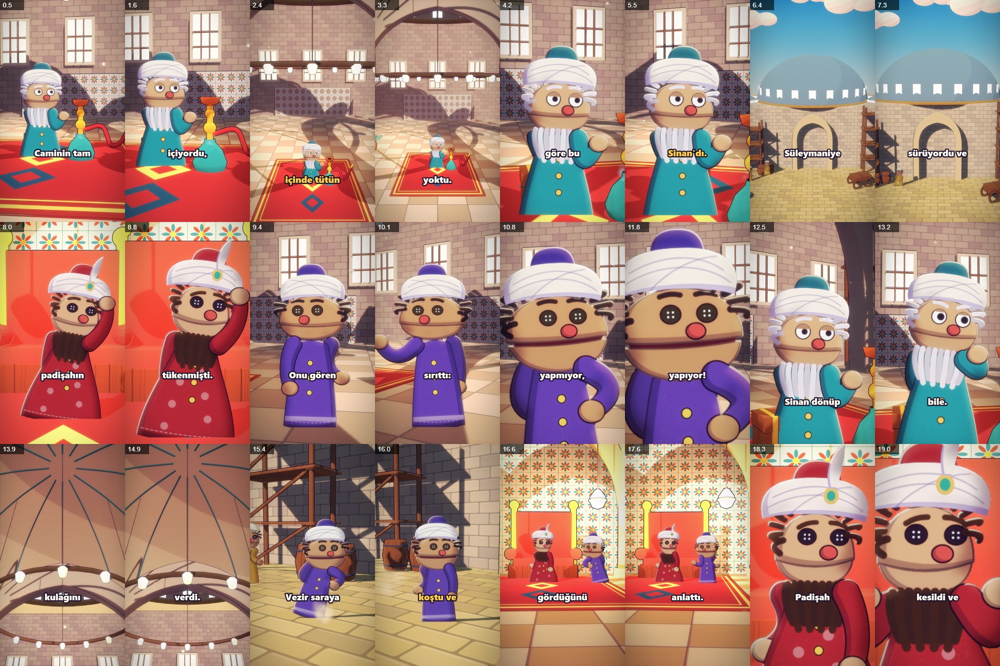
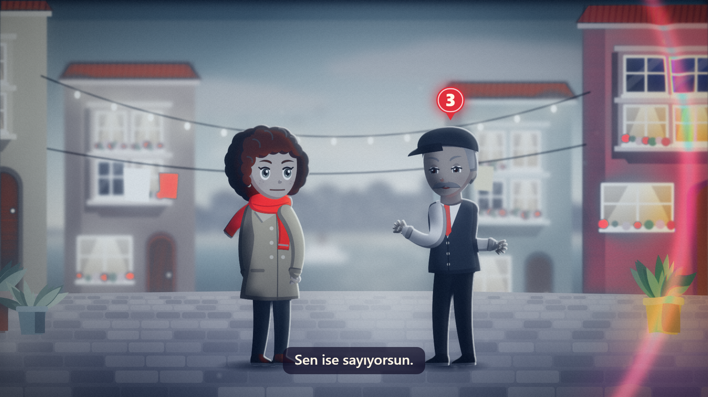
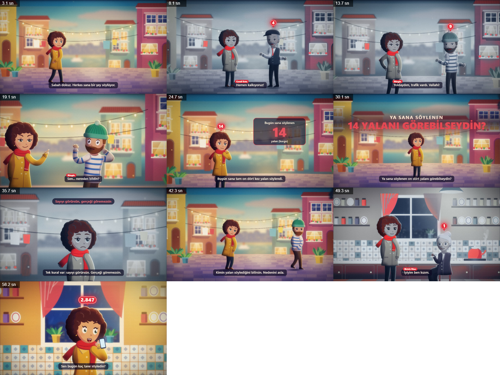
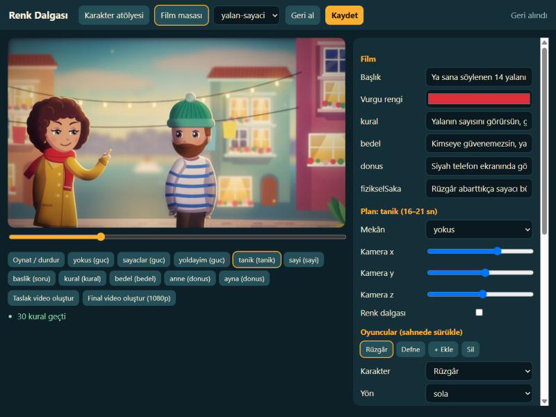

# Renk Dalgası

**Koddan çizilen, sinematik, Türkçe "Ya … olsaydı?" filmleri için üretim sistemi.**

## Ana sistem: Tek anlatıcılı hikâye

Dikey 1080×1920. **Tek anlatıcı anlatır, karakterler konuşmadan olayı oynar.** Ayrıntılı 2B karakterler, ışıklı gerçek 3B dekor, süzülen kamera.



- **12 tema, 120 tema karakteri (toplam 139):** Korsan Denizi, Orta Çağ Kalesi, Antik Mısır, Vahşi Batı, Sakura Bahçesi, Uzay Üssü, Kutup Seferi, Neon Şehir, Modern Şehir, Çılgın Laboratuvar, Masal Ormanı, Antik Ege. Her temada 10 karakter, iki 3B mekân, kendi ışığı ve vurgu rengi var. [Tema rehberi](belgeler/TEMALAR.md)
- **Saat anlatıcıdır:** olaylar saniyeye değil kelimeye bağlanır; ses değişince film kendini yeniden zamanlar.
- **Olay akışı denetimi:** ışınlanma, elde olmayan eşyayı verme, görünmeyen eylem ve olaysız cümle hata sayılır.
- **Karşılaştırma:** hareket ve kadraj, ölçülmüş referansla karşılaştırılır.
- **Doğruluk:** kaynak zorunlu; her hikâye belgeli, rivayet ya da kurgu diye etiketlenir.

```bash
node sistem.mjs hikaye denetle nargile
node sistem.mjs hikaye kareler nargile
node sistem.mjs hikaye karsilastir nargile
node sistem.mjs hikaye izle nargile      # tarayıcıda canlı önizleme
```

[Rakip analizi](belgeler/RAKIP_ANALIZI.md) · [Hikâye sistemi](belgeler/HIKAYE_SISTEMI.md)

---

## Yatay "Ya … olsaydı?" filmleri

Kurulacak npm paketi yok; three.js 0.170.0 (MIT) `dis/` klasöründe sabit sürümle durur.


▶ **Hareketli tanıtım:** [galeri/hareket.mp4](galeri/hareket.mp4)

## İmza: renk dalgası

Güç çalıştığında kahramandan bir halka yayılır, dünyanın rengi çekilir ve yalnızca o filmin **vurgu rengi** kalır. Her filmin vurgu rengi kahramanın üstündeki bir eşyadan gelir: kızıl atkı, turuncu kulaklık, sarı yağmurluk.



## Örnek filmler (62 saniye, hikâyesi tamamlanan)

| Film | Kahraman | Mekân | Kural | Son |
|---|---|---|---|---|
| Ya sana söylenen 14 yalanı görebilseydin? | Defne | Yokuş, mutfak | Sayıyı görürsün, gerçeği göremezsin | Kendi sayısı en büyük |
| Ya 10 saniye sonrasını duyabilseydin? | Kaan | İskele, yokuş | Duyarsın, göremezsin | Kulaklığı çıkarır, anı duyar |
| Ya her gün 1 anını satabilseydin? | Ece | Anı çarşısı, mutfak | Satılan anı geri gelmez | Ninenin sattığı torundur |

| | | |
|---|---|---|
|  |  |  |

## Etkileşimli stüdyo

```bash
node sistem.mjs studyo
```



- **Karakter atölyesi:** 15 karakteri canlı izle; saç, kıyafet, renk, boy ve aksesuar değiştir, kopyala, kaydet.
- **Film masası:** karakteri sahnede sürükle; poz, ifade, kamera ve replik düzenle; denetimi anında gör; videoyu düğmeyle oluştur.
- Yalnızca bu bilgisayardan açılır. Her kayıttan önceki sürüm `.yedek` olarak durur.

## Ajan ekibi

Claude Code için dokuz ajan `.claude/agents/` içinde: araştırmacı, senarist, karakter tasarımcısı, sahne tasarımcısı, animatör, ses yönetmeni, kalite denetçisi, rakip analisti, olay kurgucusu. İş akışı `SKILL.md` içinde. Ajanlar Claude Code içinde çalışır, stüdyonun içinde değil.

## Kurulum

Node 22+, Google Chrome ve ffmpeg yeterli (`CHROME_PATH` ile başka bir Chromium verilebilir).

```bash
node sistem.mjs yardim
node sistem.mjs kareler yalan-sayaci   # her plandan bir kare
node sistem.mjs tanitim                # 15 karakterin hareketli tanıtımı
node sistem.mjs test
```

## Yeni film

```bash
node sistem.mjs yeni filmim        # iskelet; doldurulana kadar denetimden geçmez
node sistem.mjs denetle filmim     # hikâye + teknik denetim
node sistem.mjs kareler filmim     # önce hareketsiz kareler
node sistem.mjs ses filmim         # müzik, efekt, seslendirme
node sistem.mjs render filmim
```

## Yapı

| Yol | İçerik |
|---|---|
| `kadro/kadro.json` | 15 karakterin tarifi: yüz, saç, kıyafet, imza eşya |
| `motor/` | Karakter, yüz, dudak, film, renk dalgası, tarayıcı denetimi |
| `dunyalar/` | Yokuş, iskele, anı çarşısı, mutfak |
| `filmler/` | Film tarifleri |
| `araclar/` | Denetim, ses, testler |
| `belgeler/` | [Kaynak analizi](belgeler/ANALIZ.md), [stil](belgeler/STIL.md), [hikâye](belgeler/HIKAYE.md), [konular](belgeler/KONULAR.md), [film şeması](belgeler/FILM_SEMASI.md) |
| `SKILL.md`, `AGENTS.md` | Claude Code ve diğer kod ajanları için iş akışı |

## Bilinen sınırlar

- Seslendirme dosyaları depoda yok. `filmler/<ad>/ses/L01.wav` biçiminde koyulunca mikse girer ve müzik kısılır.
- Dudak hareketi metinden hesaplanır, ses dalgasından değil.
- Karakterler yalnızca 3/4 açıdan çizilir; arkadan ve tam yandan görünüş yok.
- Bire bir aynı kare güvencesi aynı bilgisayar ve aynı Chrome sürümü içindir.
- Yazı tipi Segoe UI'dir; başka sistemde yedek yazı tipine geçer.

MIT lisanslıdır. Kod ve çizimler bu depo için sıfırdan yazıldı.
