# Renk Dalgası

**Temanı seç, ilham al, sahneleri diz, videonu üret.** Türkçe, tek anlatıcılı, hareketli hikâye videoları için hazır kit. Claude Code ile konuşarak kullanılır; her şey koddan çizilir.

▶ **[24 hazır sahne, tek videoda](galeri/sahneler.mp4)**

| | |
|---|---|
| **12 tema** | Her biri ayrı bir çizgi dünyası |
| **120 tema karakteri** | 12 farklı biçim: damla, yumurta, duvar resmi, sırık, mürekkep, balon, hayvan, küp robot, dev kafa, nesne kafa, kukla, vazo |
| **24 hazır sahne** | Kovalamaca, patlama, tuzak, düello, fırtına, kaçış… |
| **96 video fikri** | Her temada 8; istersen yenisini üretir |
| **6 örnek hikâye** | Kopyala, değiştir |

## 1. Kur (bir kez)

Gerekenler: [Node 22+](https://nodejs.org), Google Chrome, [ffmpeg](https://ffmpeg.org). Kurulacak npm paketi yok.

```bash
git clone https://github.com/Salihefendihsa/renk-dalgasi
cd renk-dalgasi
node sistem.mjs hikaye temalar
```

## 2. En kolay yol: Claude'a söyle

Klasörü Claude Code'da aç ve yaz:

> Korsan temasıyla, soğan atan korsanlar hakkında bir video yap.

Claude `SKILL.md` dosyasını izler: fikri seçer, metni yazar, sahneleri dizer, kareleri gösterir, sen onaylayınca videoyu oluşturur. Codex gibi başka ajanlar `AGENTS.md` ile başlar. Her yerden çağırmak istersen klasörü `~/.claude/skills/renk-dalgasi/` altına kopyala.

## 3. Elle yapmak istersen

```bash
node sistem.mjs hikaye ilham korsan                          # fikir bul
node sistem.mjs hikaye yeni filmim --tema=korsan --ilham=2   # sahneleriyle hazır gelir
#  → hikayeler/filmim/hikaye.json içindeki cümleleri doldur
node sistem.mjs hikaye denetle filmim                        # hata var mı?
node sistem.mjs hikaye kareler filmim                        # nasıl görünüyor?
node sistem.mjs hikaye ses filmim                            # müzik + hikayeler/filmim/ses/C01.wav … anlatıcı sesi
node sistem.mjs hikaye render filmim --olcek=0.5             # taslak; --olcek=1 final
```

## Temalar

| Tema | Karakterler | Ne üretilir? |
|---|---|---|
| **[Korsan Denizi](belgeler/temalar/korsan.md)**<br>Damla | 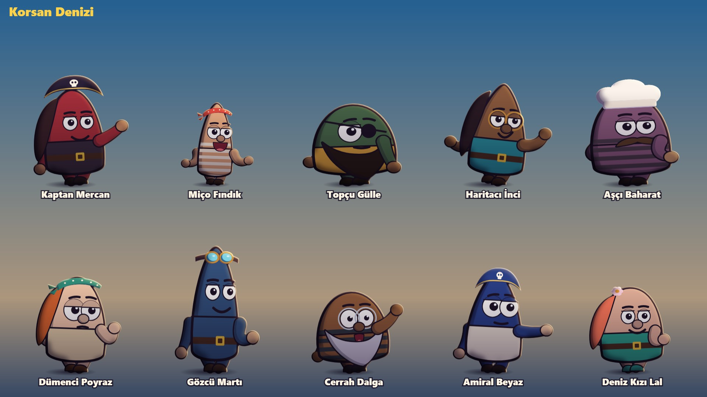 | [8 video fikri](belgeler/ilham/korsan.md) |
| **[Orta Çağ Kalesi](belgeler/temalar/ortacag.md)**<br>Yumurta kafa | 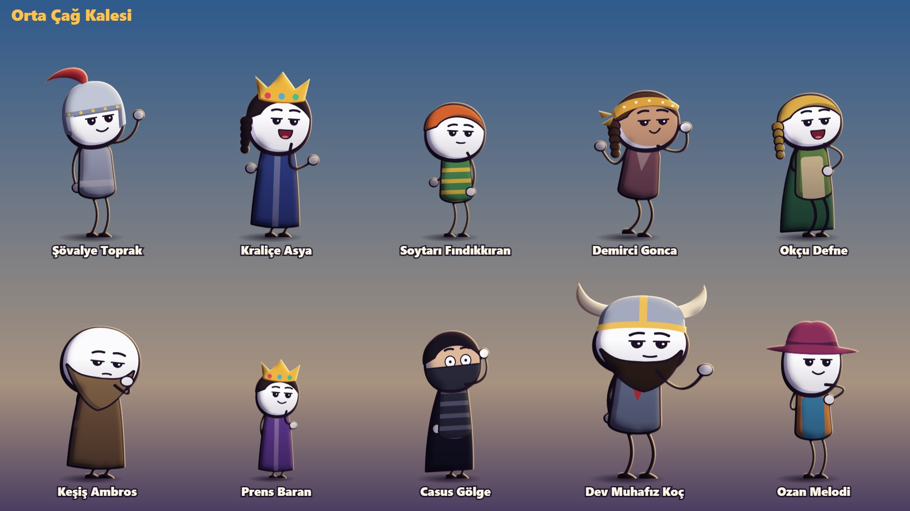 | [8 video fikri](belgeler/ilham/ortacag.md) |
| **[Antik Mısır](belgeler/temalar/misir.md)**<br>Duvar resmi | 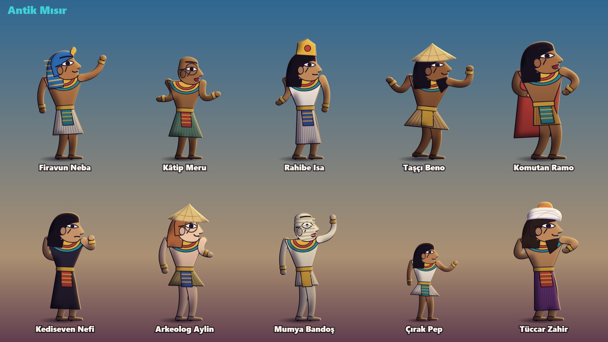 | [8 video fikri](belgeler/ilham/misir.md) |
| **[Vahşi Batı](belgeler/temalar/bati.md)**<br>Sırık | 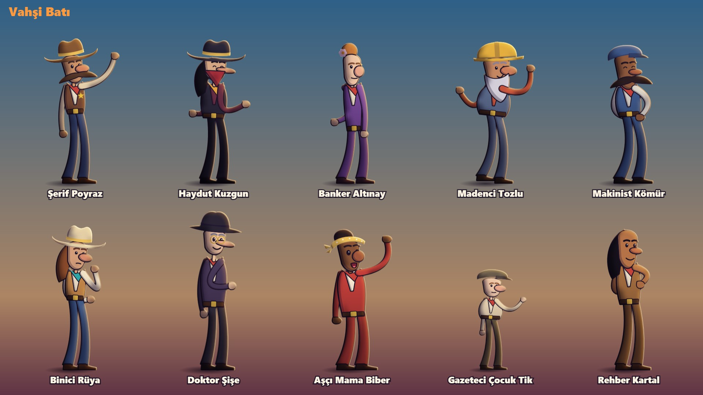 | [8 video fikri](belgeler/ilham/bati.md) |
| **[Sakura Bahçesi](belgeler/temalar/japon.md)**<br>Mürekkep | 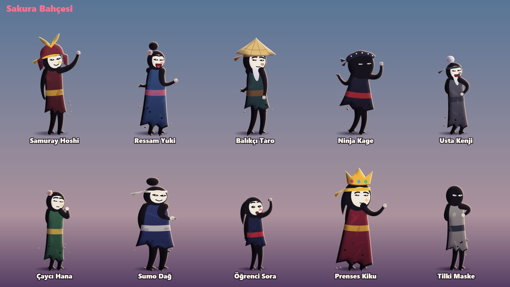 | [8 video fikri](belgeler/ilham/japon.md) |
| **[Uzay Üssü](belgeler/temalar/uzay.md)**<br>Balon | 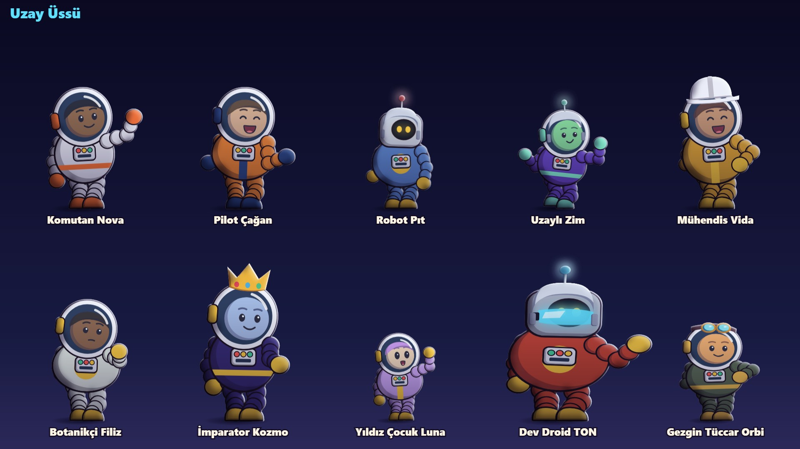 | [8 video fikri](belgeler/ilham/uzay.md) |
| **[Kutup Seferi](belgeler/temalar/kutup.md)**<br>Hayvanlar | 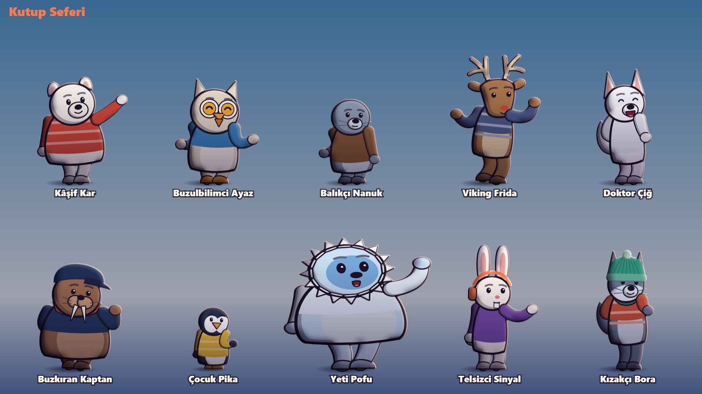 | [8 video fikri](belgeler/ilham/kutup.md) |
| **[Neon Şehir](belgeler/temalar/siber.md)**<br>Küp robot | 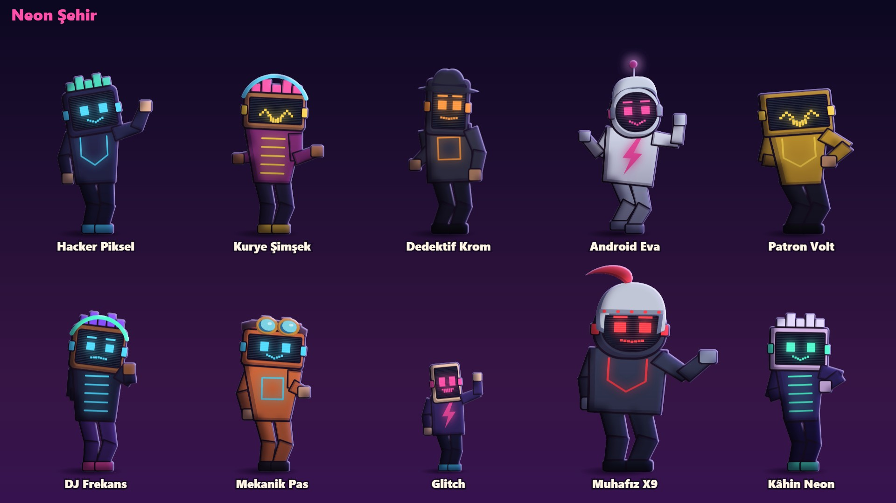 | [8 video fikri](belgeler/ilham/siber.md) |
| **[Modern Şehir](belgeler/temalar/modern.md)**<br>Dev kafa |  | [8 video fikri](belgeler/ilham/modern.md) |
| **[Çılgın Laboratuvar](belgeler/temalar/bilim.md)**<br>Nesne kafa | 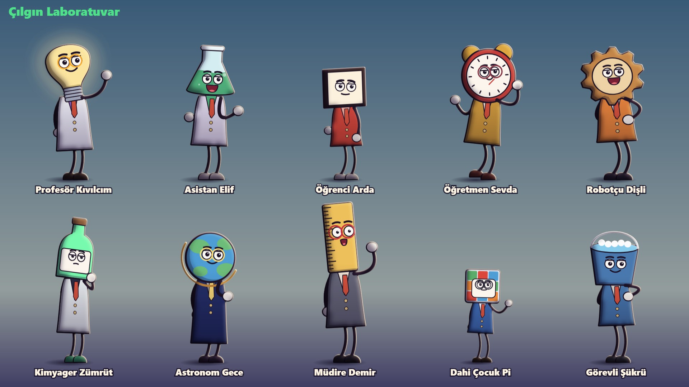 | [8 video fikri](belgeler/ilham/bilim.md) |
| **[Masal Ormanı](belgeler/temalar/masal.md)**<br>Keçe kukla | 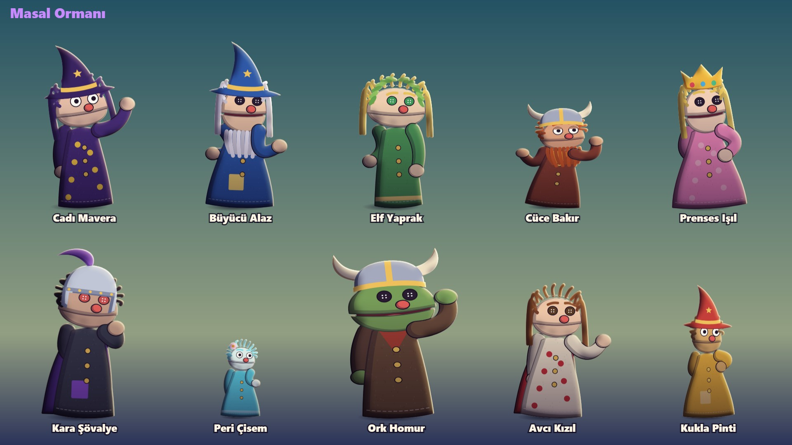 | [8 video fikri](belgeler/ilham/masal.md) |
| **[Antik Ege](belgeler/temalar/antik.md)**<br>Vazo figürü | 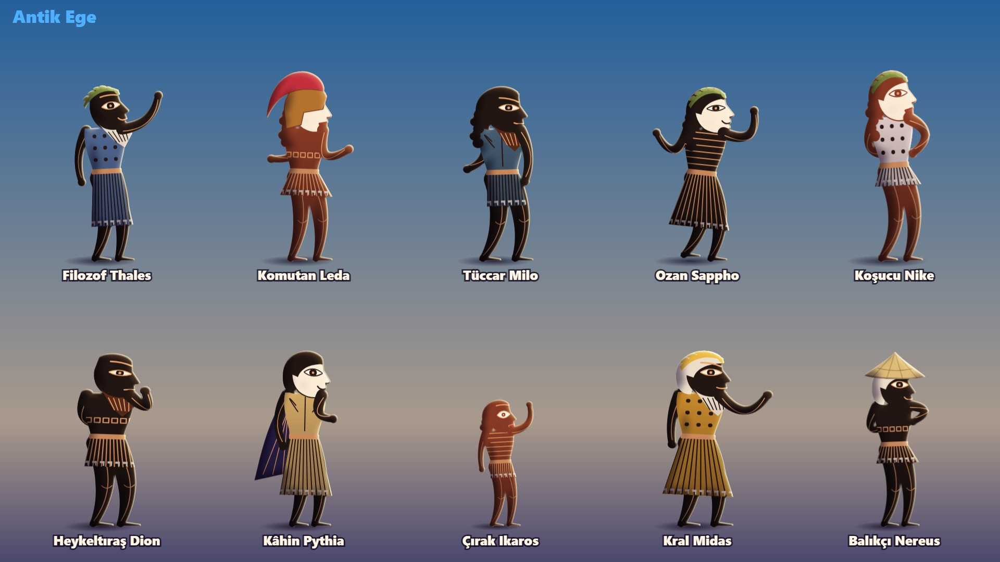 | [8 video fikri](belgeler/ilham/antik.md) |

Temalar karıştırılabilir: robot, orta çağ kalesine girebilir.

## Hazır sahneler

Her sahne her temada ve her karakterle çalışır. Hareket, kamera, eşya, efekt ve sarsıntı içindedir. [Hepsi görselli](belgeler/SAHNELER.md)

| | |
|---|---|
| 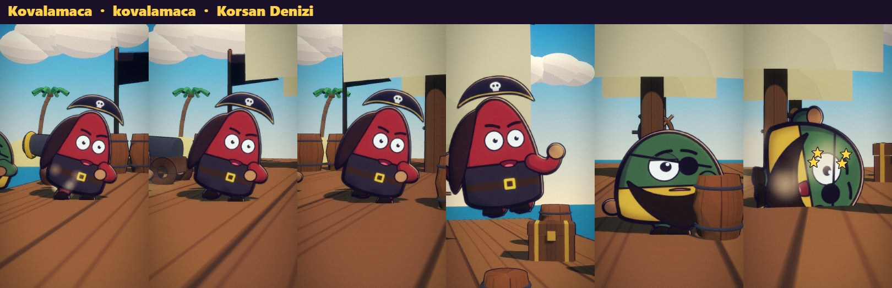 | 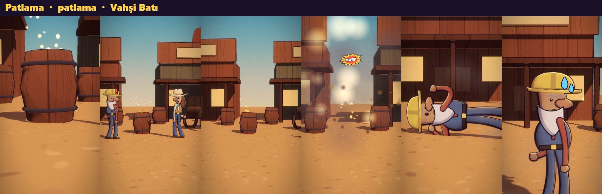 |
| 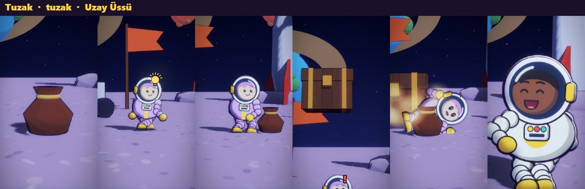 |  |
|  |  |

## Belgeler

- **[Kim kimdir, nerede kullanılır?](belgeler/KARAKTER_REHBERI.md)** 139 karakterin görevi
- **[Ne üretebilirim?](belgeler/ILHAM.md)** 96 fikir
- **[Hazır sahneler](belgeler/SAHNELER.md)**
- [Hikâye sistemi](belgeler/HIKAYE_SISTEMI.md) · [Tema ekleme](belgeler/TEMALAR.md) · [Rakip analizi](belgeler/RAKIP_ANALIZI.md) · [Eski yatay filmler](belgeler/YATAY_FILM.md)

## Kurallar

- **Tek anlatıcı konuşur**, karakterler oynar.
- Gerçek konu anlatıyorsan en az iki kaynak gerekir; kurguysa videoda söylenir. Denetim bunu zorunlu tutar.
- Başka bir kanalın karakterini, metnini ya da hikâyesini kopyalama.

## Bilinen sınırlar

- Anlatıcı sesi depoda yok; kendi sesini ya da TTS kaydını cümle başına bir dosya olarak koyarsın.
- 1080p final yavaştır; önce `--olcek=0.5` ile dene.
- Karakterler 3/4 ya da yandan çizilir, arkadan görünüş yok.
- Yazı tipi Segoe UI; başka sistemde yedeğe düşer.

MIT lisanslıdır. three.js 0.170.0 (MIT) `dis/` klasöründedir.
