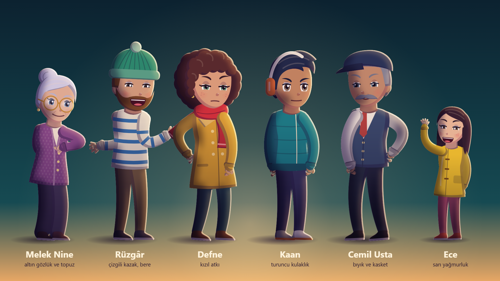
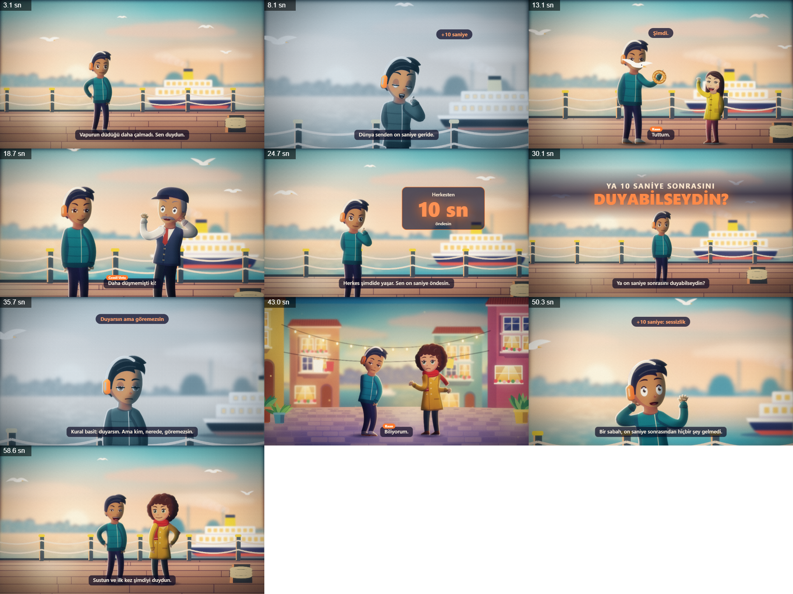
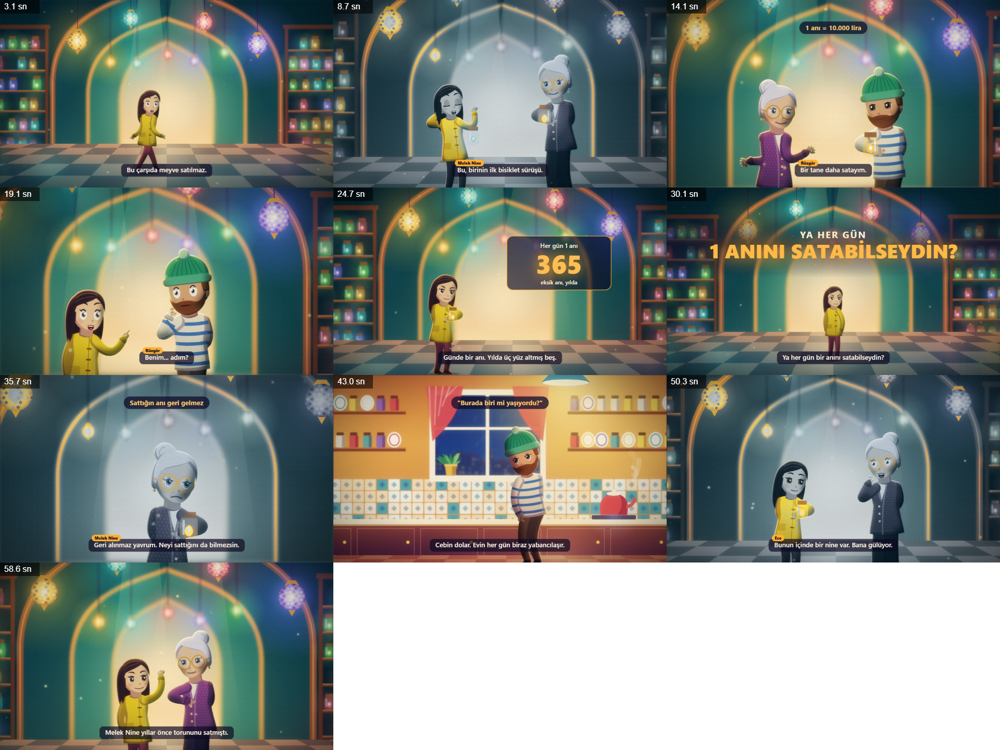

# Renk Dalgası

**Koddan çizilen, sinematik, Türkçe "Ya … olsaydı?" filmleri için üretim sistemi.**

Her karakter, mekân ve ışık kodla çizilir. Film bir `film.json` dosyasıdır: planlar, oyunculuk, replikler, müzik. Yapay zekâ video üreticisi, hazır görsel ve **npm paketi yok**.



## İmza: renk dalgası

Güç çalıştığında kahramandan bir halka yayılır, dünyanın rengi çekilir ve yalnızca o filmin **vurgu rengi** kalır. Her filmin vurgu rengi kahramanın üstündeki bir eşyadan gelir: kızıl atkı, turuncu kulaklık, sarı yağmurluk.


## Örnek filmler (62 saniye, hikâyesi tamamlanan)

| Film | Kahraman | Mekân | Kural | Son |
|---|---|---|---|---|
| Ya sana söylenen 14 yalanı görebilseydin? | Defne | Yokuş, mutfak | Sayıyı görürsün, gerçeği göremezsin | Kendi sayısı en büyük |
| Ya 10 saniye sonrasını duyabilseydin? | Kaan | İskele, yokuş | Duyarsın, göremezsin | Kulaklığı çıkarır, anı duyar |
| Ya her gün 1 anını satabilseydin? | Ece | Anı çarşısı, mutfak | Satılan anı geri gelmez | Ninenin sattığı torundur |

| | | |
|---|---|---|
|  |  |  |

## Kurulum

Node 22+, Google Chrome ve ffmpeg yeterli (`CHROME_PATH` ile başka bir Chromium verilebilir).

```bash
node sistem.mjs yardim
node sistem.mjs kareler yalan-sayaci   # her plandan bir kare
node sistem.mjs studyo yalan-sayaci    # tarayıcıda canlı önizleme
node sistem.mjs test
```

## Yeni film

```bash
node sistem.mjs yeni filmim        # iskelet; doldurulana kadar denetimden geçmez
node sistem.mjs denetle filmim     # hikâye + teknik denetim
node sistem.mjs kareler filmim     # önce hareketsiz kareler
node sistem.mjs ses filmim         # müzik, efekt, seslendirme
node sistem.mjs render filmim
```

## Yapı

| Yol | İçerik |
|---|---|
| `kadro/kadro.json` | Altı karakterin tarifi: yüz, saç, kıyafet, imza eşya |
| `motor/` | Karakter, yüz, dudak, film, renk dalgası, tarayıcı denetimi |
| `dunyalar/` | Yokuş, iskele, anı çarşısı, mutfak |
| `filmler/` | Film tarifleri |
| `araclar/` | Denetim, ses, testler |
| `belgeler/` | [Kaynak analizi](belgeler/ANALIZ.md), [stil](belgeler/STIL.md), [hikâye](belgeler/HIKAYE.md), [konular](belgeler/KONULAR.md), [film şeması](belgeler/FILM_SEMASI.md) |
| `SKILL.md`, `AGENTS.md` | Claude Code ve diğer kod ajanları için iş akışı |

## Bilinen sınırlar

- Seslendirme dosyaları depoda yok. `filmler/<ad>/ses/L01.wav` biçiminde koyulunca mikse girer ve müzik kısılır.
- Dudak hareketi metinden hesaplanır, ses dalgasından değil.
- Karakterler yalnızca 3/4 açıdan çizilir; arkadan ve tam yandan görünüş yok.
- Bire bir aynı kare güvencesi aynı bilgisayar ve aynı Chrome sürümü içindir.
- Yazı tipi Segoe UI'dir; başka sistemde yedek yazı tipine geçer.

MIT lisanslıdır. Kod ve çizimler bu depo için sıfırdan yazıldı.
