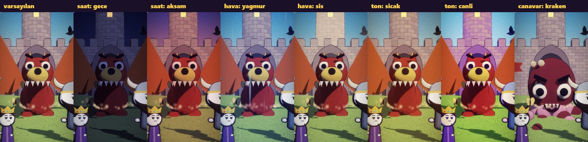

# Ayarlar

> Koddan üretilir: `node sistem.mjs hikaye rehber`

Kod yazmadan değiştirirsin. İki yer var:

| Nerede | Neyi etkiler |
|---|---|
| `ayarlar.json` (depo kökü) | Bütün filmler |
| `hikaye.json` içinde `"ayar"` | Yalnız o film; öncekinin üstüne yazar |

```json
"ayar": { "saat": "gece", "hava": "yagmur", "ton": "soguk", "canavar": "kraken", "altyaziBoy": 1.2 }
```



## Görüntü

| Ayar | Ne yapar | Değer | Varsayılan |
|---|---|---|---|
| `saat` | Günün saati | `tema` `sabah` `aksam` `gece` | `tema` |
| `hava` | Hava | `yok` `yagmur` `kar` `sis` `yaprak` | `yok` |
| `ton` | Renk tonu | `tema` `sicak` `soguk` `pastel` `canli` | `tema` |
| `vurgu` | Vurgu rengi | `#rrggbb` | temadan |
| `sarsinti` | Kamera sarsıntısı | 0 – 2 | `1` |
| `canli` | Arka plan canlıları | `true` `false` | `true` |
| `bicimHareket` | Biçime özel hareket | `true` `false` | `true` |
| `kalabalik` | Kalabalık yoğunluğu | 0.2 – 2 | `1` |

## Yazı

| Ayar | Ne yapar | Değer | Varsayılan |
|---|---|---|---|
| `altyazi` | Altyazı | `true` `false` | `true` |
| `altyaziBoy` | Altyazı büyüklüğü | 0.6 – 1.5 | `1` |
| `altyaziY` | Altyazı yüksekliği (piksel) | 300 – 1700 | `1330` |
| `altyaziRenk` | Altyazı rengi | `#rrggbb` | temadan |
| `vurusYazi` | BUM, KÜT yazıları | `true` `false` | `true` |
| `isaret` | Baş üstü işaretler (! ? ter) | `true` `false` | `true` |
| `sozNesne` | Sözle beliren nesneler | `true` `false` | `true` |

## Oyuncu

| Ayar | Ne yapar | Değer | Varsayılan |
|---|---|---|---|
| `hayvan` | Yoldaş hayvan | hayvan kodu | temadan |
| `canavar` | Dev canavar | hayvan kodu | temadan |

## Ses

| Ayar | Ne yapar | Değer | Varsayılan |
|---|---|---|---|
| `tini` | Müzik çalgısı | `tema` `piyano` `akordeon` `ud` `flut` `banjo` `koto` `sentez` `can` | `tema` |
| `ortam` | Ortam sesi | `deniz` dalga ve martı, `cayir` rüzgâr ve karga, `salon` taş salon yankısı, `col` çöl rüzgârı, `magara` mağara damlaları, `gece` gece böcekleri, `bahce` su ve rüzgâr çanı, `uzay` uzay uğultusu, `makine` makine uğultusu, `kutup` kar fırtınası, `neon` neon uğultusu ve yağmur, `sehir` trafik ve güvercin, `ofis` ofis uğultusu, `lab` kabarcık ve cihaz, `orman` orman kuşları, `cekirge` ağustos böcekleri | temadan |
| `muzik` | Müzik düzeyi | 0 – 2 | `1` |
| `efekt` | Efekt düzeyi | 0 – 2 | `1` |
| `ortamSes` | Ortam sesi düzeyi | 0 – 2 | `1` |
| `anlatici` | Anlatıcı düzeyi | 0.2 – 2 | `1` |
| `otoSes` | Otomatik efektler | `true` `false` | `true` |

## Hayvan kodları

`korsan_papagan` Kaptan papağan · `maymun` Bandanalı maymun · `kraken` Kraken · `zirhli_at` Zırhlı at · `kuzgun` Kuzgun · `kizil_ejder` Kızıl ejderha · `suslu_deve` Süslü deve · `kutsal_kedi` Kutsal kedi · `dev_kobra` Dev kobra · `eyerli_at` Eyerli at · `cakal` Çakal · `dev_akrep` Dev akrep · `sans_kedisi` Şans kedisi · `turna` Turna · `bulut_ejderi` Bulut ejderi · `kubbeli_uzayli` Kubbeli uzaylı · `gezgin` Gezgin robot · `yildiz_solucani` Yıldız solucanı · `bereli_penguen` Bereli penguen · `kizak_kopegi` Kızak köpeği · `yeti` Yeti · `neon_kopek` Neon robot köpek · `holo_kedi` Hologram kedi · `dev_mecha` Dev mecha · `kasketli_kopek` Kasketli köpek · `sokak_kedisi` Sokak kedisi · `dev_supurge` Dev robot süpürge · `gozluklu_tavuk` Gözlüklü tavuk · `deney_faresi` Deney faresi · `balcik` Balçık canavarı · `cicekli_koyun` Çiçekli koyun · `tilki` Tilki · `agac_canavari` Ağaç canavarı · `vazolu_kaplumbaga` Vazo desenli kaplumbağa · `keci` Defneli keçi · `hydra` Üç başlı Hydra · `at` At · `deve` Deve · `kopek` Köpek · `kurt` Kurt · `kedi` Kedi · `koyun` Koyun · `robokopek` Robot köpek · `papagan` Papağan · `tavuk` Tavuk · `penguen` Penguen · `yarasa` Yarasa · `kaplumbaga` Kaplumbağa · `yilan` Yılan · `ahtapot` Ahtapot · `kopekbaligi` Köpek balığı · `ejder` Ejderha · `uzayli` Uzaylı yaratık

## Karakteri değiştir

Hazır bir karakterin rengini, boyunu, şapkasını değiştir:

```json
"oyuncular": {
  "kahraman": { "kim": "korsan-kaptan", "degistir": { "ust": { "renk": "#2f8f5a" }, "sac": { "renk": "#f0b93f" }, "boy": 1.2, "ek": ["gozbandi"] } }
}
```

Değiştirilebilenler: `ad` `ten` `goz` `sac` `ust` `alt` `ayak` `ek` `boy` `en` `baslik` `baslikVurgu`

Şimdiki değerleri gör: `node sistem.mjs hikaye ayarlar`
