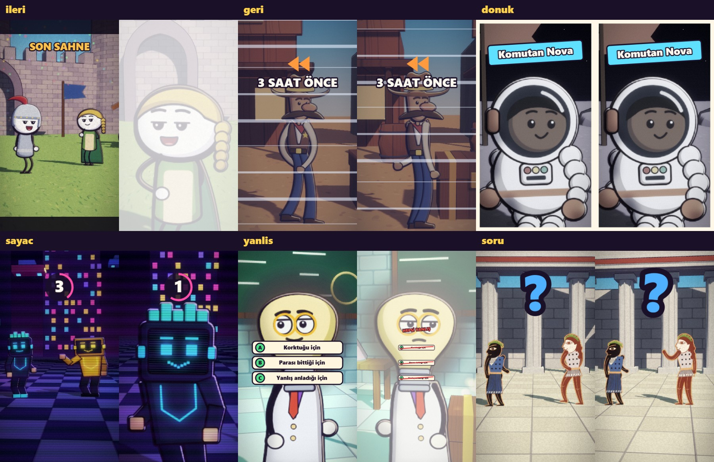

# Kanca türleri

İlk saniyelerde izleyiciyi tutan altı kalıp. Görüntüyü ve sesi kendisi ekler, anlatıyı değiştirmez.



| Kod | Ne yapar | Ne zaman iyi gider |
|---|---|---|
| `ileri` | Finalden bir saniyeyle açılır, sonra başa döner | Final görüntüsü şaşırtıcıysa |
| `geri` | Kancadan sonra geri sarar, "3 saat önce" yazar | Hikâye sonuçtan başlıyorsa |
| `donuk` | Kancanın sonunda kare donar, kahramanın adı çıkar | Kahraman öne çıkacaksa |
| `sayac` | Kanca boyunca 3-2-1 sayar | Süre baskısı varsa |
| `yanlis` | Seçenekler çıkar, sır bölümünde üstleri çizilir | Herkesin yanlış bildiği bir neden varsa |
| `soru` | Dev soru işareti | Kısa ve tuhaf kancalarda |

```json
"kanca": { "tur": "geri", "metin": "3 saat önce" }
"kanca": { "tur": "yanlis", "secenekler": ["Korktuğu için", "Parası bittiği için"] }
```

Yeni hikâyede: `node sistem.mjs hikaye yeni filmim --tema=uzay --ilham=1 --kanca=ileri`. Liste: `hikaye kancalar`.

`ileri` yalnız görüntüyü değiştirir; finali ele verecekse kullanma. `yanlis` seçenekleri gerçekten yanlış olmalı.
