# Karakter ve tema rehberi

> Bu dosya `node sistem.mjs hikaye rehber` ile koddan üretilir. Elle değiştirmeyin; bilgiyi `motor3/kullanim.js` içinde güncelleyin.

**12 tema · 120 tema karakteri · 124 karakter toplam**

## 1. Hangi tema ne için?

| Tema | Kod | Çizim biçimi | Ne anlatmak için? | Mekânlar | Ayrıntı |
|---|---|---|---|---|---|
| **Korsan Denizi** | `korsan` | Damla | Deniz, keşif, hile ve hayatta kalma hikâyeleri. | `guverte`, `ada`, `kamara`, `acikdeniz` | [10 karakter](temalar/korsan.md) |
| **Orta Çağ Kalesi** | `ortacag` | Yumurta kafa | Kale, kuşatma, kral ve hile hikâyeleri. | `kale`, `salon`, `zindan`, `pazar` | [10 karakter](temalar/ortacag.md) |
| **Antik Mısır** | `misir` | Duvar resmi | Piramit, mezar, buluş ve inanç hikâyeleri. | `col`, `tapinak`, `nil`, `mezar` | [10 karakter](temalar/misir.md) |
| **Vahşi Batı** | `bati` | Sırık | Altın, tren, dolandırıcılık ve sınır kasabası hikâyeleri. | `kasaba`, `demiryolu`, `salon`, `maden` | [10 karakter](temalar/bati.md) |
| **Sakura Bahçesi** | `japon` | Mürekkep | Zanaat, onur, sabır ve gece hikâyeleri. | `bahce`, `sokak`, `cayevi`, `bambu` | [10 karakter](temalar/japon.md) |
| **Uzay Üssü** | `uzay` | Balon | Uzay yolculuğu, bilim ve hayatta kalma hikâyeleri. | `gezegen`, `gemi`, `kristalmagara`, `yorunge` | [10 karakter](temalar/uzay.md) |
| **Kutup Seferi** | `kutup` | Hayvanlar | Keşif, soğuk, dayanıklılık ve kurtarma hikâyeleri. | `buz`, `kamp`, `buzmagara`, `kuzeyisigi` | [10 karakter](temalar/kutup.md) |
| **Neon Şehir** | `siber` | Küp robot | Teknoloji, güvenlik ve yakın gelecek hikâyeleri. | `cadde`, `cati`, `metro`, `gecepazari` | [10 karakter](temalar/siber.md) |
| **Modern Şehir** | `modern` | Dev kafa | Gündelik hayat, iş, şehir ve psikoloji hikâyeleri. | `cadde`, `ofis`, `okul`, `ev` | [10 karakter](temalar/modern.md) |
| **Çılgın Laboratuvar** | `bilim` | Nesne kafa | Deney, buluş ve okul hikâyeleri. | `lab`, `sinif`, `bodrum`, `sera` | [10 karakter](temalar/bilim.md) |
| **Masal Ormanı** | `masal` | Keçe kukla | Masal, efsane ve ders veren kurgu hikâyeler. | `orman`, `kulube`, `mantarkoyu`, `ejderini` | [10 karakter](temalar/masal.md) |
| **Antik Ege** | `antik` | Vazo figürü | Felsefe, matematik, savaş ve efsane hikâyeleri. | `agora`, `liman`, `arena`, `kutuphane` | [10 karakter](temalar/antik.md) |

## 2. Görevler ne demek?

Anlatıcı tektir; karakterler **konuşmaz, oynar**. Görev, karakterin yedi adımda ne yaptığını söyler.

| Görev | Hikâyede ne yapar? | En çok hangi adımda? |
|---|---|---|
| Kahraman | Garip işi yapar, açıklamaz | kanca, sakin, final |
| Alaycı | Kahramanla dalga geçer, sonunda yanılır | alay, final |
| Tanık | İzleyicinin yerine şaşırır | kurulum, tırmanış |
| Engel / rakip | Tehlikeyi yaratır, karşı çıkar | kurulum, tırmanış |
| Yardımcı | Eşya getirir, haber taşır | tırmanış |
| Uzman | İşin nasıl çalıştığını gösterir | sır |
| Şaka | Fiziksel komik anı yaşar | alay, tırmanış |

**İyi bir kadro:** 1 kahraman + 1 alaycı + 1 engel ya da tanık. Üç karakter çoğu hikâyeye yeter.

## 3. Göreve göre karakter bul

<details><summary><b>Kahraman</b></summary>

- **Korsan Denizi:** Kaptan Mercan (`korsan-kaptan`), Aşçı Baharat (`korsan-ahci`), Deniz Kızı Lal (`korsan-deniz`)
- **Orta Çağ Kalesi:** Şövalye Toprak (`ortacag-sovalye`), Kraliçe Asya (`ortacag-kralice`), Soytarı Fındıkkıran (`ortacag-soytari`), Demirci Gonca (`ortacag-demirci`), Okçu Defne (`ortacag-okcu`), Casus Gölge (`ortacag-casus`)
- **Antik Mısır:** Rahibe Isa (`misir-rahibe`), Taşçı Beno (`misir-tasci`), Kediseven Nefi (`misir-kediseven`), Arkeolog Aylin (`misir-kasifm`)
- **Vahşi Batı:** Şerif Poyraz (`bati-serif`), Haydut Kuzgun (`bati-haydut`), Banker Altınay (`bati-banker`), Madenci Tozlu (`bati-madenci`), Binici Rüya (`bati-kovboykiz`)
- **Sakura Bahçesi:** Samuray Hoshi (`japon-samuray`), Ressam Yuki (`japon-ressam`), Ninja Kage (`japon-ninja`), Usta Kenji (`japon-usta`), Öğrenci Sora (`japon-ogrenci`), Prenses Kiku (`japon-prenses`)
- **Uzay Üssü:** Komutan Nova (`uzay-komutan`), Pilot Çağan (`uzay-pilot`), Mühendis Vida (`uzay-muhendis`)
- **Kutup Seferi:** Kâşif Kar (`kutup-kasif`), Balıkçı Nanuk (`kutup-avci`), Viking Frida (`kutup-viking`), Buzkıran Kaptan (`kutup-kaptan`), Kızakçı Bora (`kutup-kizakci`)
- **Neon Şehir:** Hacker Piksel (`siber-hacker`), Kurye Şimşek (`siber-kurye`), Dedektif Krom (`siber-dedektif`), Glitch (`siber-cocuk`)
- **Modern Şehir:** Gazeteci Ilgaz (`modern-gazeteci`), Polis Deniz (`modern-polis`), İşçi Yaman (`modern-isci`), Nermin Teyze (`modern-teyze`), Sporcu Ateş (`modern-sporcu`), Ressam Mavi (`modern-sanatci`)
- **Çılgın Laboratuvar:** Profesör Kıvılcım (`bilim-profesor`), Öğrenci Arda (`bilim-ogrenci`), Robotçu Dişli (`bilim-robotcu`), Dahi Çocuk Pi (`bilim-dahi`), Görevli Şükrü (`bilim-temizlikci`)
- **Masal Ormanı:** Cadı Mavera (`masal-cadi`), Elf Yaprak (`masal-elf`), Cüce Bakır (`masal-cuce`), Prenses Işıl (`masal-prenses`), Avcı Kızıl (`masal-avci`)
- **Antik Ege:** Filozof Thales (`antik-filozof`), Komutan Leda (`antik-komutan`), Koşucu Nike (`antik-sporcu`), Heykeltıraş Dion (`antik-heykeltiras`), Çırak Ikaros (`antik-cocuk`)
- **Ek kadro (Osmanlı):** Mimar (`sinan`)

</details>

<details><summary><b>Alaycı</b></summary>

- **Korsan Denizi:** Topçu Gülle (`korsan-topcu`), Amiral Beyaz (`korsan-amiral`)
- **Orta Çağ Kalesi:** Soytarı Fındıkkıran (`ortacag-soytari`), Dev Muhafız Koç (`ortacag-dev`)
- **Antik Mısır:** Firavun Neba (`misir-firavun`), Tüccar Zahir (`misir-tuccar`)
- **Vahşi Batı:** Banker Altınay (`bati-banker`), Doktor Şişe (`bati-doktor`)
- **Sakura Bahçesi:** Sumo Dağ (`japon-sumo`)
- **Uzay Üssü:** İmparator Kozmo (`uzay-imparator`), Gezgin Tüccar Orbi (`uzay-tuccar`)
- **Neon Şehir:** Patron Volt (`siber-patron`)
- **Modern Şehir:** Patron Haşmet (`modern-patron`)
- **Çılgın Laboratuvar:** Öğretmen Sevda (`bilim-ogretmen`), Müdire Demir (`bilim-mudur`)
- **Masal Ormanı:** Cüce Bakır (`masal-cuce`)
- **Antik Ege:** Tüccar Milo (`antik-tuccar`), Kral Midas (`antik-kral`)
- **Ek kadro (Osmanlı):** Vezir (`vezir`)

</details>

<details><summary><b>Tanık</b></summary>

- **Korsan Denizi:** Miço Fındık (`korsan-mico`), Dümenci Poyraz (`korsan-dumenci`), Gözcü Martı (`korsan-gozcu`)
- **Orta Çağ Kalesi:** Keşiş Ambros (`ortacag-kesis`), Prens Baran (`ortacag-prens`), Ozan Melodi (`ortacag-ozan`)
- **Antik Mısır:** Kâtip Meru (`misir-katip`), Çırak Pep (`misir-cocuk`)
- **Vahşi Batı:** Madenci Tozlu (`bati-madenci`), Gazeteci Çocuk Tik (`bati-cocuk`)
- **Sakura Bahçesi:** Balıkçı Taro (`japon-balikci`), Çaycı Hana (`japon-cayci`), Öğrenci Sora (`japon-ogrenci`)
- **Uzay Üssü:** Yıldız Çocuk Luna (`uzay-cocuk`)
- **Kutup Seferi:** Çocuk Pika (`kutup-cocuk`), Telsizci Sinyal (`kutup-radyocu`)
- **Neon Şehir:** Kurye Şimşek (`siber-kurye`), Kâhin Neon (`siber-kahin`)
- **Modern Şehir:** Gazeteci Ilgaz (`modern-gazeteci`), Şoför Rıza (`modern-sofor`), Küçük Derin (`modern-kiz`)
- **Çılgın Laboratuvar:** Asistan Elif (`bilim-asistan`), Görevli Şükrü (`bilim-temizlikci`)
- **Masal Ormanı:** Kukla Pinti (`masal-soytari`)
- **Antik Ege:** Ozan Sappho (`antik-ozan`), Balıkçı Nereus (`antik-balikci`)
- **Ek kadro (Osmanlı):** Usta (`usta`)

</details>

<details><summary><b>Engel / rakip</b></summary>

- **Korsan Denizi:** Kaptan Mercan (`korsan-kaptan`), Topçu Gülle (`korsan-topcu`), Amiral Beyaz (`korsan-amiral`)
- **Orta Çağ Kalesi:** Şövalye Toprak (`ortacag-sovalye`), Kraliçe Asya (`ortacag-kralice`), Casus Gölge (`ortacag-casus`), Dev Muhafız Koç (`ortacag-dev`)
- **Antik Mısır:** Firavun Neba (`misir-firavun`), Komutan Ramo (`misir-komutan`), Tüccar Zahir (`misir-tuccar`)
- **Vahşi Batı:** Şerif Poyraz (`bati-serif`), Haydut Kuzgun (`bati-haydut`), Doktor Şişe (`bati-doktor`)
- **Sakura Bahçesi:** Samuray Hoshi (`japon-samuray`), Ninja Kage (`japon-ninja`), Sumo Dağ (`japon-sumo`), Prenses Kiku (`japon-prenses`), Tilki Maske (`japon-maskeli`)
- **Uzay Üssü:** Uzaylı Zim (`uzay-uzayli`), İmparator Kozmo (`uzay-imparator`), Dev Droid TON (`uzay-droid`), Gezgin Tüccar Orbi (`uzay-tuccar`)
- **Kutup Seferi:** Viking Frida (`kutup-viking`), Buzkıran Kaptan (`kutup-kaptan`)
- **Neon Şehir:** Android Eva (`siber-android`), Patron Volt (`siber-patron`), Muhafız X9 (`siber-muhafiz`)
- **Modern Şehir:** Patron Haşmet (`modern-patron`), Polis Deniz (`modern-polis`), Sporcu Ateş (`modern-sporcu`)
- **Çılgın Laboratuvar:** Müdire Demir (`bilim-mudur`)
- **Masal Ormanı:** Cadı Mavera (`masal-cadi`), Kara Şövalye (`masal-sovalye`), Ork Homur (`masal-ork`)
- **Antik Ege:** Komutan Leda (`antik-komutan`), Tüccar Milo (`antik-tuccar`), Kâhin Pythia (`antik-kahin`), Kral Midas (`antik-kral`)
- **Ek kadro (Osmanlı):** Padişah (`padisah`)

</details>

<details><summary><b>Yardımcı</b></summary>

- **Korsan Denizi:** Haritacı İnci (`korsan-harita`), Dümenci Poyraz (`korsan-dumenci`)
- **Orta Çağ Kalesi:** Ozan Melodi (`ortacag-ozan`)
- **Vahşi Batı:** Aşçı Mama Biber (`bati-kazan`), Rehber Kartal (`bati-kartal`)
- **Sakura Bahçesi:** Çaycı Hana (`japon-cayci`)
- **Uzay Üssü:** Robot Pıt (`uzay-robot`)
- **Kutup Seferi:** Doktor Çiğ (`kutup-doktor`), Telsizci Sinyal (`kutup-radyocu`)
- **Neon Şehir:** DJ Frekans (`siber-dj`)
- **Çılgın Laboratuvar:** Asistan Elif (`bilim-asistan`)
- **Masal Ormanı:** Peri Çisem (`masal-peri`)
- **Ek kadro (Osmanlı):** Usta (`usta`)

</details>

<details><summary><b>Uzman</b></summary>

- **Korsan Denizi:** Haritacı İnci (`korsan-harita`), Cerrah Dalga (`korsan-cerrah`)
- **Orta Çağ Kalesi:** Demirci Gonca (`ortacag-demirci`), Keşiş Ambros (`ortacag-kesis`)
- **Antik Mısır:** Kâtip Meru (`misir-katip`), Rahibe Isa (`misir-rahibe`), Arkeolog Aylin (`misir-kasifm`)
- **Vahşi Batı:** Makinist Kömür (`bati-demiryolcu`), Rehber Kartal (`bati-kartal`)
- **Sakura Bahçesi:** Balıkçı Taro (`japon-balikci`), Usta Kenji (`japon-usta`)
- **Uzay Üssü:** Mühendis Vida (`uzay-muhendis`), Botanikçi Filiz (`uzay-bitkici`)
- **Kutup Seferi:** Buzulbilimci Ayaz (`kutup-bilimci`), Balıkçı Nanuk (`kutup-avci`), Doktor Çiğ (`kutup-doktor`)
- **Neon Şehir:** Android Eva (`siber-android`), Mekanik Pas (`siber-mekanik`)
- **Modern Şehir:** Emekli Kazım (`modern-bilge`)
- **Çılgın Laboratuvar:** Öğretmen Sevda (`bilim-ogretmen`), Robotçu Dişli (`bilim-robotcu`), Kimyager Zümrüt (`bilim-kimyager`), Astronom Gece (`bilim-astronom`)
- **Masal Ormanı:** Büyücü Alaz (`masal-buyucu`)
- **Antik Ege:** Ozan Sappho (`antik-ozan`), Heykeltıraş Dion (`antik-heykeltiras`)

</details>

<details><summary><b>Şaka</b></summary>

- **Korsan Denizi:** Miço Fındık (`korsan-mico`), Aşçı Baharat (`korsan-ahci`)
- **Orta Çağ Kalesi:** Soytarı Fındıkkıran (`ortacag-soytari`), Prens Baran (`ortacag-prens`)
- **Antik Mısır:** Kediseven Nefi (`misir-kediseven`), Mumya Bandoş (`misir-mumya`)
- **Vahşi Batı:** Aşçı Mama Biber (`bati-kazan`)
- **Sakura Bahçesi:** Tilki Maske (`japon-maskeli`)
- **Uzay Üssü:** Pilot Çağan (`uzay-pilot`), Robot Pıt (`uzay-robot`), Uzaylı Zim (`uzay-uzayli`)
- **Kutup Seferi:** Yeti Pofu (`kutup-yeti`)
- **Neon Şehir:** DJ Frekans (`siber-dj`), Glitch (`siber-cocuk`)
- **Modern Şehir:** Şoför Rıza (`modern-sofor`), Nermin Teyze (`modern-teyze`)
- **Çılgın Laboratuvar:** Öğrenci Arda (`bilim-ogrenci`)
- **Masal Ormanı:** Ork Homur (`masal-ork`), Kukla Pinti (`masal-soytari`)
- **Antik Ege:** Çırak Ikaros (`antik-cocuk`)

</details>

## 4. Nasıl kullanılır?

```bash
node sistem.mjs hikaye yeni filmim --tema=korsan
node sistem.mjs hikaye kim korsan-kaptan
```

```json
"mekanlar":  { "gemi": { "tema": "korsan", "mekan": "guverte" } },
"oyuncular": { "kahraman": { "kim": "korsan-ahci" }, "alayci": { "kim": "korsan-topcu" } },
"olaylar": [
  { "an": "bas",   "kim": "kahraman", "eyle": "gir", "mekan": "gemi", "x": 0, "z": 0 },
  { "an": "C04",   "kim": "alayci",   "eyle": "gir", "mekan": "gemi", "x": 2, "z": 0 },
  { "an": "C04.3", "kim": "alayci",   "eyle": "poz", "poz": "gulkahkaha" }
]
```

Temalar karıştırılabilir: her mekân ve her karakter farklı temadan gelebilir. Bütün pozlar ve yüz ifadeleri her karakterde çalışır: [hikâye sistemi](HIKAYE_SISTEMI.md).

## 5. Ek kadro: Osmanlı

Her temaya girebilirler. Osmanlı kadrosu: `sinan`, `padisah`, `vezir`, `usta`.

| Karakter | Kod | Görünüş | Hikâyedeki görevi | Nerede kullanılır? |
|---|---|---|---|---|
| **Mimar** | `sinan` | turkuaz kaftan, ak sakal; kaftan (yaşlı) | Kahraman | Osmanlı mimarı; yapı ve buluş |
| **Padişah** | `padisah` | kızıl kaftan, sorguç; kaftan | Engel / rakip | Osmanlı padişahı; karar, sabırsızlık |
| **Vezir** | `vezir` | mor kaftan, burma bıyık; kaftan | Alaycı | Alaycı vezir |
| **Usta** | `usta` | takke, hardal yelek; yelek | Yardımcı, Tanık | Duvar ustası; inşaat, kalabalık |

## 6. Bütün tema karakterleri

### Korsan Denizi (`korsan`)

Deniz, keşif, hile ve hayatta kalma hikâyeleri.

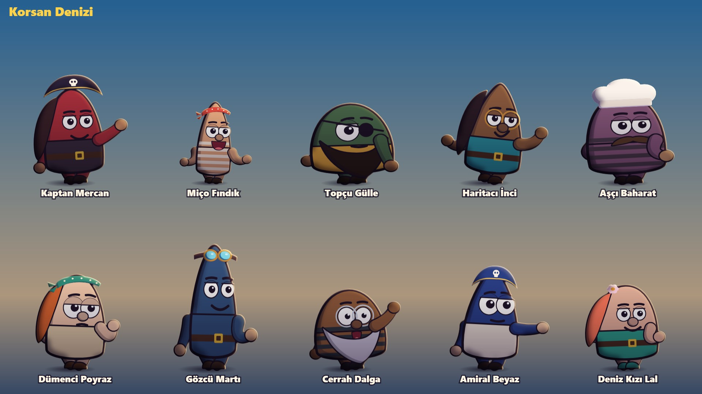

| Karakter | Kod | Görünüş | Hikâyedeki görevi | Nerede kullanılır? |
|---|---|---|---|---|
| **Kaptan Mercan** | `korsan-kaptan` | kızıl ceket, tüylü şapka; korsan ceketi | Kahraman, Engel / rakip | Kararı veren lider; açıklama yapmadan garip emir veren sakin kahraman |
| **Miço Fındık** | `korsan-mico` | çizgili tişört; kazak (çocuk) | Tanık, Şaka | Her şeyi ilk gören çocuk; soru soran, şaşıran göz |
| **Topçu Gülle** | `korsan-topcu` | göz bandı, dev gövde; korsan ceketi | Alaycı, Engel / rakip | Kahramanla alay eden iri yarı tayfa; top ve patlama sahneleri |
| **Haritacı İnci** | `korsan-harita` | turkuaz ceket, gözlük; korsan ceketi | Uzman, Yardımcı | Harita, rota, yıldız; işin sırrını gösteren kişi |
| **Aşçı Baharat** | `korsan-ahci` | aşçı şapkası, geniş gövde; önlük (iri) | Şaka, Kahraman | Mutfak ve yiyecek hileleri; kimsenin ciddiye almadığı kahraman |
| **Dümenci Poyraz** | `korsan-dumenci` | kızıl örgüler, yeşil bandana; tunik | Yardımcı, Tanık | Fırtına, dönüş, kaçış; dümen başındaki gergin anlar |
| **Gözcü Martı** | `korsan-gozcu` | uzun boy, pilot gözlüğü; korsan ceketi (uzun, ince) | Tanık | Tehlikeyi uzaktan haber veren; "kara göründü" anları |
| **Cerrah Dalga** | `korsan-cerrah` | uzun siyah ceket, yuvarlak gözlük; palto (yaşlı) | Uzman | Hastalık, iskorbüt, gemide tıp hikâyeleri |
| **Amiral Beyaz** | `korsan-amiral` | apoletli lacivert, fötr; takım elbise (yaşlı, pelerinli) | Engel / rakip, Alaycı | Korsanların peşindeki resmî güç; kendinden emin rakip |
| **Deniz Kızı Lal** | `korsan-deniz` | mercan saç, yosun elbise; elbise | Kahraman | Deniz efsaneleri ve masalsı bölümler (kurgu etiketiyle) |

### Orta Çağ Kalesi (`ortacag`)

Kale, kuşatma, kral ve hile hikâyeleri.

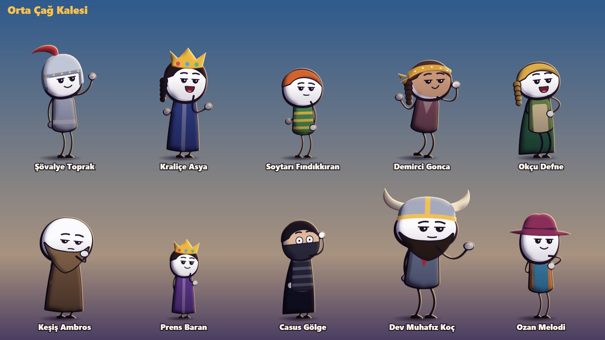

| Karakter | Kod | Görünüş | Hikâyedeki görevi | Nerede kullanılır? |
|---|---|---|---|---|
| **Şövalye Toprak** | `ortacag-sovalye` | gümüş zırh, kızıl sorguç; zırh | Kahraman, Engel / rakip | Düello, görev, onur; ya kahraman ya yenilen rakip |
| **Kraliçe Asya** | `ortacag-kralice` | altın taç, lacivert elbise; elbise | Kahraman, Engel / rakip | Kararı veren hükümdar; sabırlı ve zeki lider |
| **Soytarı Fındıkkıran** | `ortacag-soytari` | yeşil tunik, muzip yüz; tunik | Alaycı, Şaka, Kahraman | Alay eden; bazen gerçeği tek gören kişi |
| **Demirci Gonca** | `ortacag-demirci` | deri önlük, bandana; önlük | Uzman, Kahraman | Zırh, kilit, silah, mekanizma açıklamaları |
| **Okçu Defne** | `ortacag-okcu` | yeşil pelerin, sarı örgü; tunik (pelerinli) | Kahraman | Uzak atış, orman, gizli pusu |
| **Keşiş Ambros** | `ortacag-kesis` | kahve cüppe, kel; cüppe (yaşlı, iri) | Uzman, Tanık | El yazması, bilgi, manastır; sırrı bilen kişi |
| **Prens Baran** | `ortacag-prens` | küçük taç, mor kaftan; kaftan (çocuk) | Tanık, Şaka | Çocuk gözünden saray; masum soru |
| **Casus Gölge** | `ortacag-casus` | siyah pelerin, maske; tunik (ince, pelerinli) | Kahraman, Engel / rakip | Sızma, gece, gizli mektup |
| **Dev Muhafız Koç** | `ortacag-dev` | dev beden, miğfer; zırh (uzun, iri) | Engel / rakip, Alaycı | Aşılması gereken muhafız; küçümseyen güçlü |
| **Ozan Melodi** | `ortacag-ozan` | tüylü şapka, turuncu tunik; tunik | Tanık, Yardımcı | Haberi yayan; kalabalık ve şenlik sahneleri |

### Antik Mısır (`misir`)

Piramit, mezar, buluş ve inanç hikâyeleri.

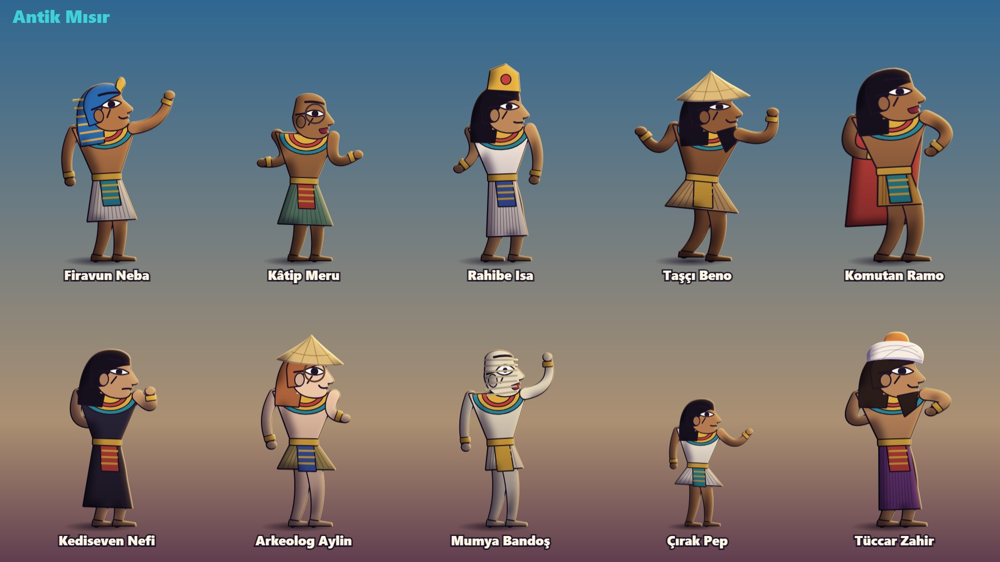

| Karakter | Kod | Görünüş | Hikâyedeki görevi | Nerede kullanılır? |
|---|---|---|---|---|
| **Firavun Neba** | `misir-firavun` | mavi çizgili başlık; keten tunik | Engel / rakip, Alaycı | Emir veren hükümdar; sonunda yanılan güç |
| **Kâtip Meru** | `misir-katip` | kel kafa, yeşil keten; tunik | Uzman, Tanık | Yazı, hesap, kayıt; sayıyı söyleyen kişi |
| **Rahibe Isa** | `misir-rahibe` | altın taç, turkuaz kolye; keten tunik | Uzman, Kahraman | Tören, yıldız, inanç; sakin ve bilgili |
| **Taşçı Beno** | `misir-tasci` | hasır şapka; tunik | Kahraman | Taş, kaldıraç, kızak; emeğiyle çözen kahraman |
| **Komutan Ramo** | `misir-komutan` | tunç zırh; zırh (uzun, pelerinli) | Engel / rakip | Ordu, sefer, muhafız |
| **Kediseven Nefi** | `misir-kediseven` | siyah elbise, altın kuşak; elbise | Kahraman, Şaka | Kediler, ev yaşamı, gündelik tuhaflıklar |
| **Arkeolog Aylin** | `misir-kasifm` | haki yelek, hasır şapka; yelek | Kahraman, Uzman | Günümüz arkeoloğu; hikâyeyi bugüne bağlayan final |
| **Mumya Bandoş** | `misir-mumya` | sargılı, solgun; kazak (ince) | Şaka | Komik ya da masalsı bölüm, sır canlandırması |
| **Çırak Pep** | `misir-cocuk` | yan örgü, küçük boy; keten tunik (çocuk) | Tanık | Çırak gözü; büyüklerin kaçırdığını gören |
| **Tüccar Zahir** | `misir-tuccar` | mor kaftan, kavuk; kaftan | Alaycı, Engel / rakip | Pazarlık, takas, sahtecilik |

### Vahşi Batı (`bati`)

Altın, tren, dolandırıcılık ve sınır kasabası hikâyeleri.

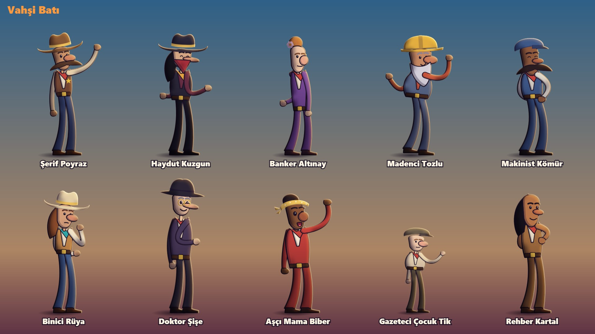

| Karakter | Kod | Görünüş | Hikâyedeki görevi | Nerede kullanılır? |
|---|---|---|---|---|
| **Şerif Poyraz** | `bati-serif` | yıldız rozet, geniş şapka; kovboy yeleği | Kahraman, Engel / rakip | Yasa, soruşturma; sakin kahraman |
| **Haydut Kuzgun** | `bati-haydut` | siyah şapka, maske; kovboy yeleği | Engel / rakip, Kahraman | Soygun, kaçış, maske; rakip ya da ters köşe kahraman |
| **Banker Altınay** | `bati-banker` | mor elbise, çiçek; elbise | Kahraman, Alaycı | Para, kasa, sözleşme; herkesten zeki çıkan |
| **Madenci Tozlu** | `bati-madenci` | sarı baret, ak sakal; tulum (yaşlı) | Kahraman, Tanık | Altın, maden, dinamit; şanssız ama sabırlı |
| **Makinist Kömür** | `bati-demiryolcu` | çizgili tulum, kasket; tulum | Uzman | Buhar, ray, hız; teknik sır |
| **Binici Rüya** | `bati-kovboykiz` | turkuaz fular, uzun örgü; kovboy yeleği | Kahraman | At, sürü, takip; cesur kahraman |
| **Doktor Şişe** | `bati-doktor` | uzun redingot, silindir gövde; palto (yaşlı, uzun, ince) | Alaycı, Engel / rakip | Sahte ilaç satıcısı, dolandırıcı |
| **Aşçı Mama Biber** | `bati-kazan` | kırmızı elbise, önlük; önlük (iri) | Yardımcı, Şaka | Mutfak, kalabalık, dedikodu |
| **Gazeteci Çocuk Tik** | `bati-cocuk` | kasket, askılı; kareli gömlek (çocuk) | Tanık | Haber dağıtan çocuk; haberi yayma anı |
| **Rehber Kartal** | `bati-kartal` | deri tunik, uzun siyah saç; tunik | Uzman, Yardımcı | İz sürme, doğa bilgisi, yol gösterme |

### Sakura Bahçesi (`japon`)

Zanaat, onur, sabır ve gece hikâyeleri.

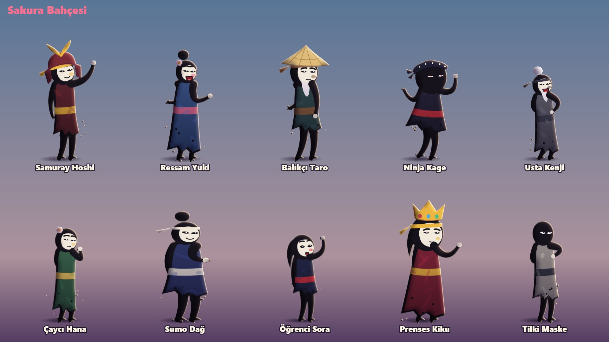

| Karakter | Kod | Görünüş | Hikâyedeki görevi | Nerede kullanılır? |
|---|---|---|---|---|
| **Samuray Hoshi** | `japon-samuray` | altın boynuzlu miğfer; zırh | Kahraman, Engel / rakip | Düello, savaş, onur |
| **Ressam Yuki** | `japon-ressam` | mavi kimono, çiçek; kimono | Kahraman | Resim, sabır, ince ayrıntı |
| **Balıkçı Taro** | `japon-balikci` | hasır şapka; kimono (yaşlı) | Uzman, Tanık | Deniz bilgisi, sade bilgelik |
| **Ninja Kage** | `japon-ninja` | koyu maske; kimono | Kahraman, Engel / rakip | Sızma, gece, hızlı hareket |
| **Usta Kenji** | `japon-usta` | ak sakal, gri kimono; kimono (yaşlı) | Uzman, Kahraman | Öğretmen; açıklamayan sakin kahraman |
| **Çaycı Hana** | `japon-cayci` | yeşil kimono, önlük; kimono | Tanık, Yardımcı | Çay evi, dinleyen, haber taşıyan |
| **Sumo Dağ** | `japon-sumo` | dev beden, topuz; kimono (iri) | Alaycı, Engel / rakip | Küçümseyen güçlü; fiziksel şaka |
| **Öğrenci Sora** | `japon-ogrenci` | lacivert ceket, kırmızı fular; takım elbise | Kahraman, Tanık | Modern ya da okul hikâyeleri; öğrenen göz |
| **Prenses Kiku** | `japon-prenses` | altın taç, kırmızı kimono; kimono | Kahraman, Engel / rakip | Saray, karar, kaçış |
| **Tilki Maske** | `japon-maskeli` | turuncu saç, beyaz maske; kimono (ince) | Engel / rakip, Şaka | Gizemli kişi, sürpriz kimlik |

### Uzay Üssü (`uzay`)

Uzay yolculuğu, bilim ve hayatta kalma hikâyeleri.

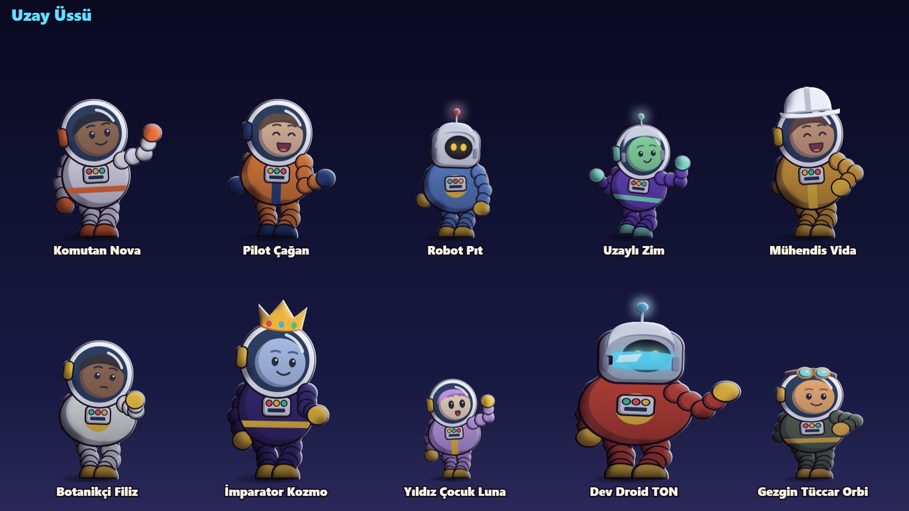

| Karakter | Kod | Görünüş | Hikâyedeki görevi | Nerede kullanılır? |
|---|---|---|---|---|
| **Komutan Nova** | `uzay-komutan` | beyaz uzay giysisi; uzay giysisi | Kahraman | Görev lideri; sakin karar veren |
| **Pilot Çağan** | `uzay-pilot` | turuncu giysi; uzay giysisi | Kahraman, Şaka | Aceleci, hata yapan; sonuçlarını yaşayan |
| **Robot Pıt** | `uzay-robot` | antenli kafa, mavi gövde; uzay giysisi | Şaka, Yardımcı | Kuralı harfiyen uygulayan komik yardımcı |
| **Uzaylı Zim** | `uzay-uzayli` | yeşil ten, mor cüppe; cüppe | Engel / rakip, Şaka | Dışarıdan bakan göz; varsayım ve kurgu bölümleri |
| **Mühendis Vida** | `uzay-muhendis` | sarı tulum, baret; tulum | Uzman, Kahraman | Tamir, parça, çözüm; sırrı gösteren |
| **Botanikçi Filiz** | `uzay-bitkici` | yeşil önlük, kıvırcık; beyaz önlük | Uzman | Bitki, oksijen, yiyecek, biyoloji |
| **İmparator Kozmo** | `uzay-imparator` | altın taç, mor pelerin; kaftan (uzun, pelerinli) | Engel / rakip, Alaycı | Kurgu bölümlerde kibirli rakip |
| **Yıldız Çocuk Luna** | `uzay-cocuk` | mini uzay giysisi; uzay giysisi (çocuk) | Tanık | Çocuklara yönelik anlatım; masum soru |
| **Dev Droid TON** | `uzay-droid` | dev kırmızı robot; zırh (uzun, iri) | Engel / rakip | Kapıyı tutan, engelleyen makine |
| **Gezgin Tüccar Orbi** | `uzay-tuccar` | turuncu ten, kapüşon; cüppe (iri, pelerinli) | Alaycı, Engel / rakip | Takas, hile, şüpheli teklif |

### Kutup Seferi (`kutup`)

Keşif, soğuk, dayanıklılık ve kurtarma hikâyeleri.

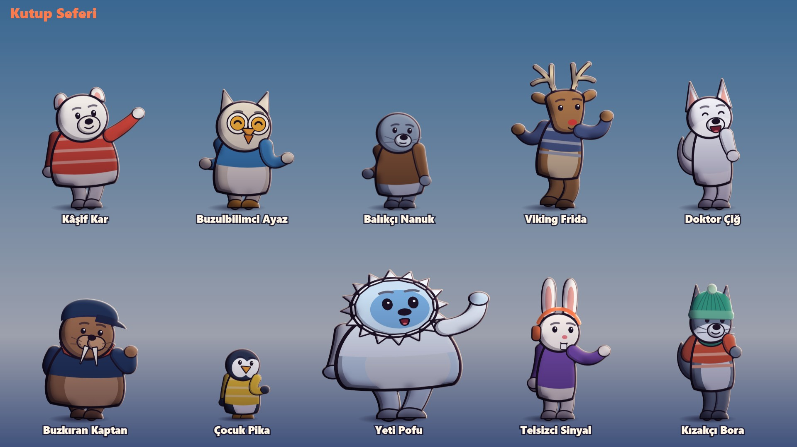

| Karakter | Kod | Görünüş | Hikâyedeki görevi | Nerede kullanılır? |
|---|---|---|---|---|
| **Kâşif Kar** | `kutup-kasif` | kızıl parka, kürk; parka | Kahraman | Sefer lideri; kararlı |
| **Buzulbilimci Ayaz** | `kutup-bilimci` | mavi parka, gözlük; parka | Uzman | Buz örneği, ölçüm, açıklama |
| **Balıkçı Nanuk** | `kutup-avci` | kahve parka; parka | Uzman, Kahraman | Yerel bilgi; hazırlıksızları kurtaran |
| **Viking Frida** | `kutup-viking` | boynuzlu miğfer, örgüler; tunik | Kahraman, Engel / rakip | Kuzey denizciliği, keşif |
| **Doktor Çiğ** | `kutup-doktor` | beyaz parka, mercan örtü; parka | Uzman, Yardımcı | Donma, beslenme, ilk yardım |
| **Buzkıran Kaptan** | `kutup-kaptan` | lacivert palto, kasket; palto (yaşlı) | Engel / rakip, Kahraman | Buza sıkışan gemi, zor karar |
| **Çocuk Pika** | `kutup-cocuk` | sarı mini parka; parka (çocuk) | Tanık | Köy yaşamı, öğrenme |
| **Yeti Pofu** | `kutup-yeti` | dev beyaz kürk; parka (uzun, iri) | Şaka | Efsane ve komik kurgu |
| **Telsizci Sinyal** | `kutup-radyocu` | mor mont, kulaklık; mont | Tanık, Yardımcı | Telsiz, yardım çağrısı, gerilim |
| **Kızakçı Bora** | `kutup-kizakci` | yeşil atkı, bere; kazak | Kahraman | Kızak, hız, yarış |

### Neon Şehir (`siber`)

Teknoloji, güvenlik ve yakın gelecek hikâyeleri.

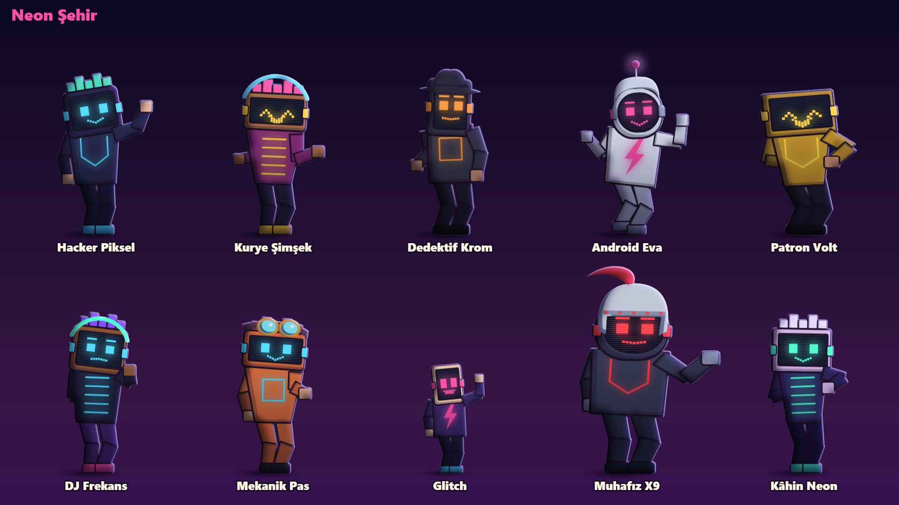

| Karakter | Kod | Görünüş | Hikâyedeki görevi | Nerede kullanılır? |
|---|---|---|---|---|
| **Hacker Piksel** | `siber-hacker` | neon vizör; neon ceket | Kahraman | Açığı bulan; zekâsıyla çözen |
| **Kurye Şimşek** | `siber-kurye` | pembe ceket, mikrofon; neon ceket | Kahraman, Tanık | Takip, zaman yarışı |
| **Dedektif Krom** | `siber-dedektif` | fötr şapka, parlak çizgiler; neon ceket | Kahraman | İz, kanıt, sorgu |
| **Android Eva** | `siber-android` | gümüş ten, anten; neon ceket | Engel / rakip, Uzman | Yapay zekâ, "insan mı?" soruları |
| **Patron Volt** | `siber-patron` | altın takım, kel; takım elbise (iri) | Alaycı, Engel / rakip | Kibirli şirket sahibi; sonunda kaybeden |
| **DJ Frekans** | `siber-dj` | mor afro, dev kulaklık; kapüşonlu | Yardımcı, Şaka | Kalabalık, ses, dikkat dağıtma |
| **Mekanik Pas** | `siber-mekanik` | turuncu tulum, pilot gözlüğü; tulum | Uzman | Cihazın içi; sırrı gösteren |
| **Glitch** | `siber-cocuk` | küçük boy, camgöbeği saç; neon ceket (çocuk) | Kahraman, Şaka | Herkesten hızlı çocuk; ters köşe |
| **Muhafız X9** | `siber-muhafiz` | dev zırh, kırmızı vizör; zırh (uzun, iri) | Engel / rakip | Geçilmez güvenlik |
| **Kâhin Neon** | `siber-kahin` | parlayan cüppe; cüppe (yaşlı, pelerinli) | Tanık | Gelecek tahmini, gizemli açılış |

### Modern Şehir (`modern`)

Gündelik hayat, iş, şehir ve psikoloji hikâyeleri.

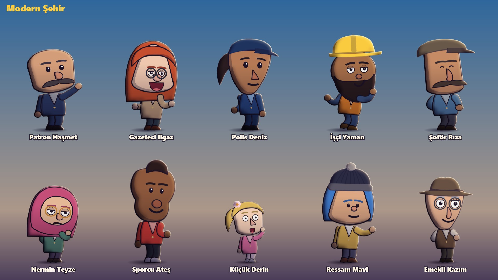

| Karakter | Kod | Görünüş | Hikâyedeki görevi | Nerede kullanılır? |
|---|---|---|---|---|
| **Patron Haşmet** | `modern-patron` | lacivert takım, bıyık; takım elbise | Alaycı, Engel / rakip | Kibirli yönetici |
| **Gazeteci Ilgaz** | `modern-gazeteci` | bej trençkot, kızıl saç; palto | Kahraman, Tanık | Araştıran, soran, ortaya çıkaran |
| **Polis Deniz** | `modern-polis` | lacivert üniforma; takım elbise | Kahraman, Engel / rakip | Soruşturma, trafik, yakalama |
| **İşçi Yaman** | `modern-isci` | sarı baret, turuncu yelek; mont | Kahraman | Sahada çözen, küçümsenen kahraman |
| **Şoför Rıza** | `modern-sofor` | kareli gömlek, bıyık; kareli gömlek (iri) | Şaka, Tanık | Yol, trafik, sohbet |
| **Nermin Teyze** | `modern-teyze` | çiçekli örtü, hırka; hırka (yaşlı) | Kahraman, Şaka | Kimsenin beklemediği zeki kahraman |
| **Sporcu Ateş** | `modern-sporcu` | kırmızı mont, dikik saç; mont (uzun) | Kahraman, Engel / rakip | Yarış, rekor, hile |
| **Küçük Derin** | `modern-kiz` | pembe elbise, sırma kuyruk; elbise (çocuk) | Tanık | Masum soru; doğruyu gören |
| **Ressam Mavi** | `modern-sanatci` | bere, boyalı önlük; önlük | Kahraman | Tasarım, sahtecilik, sanat |
| **Emekli Kazım** | `modern-bilge` | kahve yelek, baston duruşu; yelek (yaşlı) | Uzman | Geçmişi bilen, açıklayan |

### Çılgın Laboratuvar (`bilim`)

Deney, buluş ve okul hikâyeleri.

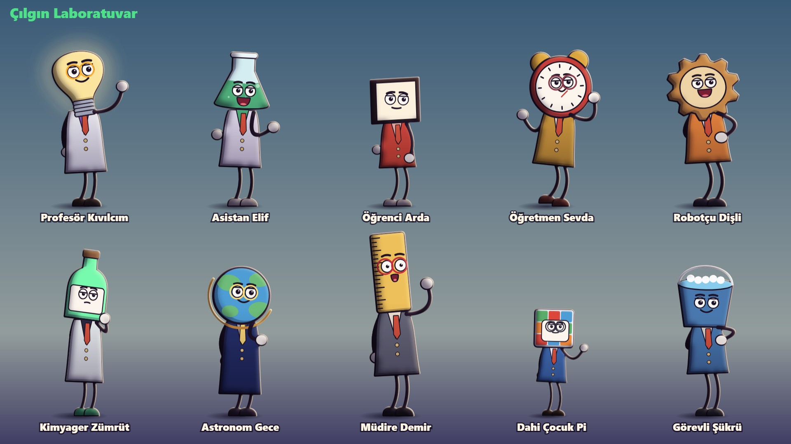

| Karakter | Kod | Görünüş | Hikâyedeki görevi | Nerede kullanılır? |
|---|---|---|---|---|
| **Profesör Kıvılcım** | `bilim-profesor` | dağınık ak saç, gözlük; beyaz önlük (yaşlı) | Kahraman | Garip deneyi yapan; açıklamayan dâhi |
| **Asistan Elif** | `bilim-asistan` | yeşil önlük, at kuyruğu; önlük | Yardımcı, Tanık | Şaşıran ve soran; izleyicinin yerine geçen |
| **Öğrenci Arda** | `bilim-ogrenci` | kırmızı kapüşonlu; kapüşonlu | Kahraman, Şaka | Meraklı; kazara bulan |
| **Öğretmen Sevda** | `bilim-ogretmen` | hardal hırka; hırka | Uzman, Alaycı | Dersi veren ya da inanmayan |
| **Robotçu Dişli** | `bilim-robotcu` | turuncu tulum, anten; tulum | Uzman, Kahraman | Makine, robot, mekanik |
| **Kimyager Zümrüt** | `bilim-kimyager` | yeşil saç, önlük; beyaz önlük (ince) | Uzman | Karışım, renk, tepkime |
| **Astronom Gece** | `bilim-astronom` | lacivert cüppe, yıldızlar; cüppe | Uzman | Yıldız, zaman, hesap |
| **Müdire Demir** | `bilim-mudur` | gri takım, sıkı topuz; takım elbise (yaşlı) | Engel / rakip, Alaycı | Deneyi durduran, alay eden yetkili |
| **Dahi Çocuk Pi** | `bilim-dahi` | dev gözlük, papyonlu yelek; yelek (çocuk) | Kahraman | Büyükleri yenen çocuk |
| **Görevli Şükrü** | `bilim-temizlikci` | mavi tulum, kasket; tulum (yaşlı) | Kahraman, Tanık | Sırrı fark eden, kimsenin görmediği kişi |

### Masal Ormanı (`masal`)

Masal, efsane ve ders veren kurgu hikâyeler.

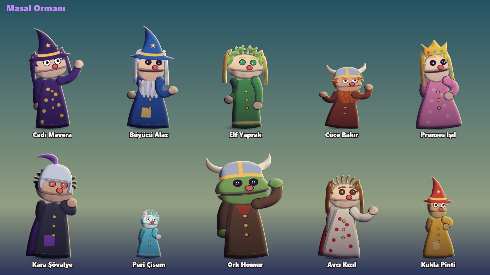

| Karakter | Kod | Görünüş | Hikâyedeki görevi | Nerede kullanılır? |
|---|---|---|---|---|
| **Cadı Mavera** | `masal-cadi` | sivri şapka, mor cüppe; cüppe | Engel / rakip, Kahraman | Anlaşma, bedel; göründüğünden iyi çıkan |
| **Büyücü Alaz** | `masal-buyucu` | mavi cüppe, ak sakal; cüppe (yaşlı) | Uzman | Kuralı koyan bilge |
| **Elf Yaprak** | `masal-elf` | defne tacı, yeşil tunik; tunik | Kahraman | Orman, iyilik, hız |
| **Cüce Bakır** | `masal-cuce` | kızıl sakal, boynuzlu miğfer; tunik (iri) | Alaycı, Kahraman | Maden, inat, zanaat |
| **Prenses Işıl** | `masal-prenses` | taç, pembe elbise; elbise | Kahraman | Kurtarılan değil, çözen kahraman |
| **Kara Şövalye** | `masal-sovalye` | siyah zırh, mor pelerin; zırh (uzun, pelerinli) | Engel / rakip | Güçlü rakip, dönüşen düşman |
| **Peri Çisem** | `masal-peri` | minik, camgöbeği elbise; elbise (minik) | Yardımcı | Minik yardımcı, ipucu veren |
| **Ork Homur** | `masal-ork` | yeşil ten, dev beden; tunik (uzun, iri) | Engel / rakip, Şaka | Korkutucu ama komik |
| **Avcı Kızıl** | `masal-avci` | kırmızı pelerin, örgü; tunik (pelerinli) | Kahraman | Takip, orman, cesaret |
| **Kukla Pinti** | `masal-soytari` | tahta ten, sarı yelek; yelek (ince) | Şaka, Tanık | Yalan, şaka, ders |

### Antik Ege (`antik`)

Felsefe, matematik, savaş ve efsane hikâyeleri.

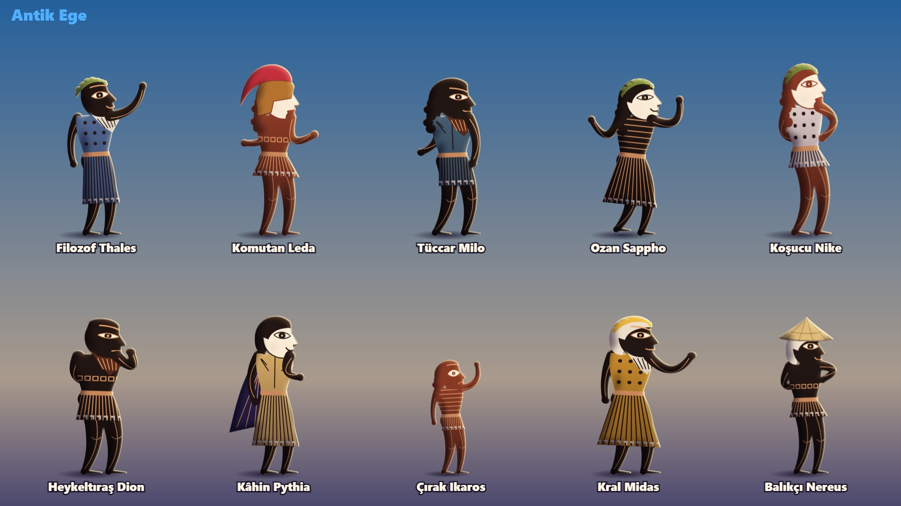

| Karakter | Kod | Görünüş | Hikâyedeki görevi | Nerede kullanılır? |
|---|---|---|---|---|
| **Filozof Thales** | `antik-filozof` | ak sakal, mavi pelerin; tunik (yaşlı) | Kahraman | Garip davranan, açıklamayan bilge |
| **Komutan Leda** | `antik-komutan` | tunç zırh, kızıl sorguç; zırh | Kahraman, Engel / rakip | Savaş hilesi, strateji |
| **Tüccar Milo** | `antik-tuccar` | turuncu tunik, kolye; tunik | Alaycı, Engel / rakip | Pazarlık, açgözlülük |
| **Ozan Sappho** | `antik-ozan` | lila elbise, defne tacı; elbise | Tanık, Uzman | Hikâyeyi aktaran, duygu |
| **Koşucu Nike** | `antik-sporcu` | kısa tunik, defne tacı; tunik (uzun, ince) | Kahraman | Koşu, olimpiyat, haber taşıma |
| **Heykeltıraş Dion** | `antik-heykeltiras` | önlük, kel, iri gövde; önlük (iri) | Uzman, Kahraman | Heykel, oran, ustalık |
| **Kâhin Pythia** | `antik-kahin` | mor örtü, pelerin; cüppe (pelerinli) | Engel / rakip | Kehanet, çift anlamlı söz |
| **Çırak Ikaros** | `antik-cocuk` | küçük boy, sarı kıvırcık; tunik (çocuk) | Kahraman, Şaka | Meraklı çırak; sınırı zorlayan |
| **Kral Midas** | `antik-kral` | altın taç, altın kaftan; kaftan (yaşlı) | Engel / rakip, Alaycı | Kibirli kral; ders alan |
| **Balıkçı Nereus** | `antik-balikci` | hasır şapka, çıplak kol; tunik (yaşlı) | Tanık | Sıradan halkın gözü |

