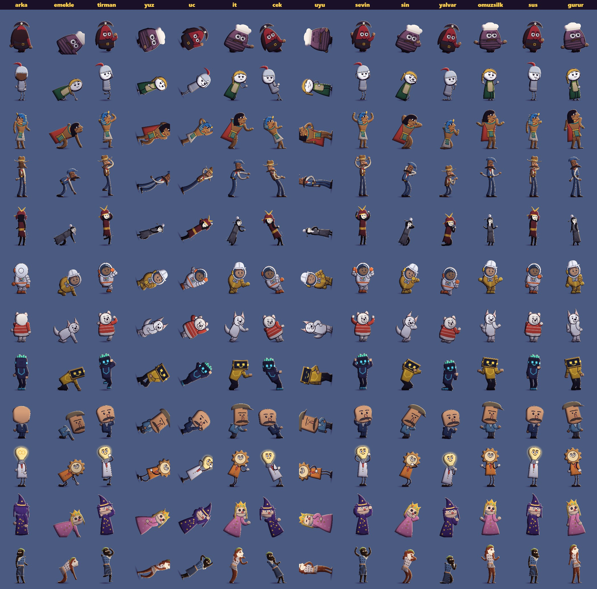
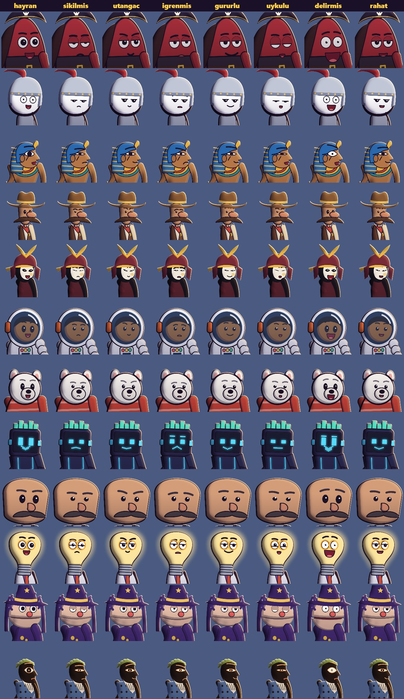

# Oyunculuk

Bütün pozlar, ifadeler ve hareketler 12 karakter biçiminin hepsinde çalışır.



## Hareketler

| Eylem | Ne yapar | Örnek |
|---|---|---|
| `yuru` `kos` `kac` | Yürür, koşar, kaçar | `"x": 2, "z": 0` |
| `emekle` | Yerde emekler | `"x": 2, "z": 0` |
| `it` `cek` | Ağır yük iter, asılır | `"x": 1, "z": 0` |
| `yuz` | Yatay yüzer | `"x": 3, "z": 0` |
| `uc` | Havalanıp uçar | `"x": 2, "z": 0, "y": 2.5` |
| `tirman` | Yukarı tırmanır | `"y": 2.5` |
| `bin` `in` | Hayvana biner, iner | `"nesne": "at"` |

```json
{ "an": "C03", "kim": "kahraman", "eyle": "bin", "nesne": "at" },
{ "an": "C03.4", "nesne": "at", "eyle": "git", "x": 4, "y": 0, "z": 1, "sure": 2 },
{ "an": "C04", "kim": "kahraman", "eyle": "in" }
```

Hayvan giderken binen de gider. Denetim uzaktan binmeyi, iki kişinin binmesini ve hayvanın üstündeyken yürümeyi hata sayar.

## Duruşlar

`bin` `yalvar` `omuzsilk` `sus` `gurur` `uyu` `sevin` `sin` ve öncekiler: `rahat` `sasir` `dusun` `isaret` `uzul` `selam` `anlat` `otur` `dans` `alkis` `elsalla` `titre` `ara` `gulkahkaha` `onayla`…

## 20 ifade

Yeniler: `hayran` `sikilmis` `utangac` `igrenmis` `gururlu` `uykulu` `delirmis` `rahat`



## Arkadan görünüş

`{ "eyle": "bak", "hedef": "arka" }`. Karakter kameradan uzaklaşarak yürüyünce kendiliğinden arkası görünür. Duvar resmi ve vazo figürü, sanat üslupları gereği arkadan çizilmez; yüzünü öbür yana çevirir. Bazı kıyafetlerin ön düğmesi ve kravatı arkada da görünür.

## Biçime özel hareket

| Biçim | Nasıl kımıldar |
|---|---|
| Damla | Seker, ezilip uzar |
| Balon | Ağır çekim zıplar |
| Kukla | Sağa sola sallanır |
| Sırık | Lastik gibi eğilir |
| Yumurta, dev kafa | Kafası sallanır, geriden gelir |
| Hayvan | Paytak yürür |
| Küp robot, duvar resmi, vazo | Kesik kesik hareket eder |

Kapatmak: `"ayar": { "bicimHareket": false }`
