# Hazır sahneler

> Koddan üretilir: `node sistem.mjs hikaye rehber`

**42 hareketli sahne.** Hepsi bütün temalarda ve bütün karakterlerle çalışır. Süreye göre kendini uzatır ya da kısaltır; kamera, hareket, eşya, efekt ve sarsıntı içindedir.

▶ [Hepsi tek videoda](../galeri/sahneler.mp4)

```json
"sahneler": [
  { "an": "C06", "bitis": "C08", "sahne": "kovalamaca", "mekan": "gemi",
    "roller": { "a": "kahraman", "b": "rakip" } }
]
```

- `an` / `bitis`: hangi cümleden hangi cümleye
- `roller`: sahnedeki kişi → hikâyedeki oyuncu
- `yer: [x, z]`: sahneyi mekânda kaydırır · `nesne`: eşyayı değiştirir (ör. `"nesne": "kazan"`)

## Kovalamaca · `kovalamaca`

Biri kaçar, öteki peşinden koşar; kaçan engelin üstünden atlar, kovalayan takılır.

**Roller:** `a` kaçan, `b` kovalayan · **İdeal süre:** 3–8 sn

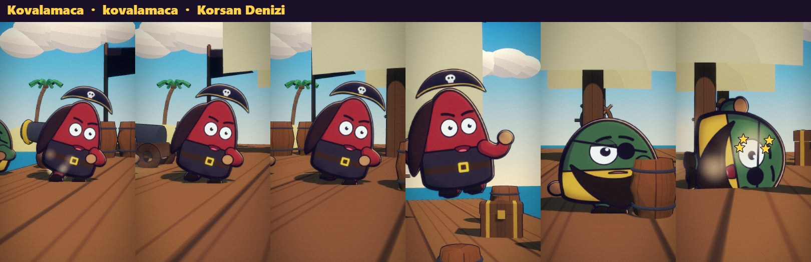

## Gizlice sızma · `gizlice`

Kahraman parmak ucunda ilerler, biri dönünce saklanır, sonra devam eder.

**Roller:** `a` sızan, `b` nöbetçi · **İdeal süre:** 3.5–9 sn

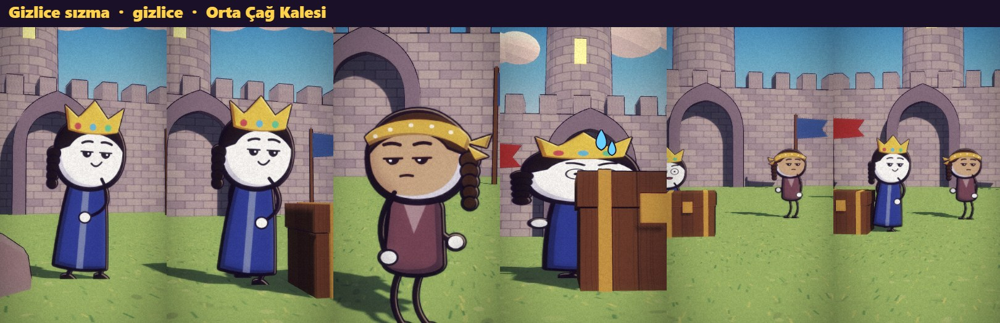

## Çarpışma · `carpisma`

İki kişi birbirine koşar, çarpışır, ikisi de geriye uçar.

**Roller:** `a` birinci, `b` ikinci · **İdeal süre:** 2–5 sn

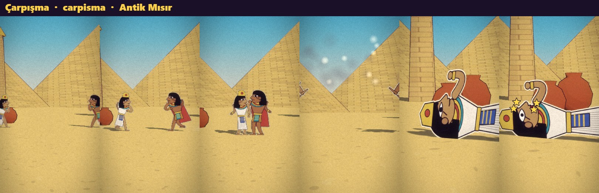

## Patlama · `patlama`

Bir şey titrer, herkes kaçar, patlar; duman içinden isli bir yüz çıkar.

**Roller:** `a` kahraman, `b` kaçan · **İdeal süre:** 3–8 sn

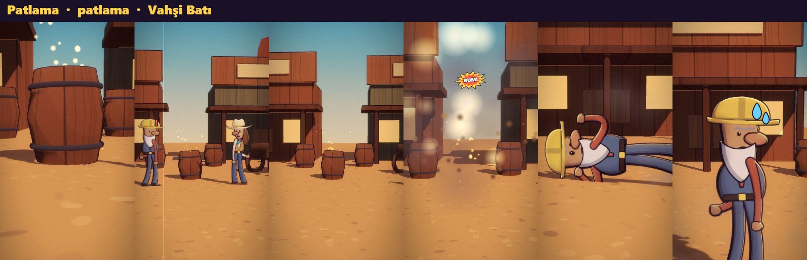

## Fırtına · `firtina`

Yağmur, şimşek ve rüzgâr; kahraman rüzgâra karşı ilerler, ötekini rüzgâr savurur.

**Roller:** `a` direnen, `b` savrulan · **İdeal süre:** 3–10 sn

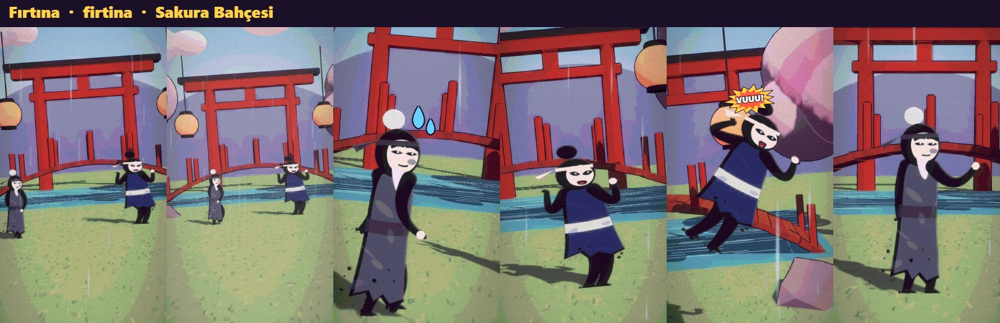

## Tuzak · `tuzak`

Kurban yeme yaklaşır, üstüne ağır bir şey düşer; tuzağı kuran güler.

**Roller:** `a` tuzakçı, `b` kurban · **İdeal süre:** 3–8 sn

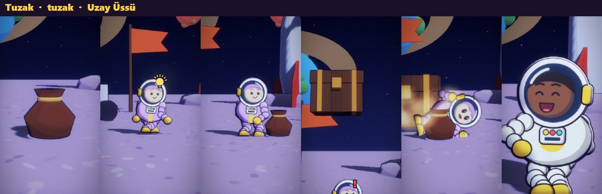

## Düello · `duello`

Yüz yüze gergin bekleyiş, hızlı yakın planlar, tek hamle; biri yere serilir.

**Roller:** `a` kazanan, `b` kaybeden · **İdeal süre:** 4–9 sn

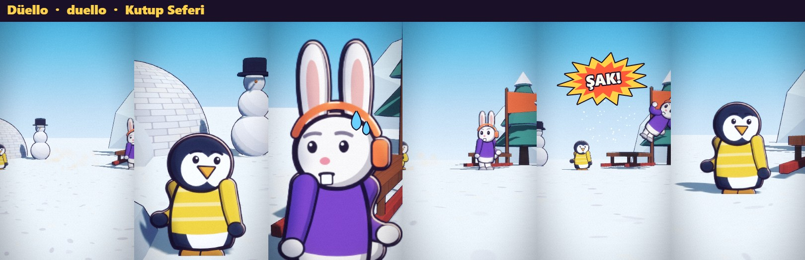

## Yüksekten düşüş · `dusus`

Kahraman kenarda sendeler, düşer, yerde izi kalır, doğrulur.

**Roller:** `a` düşen, `b` tanık · **İdeal süre:** 2.5–6 sn

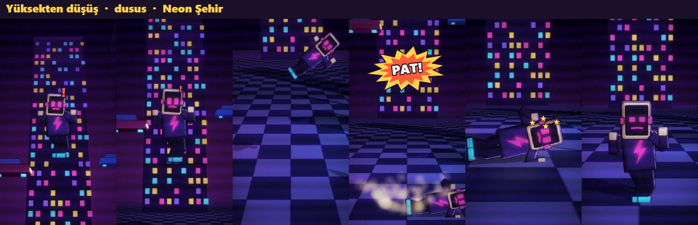

## Yarış · `yaris`

İki kişi omuz omuza koşar, son anda öne geçen değişir.

**Roller:** `a` kazanan, `b` kaybeden · **İdeal süre:** 3–8 sn

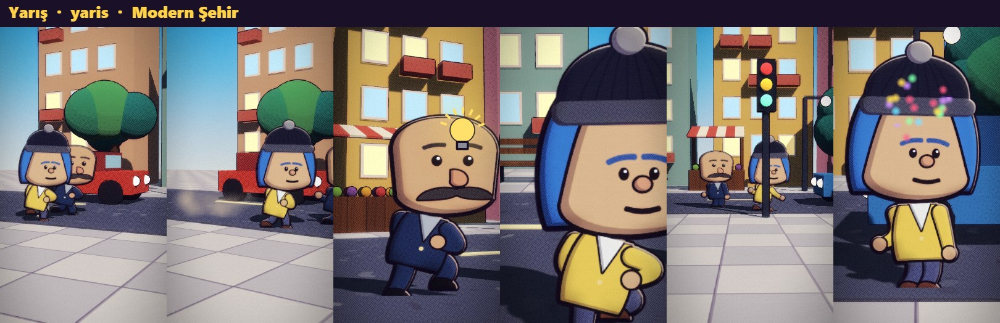

## Kap kaç · `kapkac`

Biri eşyayı kapıp kaçar, sahibi arkasından bakakalır.

**Roller:** `a` hırsız, `b` sahip · **İdeal süre:** 2.5–7 sn

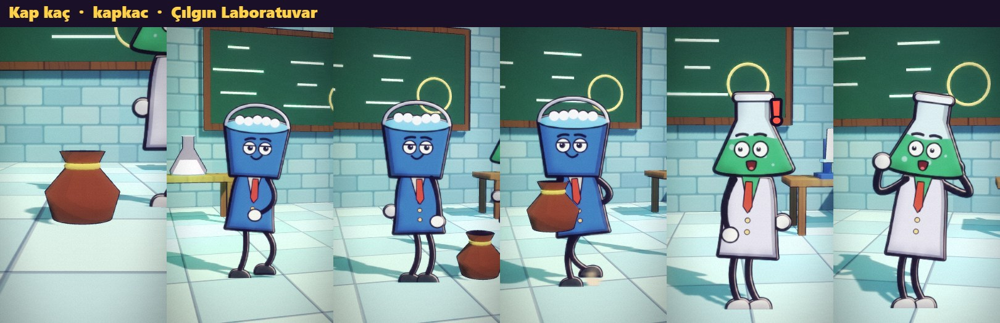

## Büyük keşif · `kesif`

Sandık açılır, ışık taşar, yüz aydınlanır, herkes şaşırır.

**Roller:** `a` bulan, `b` tanık · **İdeal süre:** 3–8 sn

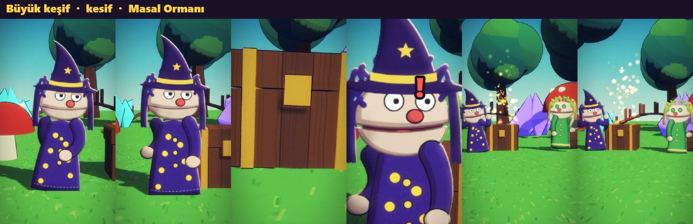

## Alay · `alay`

Alaycı parmağıyla gösterip güler, etraf da güler; kahraman umursamaz.

**Roller:** `a` kahraman, `b` alaycı · **İdeal süre:** 2.5–6 sn

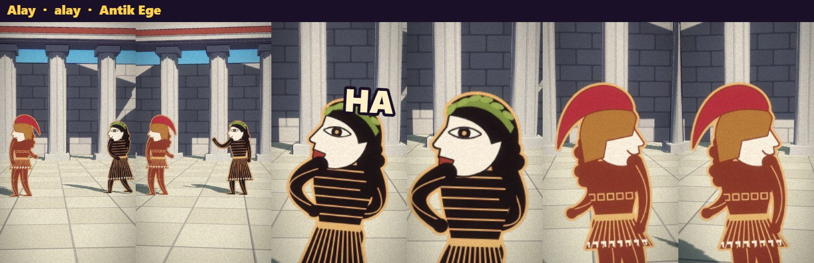

## Deprem · `deprem`

Yer sallanır, eşyalar devrilir, herkes yere kapaklanır.

**Roller:** `a` kahraman, `b` ikinci · **İdeal süre:** 3–8 sn

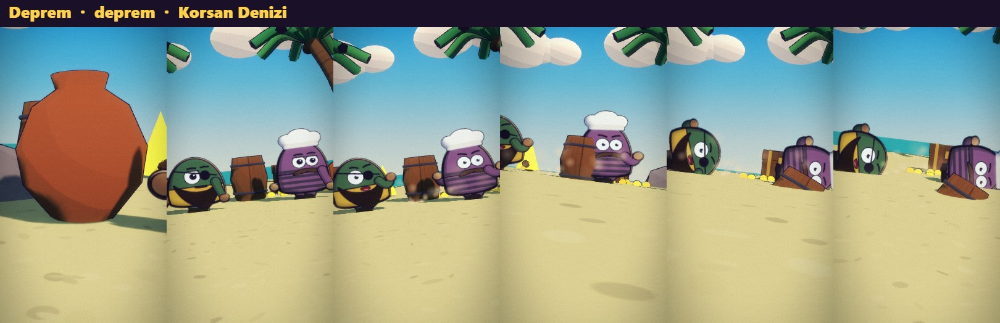

## Uçuşan eşyalar · `ucan`

Eşyalar havalanıp dönmeye başlar, herkes ağzı açık bakar.

**Roller:** `a` yapan, `b` tanık · **İdeal süre:** 3–9 sn

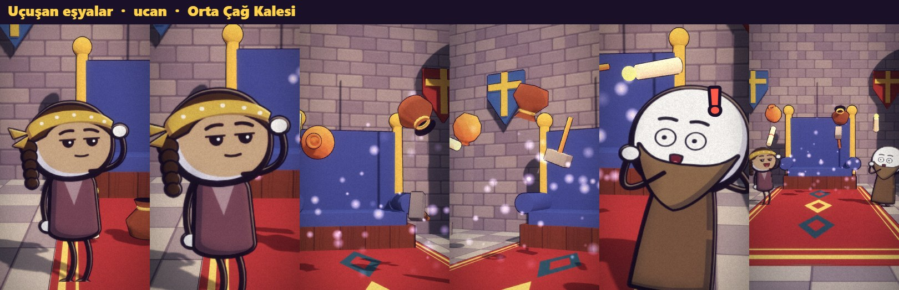

## Ters giden deney · `deney`

Karışım dökülür, köpürür, taşar, patlar; saçlar dikilir.

**Roller:** `a` deneyci, `b` yardımcı · **İdeal süre:** 3.5–9 sn

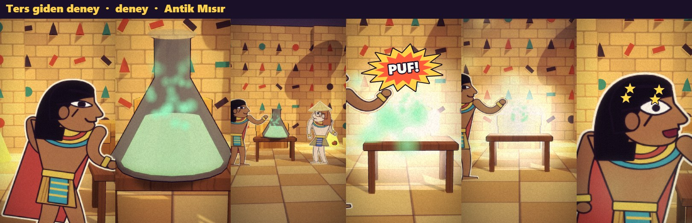

## Gizli anlaşma · `anlasma`

İki kişi etrafı kolaçan eder, eşya el değiştirir, göz kırparlar.

**Roller:** `a` veren, `b` alan · **İdeal süre:** 3–7 sn

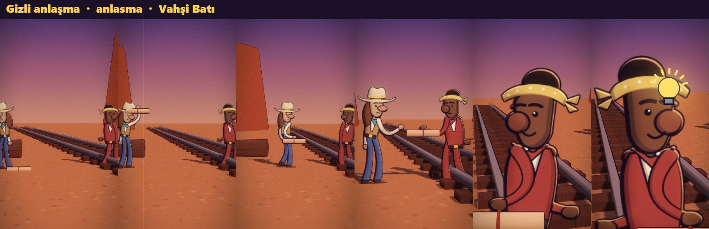

## Fikir anı · `aydinlanma`

Kahraman volta atar, durur, ampul yanar, fırlar.

**Roller:** `a` düşünen · **İdeal süre:** 2.5–7 sn

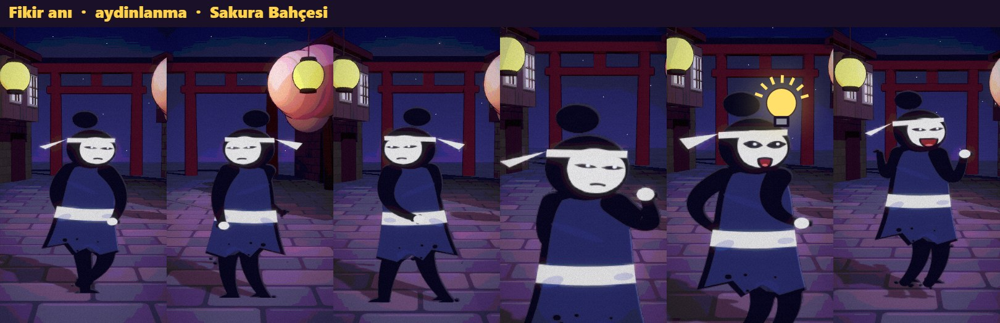

## Zafer · `zafer`

Kahraman zıplar, konfeti yağar, çevresi alkışlar.

**Roller:** `a` kahraman, `b` alkışlayan · **İdeal süre:** 2.5–6 sn

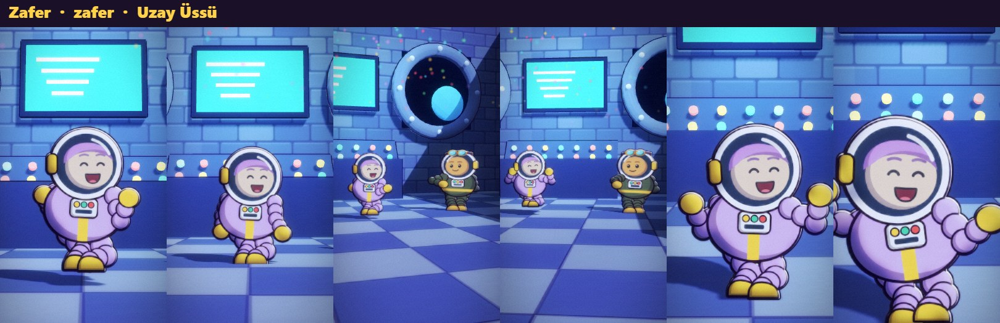

## İhanet · `ihanet`

Dost gibi yaklaşır, arkadan iter; düşen bakakalır.

**Roller:** `a` hain, `b` kurban · **İdeal süre:** 3–7 sn

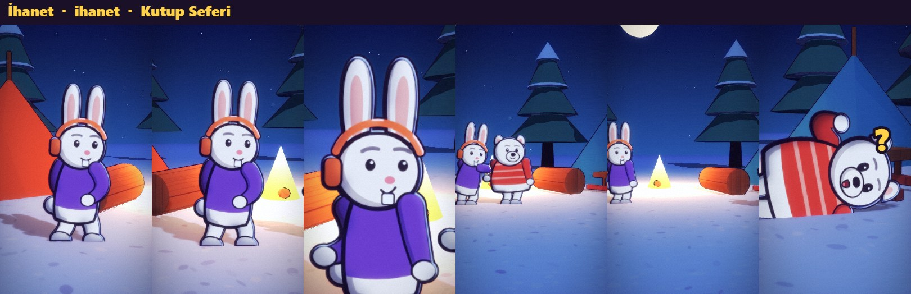

## Kaybolma · `isinlan`

Kahraman parlar ve yok olur, başka yerde belirir.

**Roller:** `a` kaybolan, `b` tanık · **İdeal süre:** 2.5–7 sn

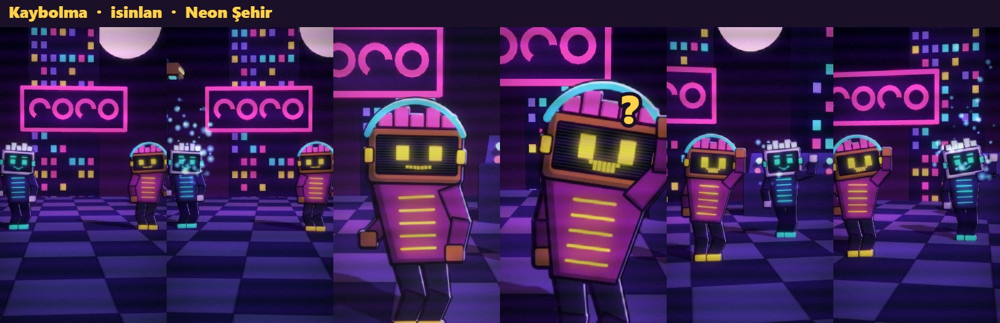

## Gergin bekleyiş · `bekleyis`

Herkes donar, ter damlar, kamera yavaşça yaklaşır, sonra biri sıçrar.

**Roller:** `a` bekleyen, `b` bekleyen 2 · **İdeal süre:** 2.5–7 sn

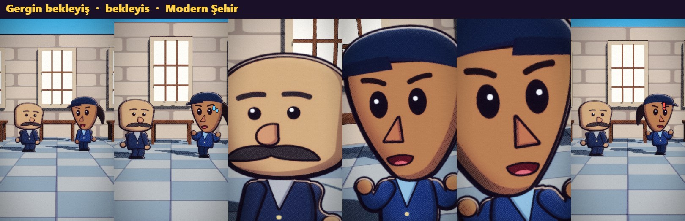

## Toz bulutu kavga · `kavga`

İkisi toz bulutuna girer, yıldızlar uçar, biri dışarı fırlar.

**Roller:** `a` kazanan, `b` kaybeden · **İdeal süre:** 2.5–6 sn

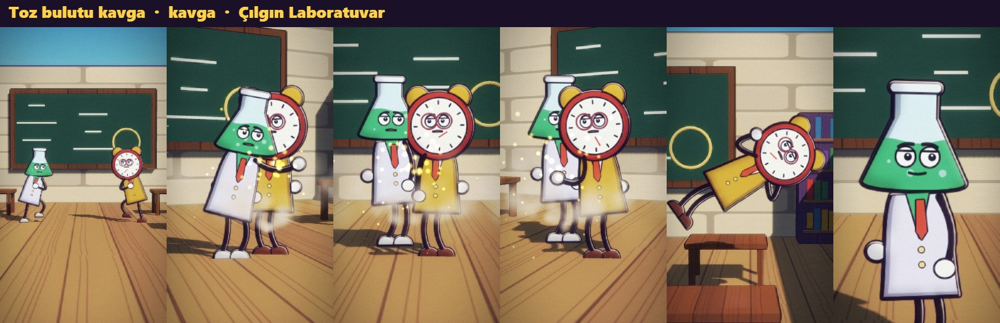

## Son anda kaçış · `kacis`

Yuvarlanan dev bir şey gelir, kahraman son anda yana atlar.

**Roller:** `a` kaçan, `b` tanık · **İdeal süre:** 2.5–6 sn

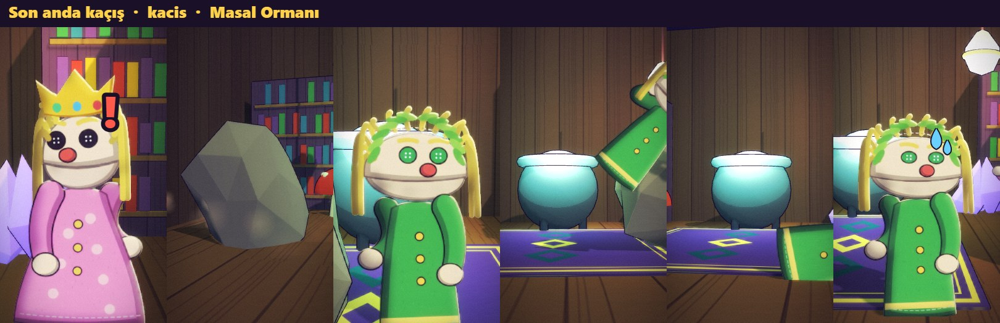

## Meydan şaşkınlığı · `kalabalik`

Kahraman ortada bir şey yapar; üç kişi koşup gelir ve şaşırır.

**Roller:** `a` kahraman, `b` birinci, `c` ikinci, `d` üçüncü · **İdeal süre:** 3–8 sn

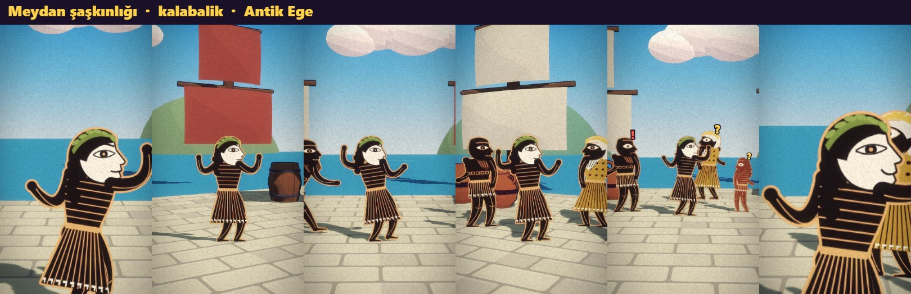

## Hayvan kovalıyor · `surek`

Temanın hayvanı kahramanı kovalar; kahraman atlar, hayvan önüne geçer.

**Roller:** `a` kaçan, `b` tanık · **İdeal süre:** 3–8 sn

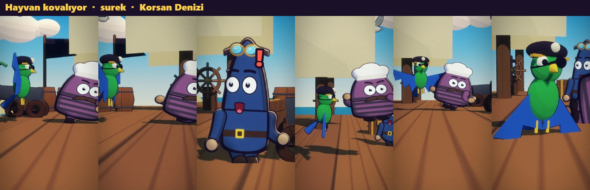

## Hayvan hırsız · `hayvankap`

Hayvan eşyayı kapıp kaçar, sahibi peşinden koşar.

**Roller:** `a` sahip · **İdeal süre:** 3–7 sn

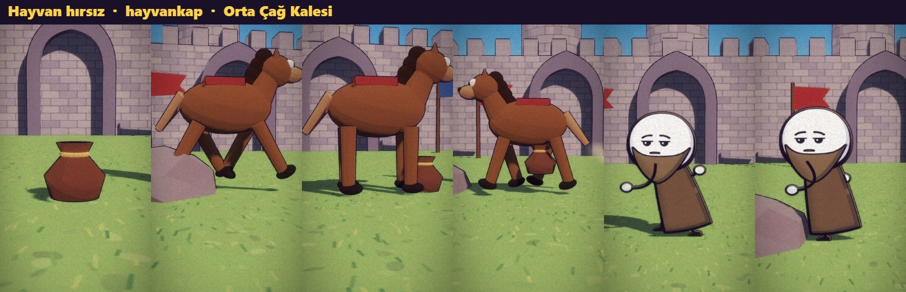

## Dev canavar · `canavar`

Arkadan dev bir yaratık yükselir, kalabalık kaçar, kahraman karşısında kalır.

**Roller:** `a` kahraman, `b` kaçan · **İdeal süre:** 3.5–9 sn

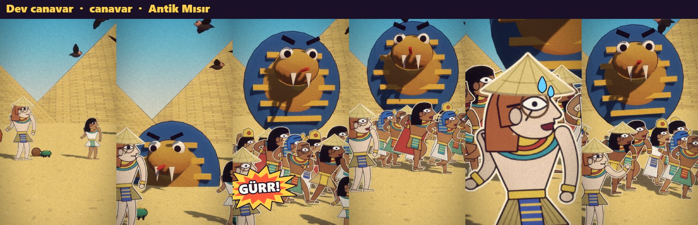

## Kalabalık paniği · `panik`

Otuz kişi çığlık çığlığa kaçar, kahraman ters yöne yürür.

**Roller:** `a` kahraman, `b` haberci · **İdeal süre:** 3–8 sn

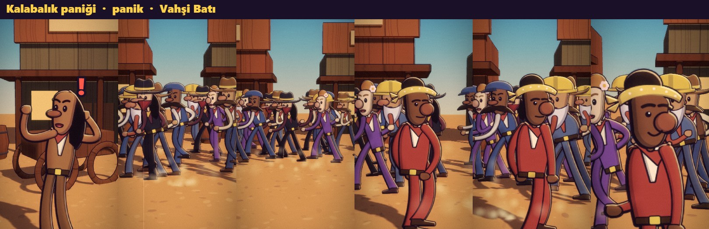

## Alkış seli · `alkisseli`

Otuz kişilik kalabalık zıplayıp alkışlar, kahraman selam verir.

**Roller:** `a` kahraman · **İdeal süre:** 2.5–6 sn

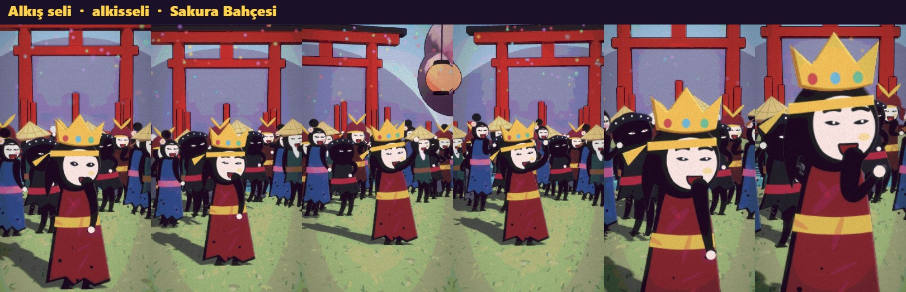

## Ordu geliyor · `ordu`

Kırk kişilik ordu uygun adım yaklaşır, kahraman tek başına karşısında durur.

**Roller:** `a` kahraman, `b` yanındaki · **İdeal süre:** 3.5–9 sn

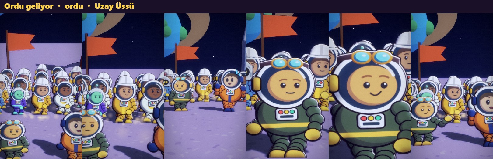

## Mahkeme · `mahkeme`

Yargıç tokmağı vurur, sanık titrer, seyirci coşar; karar herkesi şaşırtır.

**Roller:** `a` sanık, `b` yargıç · **İdeal süre:** 3.5–9 sn

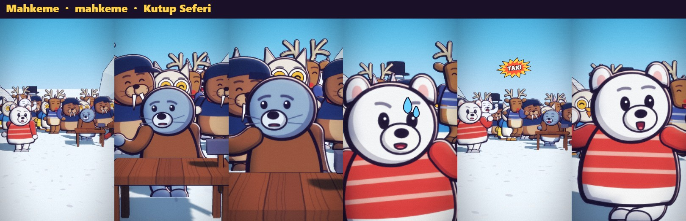

## Soygun · `soygun`

Biri gözcülük eder, öteki hazineyi kapıp kaçar; gözcü arkada kalır.

**Roller:** `a` hırsız, `b` gözcü · **İdeal süre:** 3.5–8 sn

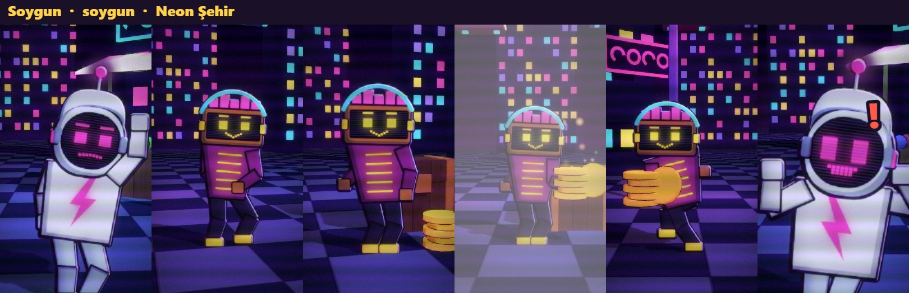

## Sel · `sel`

Su yükselir, eşyalar yüzer, kahraman ötekini çekip kurtarır.

**Roller:** `a` kurtaran, `b` sürüklenen · **İdeal süre:** 3.5–9 sn

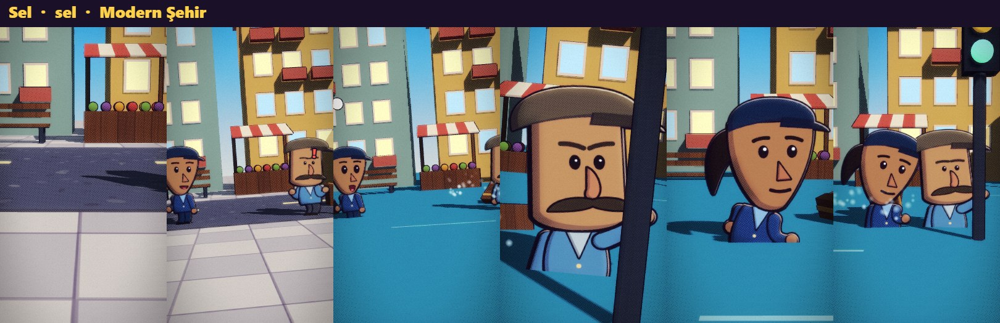

## Küçülme · `kuculme`

Işık çarpar, kahraman minicik kalır; öteki ayağının dibinde onu arar.

**Roller:** `a` küçülen, `b` arayan · **İdeal süre:** 3–8 sn

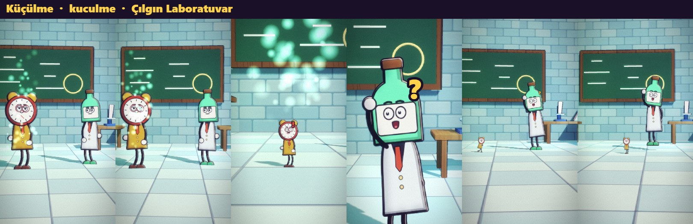

## Zaman donar · `donma`

Herkes bir anda donar, yalnız kahraman yürür ve bir numara çevirir; zaman akınca kıyamet kopar.

**Roller:** `a` hareket eden, `b` donan, `c` donan 2 · **İdeal süre:** 4–9 sn

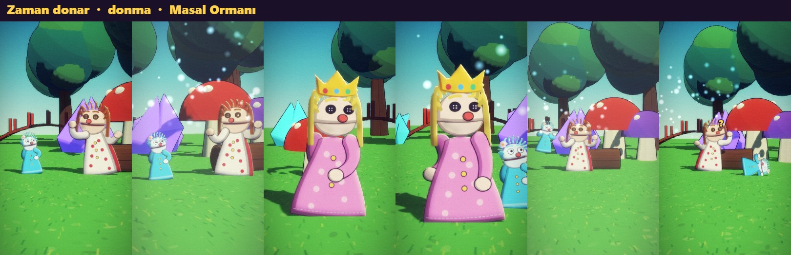

## Kılık değiştirme · `kilik`

Kahraman dumanın içinde başka birine dönüşür, nöbetçiyi kandırır.

**Roller:** `a` kılık değiştiren, `b` kanan · **İdeal süre:** 3.5–8 sn

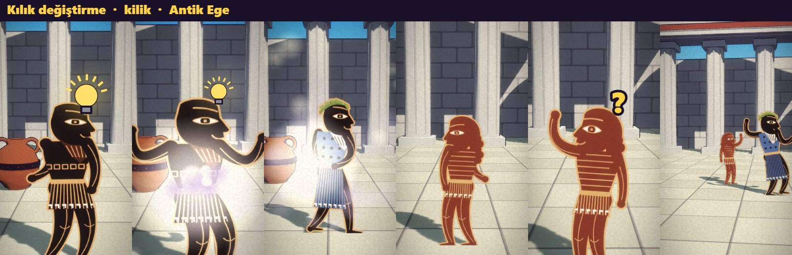

## Yanlış kişiye tokat · `yanlistokat`

Biri vurmaya niyetlenir, hedef eğilir, tokat arkadakine gider.

**Roller:** `a` vuran, `b` eğilen, `c` yiyen · **İdeal süre:** 3–7 sn

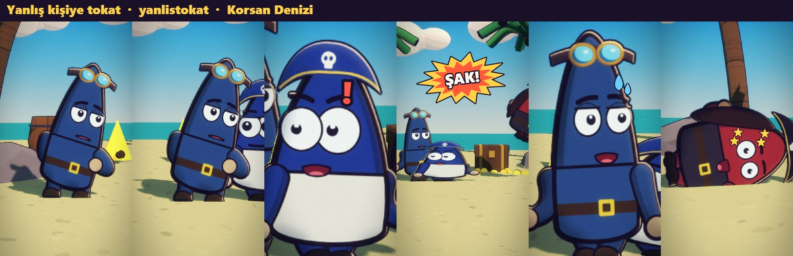

## Zincirleme kaza · `zincir`

Küçük bir dokunuş; fıçı yuvarlanır, küp uçar, sandık birinin yanına düşer.

**Roller:** `a` başlatan, `b` kurban · **İdeal süre:** 3.5–8 sn

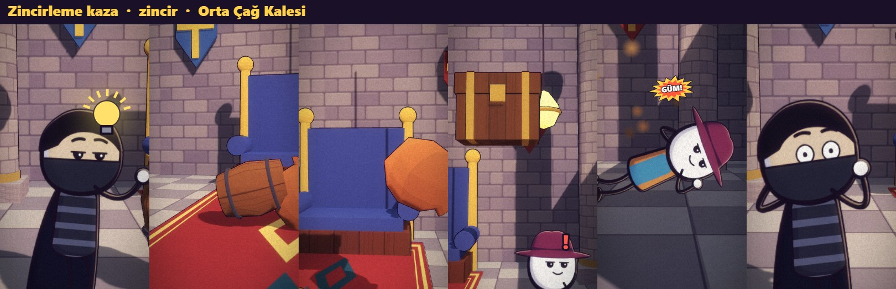

## Ters köşe · `terskose`

Kazandığını sanan kutlama yapar; arkasındaki asıl kazanan omzuna dokunur.

**Roller:** `a` kazandığını sanan, `b` asıl kazanan · **İdeal süre:** 3–8 sn

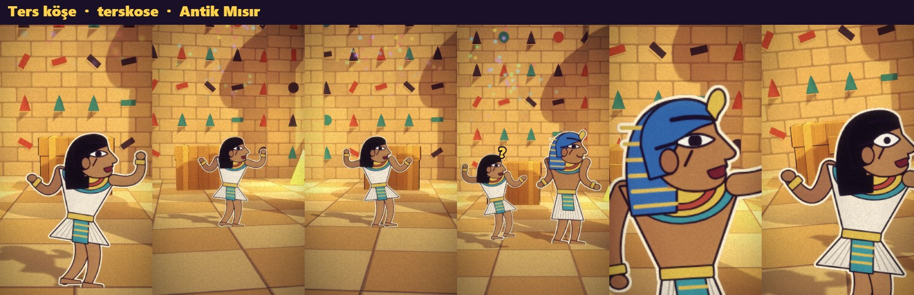

## Meğer rüyaymış · `ruya`

Her şey uçuşur, kahraman dev gibi olur; ışık çakar ve yerde uyanır.

**Roller:** `a` rüya gören, `b` uyandıran · **İdeal süre:** 4–9 sn

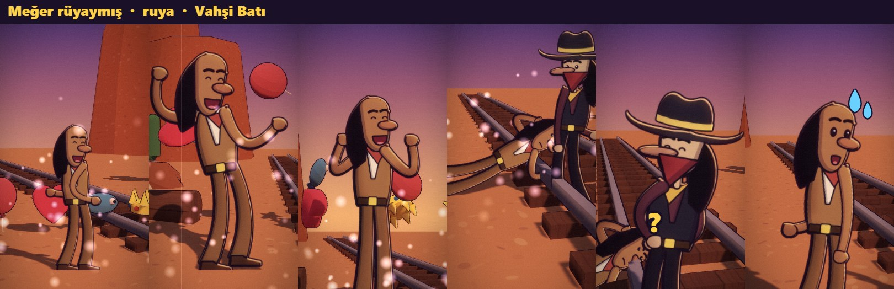

## Hazine yağmuru · `hazineyagmuru`

Gökten eşyalar yağar, biri kollarını açar, öteki altında kalır.

**Roller:** `a` sevinen, `b` altında kalan · **İdeal süre:** 3–8 sn

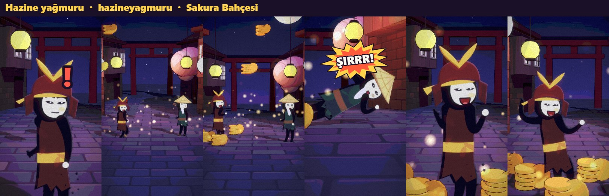

## Barış · `baris`

İki düşman birbirine yürür, gerilim doruğa çıkar; sonra el sıkışıp dans ederler.

**Roller:** `a` birinci, `b` ikinci · **İdeal süre:** 3.5–8 sn

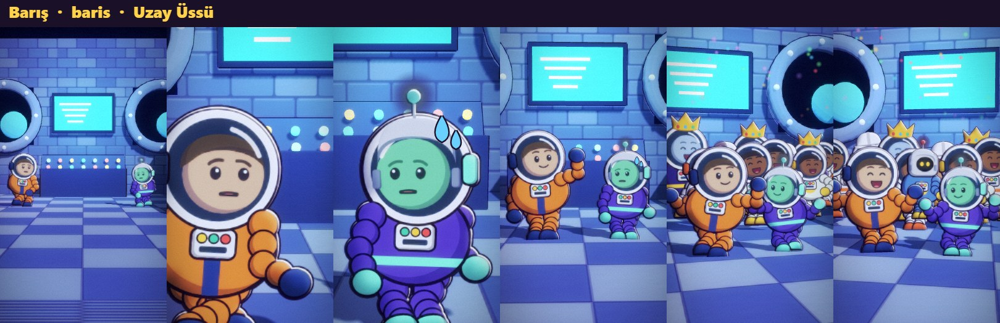
