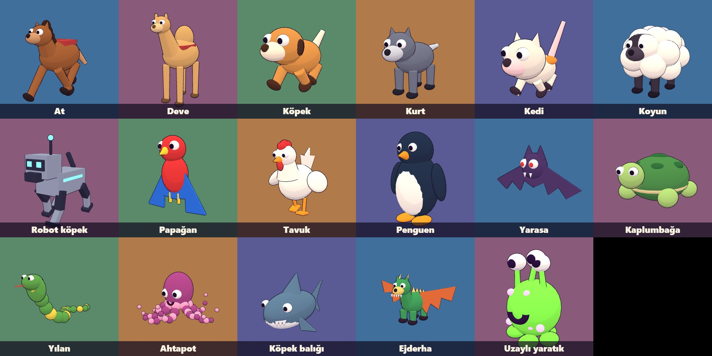
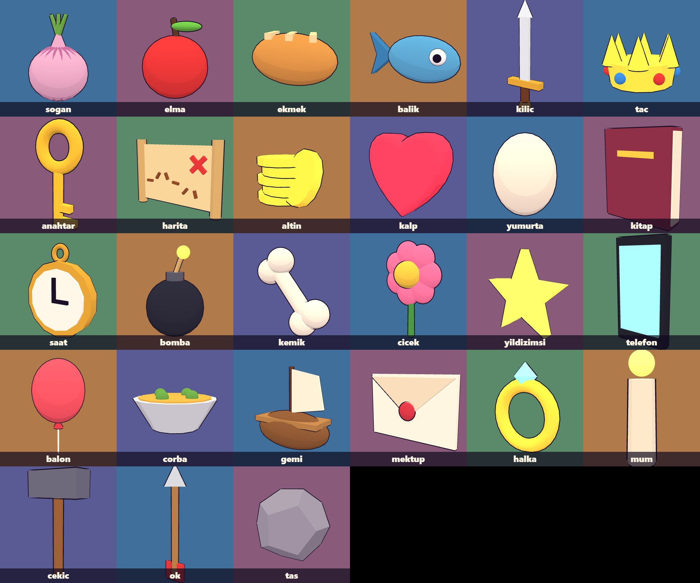

# Ses, hayvanlar, kalabalık, sözle beliren nesneler

## Anlatıcı sesi: metin bizden, ses senden

```bash
node sistem.mjs hikaye metin filmim
```

`hikayeler/filmim/metin/` içine şunları yazar:

- `tam.txt`: ElevenLabs'e yapıştırılacak bütün metin
- `C01.txt`, `C02.txt` …: cümle cümle
- `yonerge.md`: her cümlenin tonu ve hedef süresi, gereken dış seslerin listesi ve İngilizce tarifleri

Sesi hazırlayınca `hikayeler/filmim/ses/` içine koy:

| Yol | Dosya |
|---|---|
| Tek kayıt | `tam.mp3`. Sistem cümlelere böler |
| Cümle cümle *(en kesin)* | `C01.mp3`, `C02.mp3` … |

mp3, wav, m4a, ogg, flac olur. Sonra:

```bash
node sistem.mjs hikaye ses filmim
```

Film sesin gerçek süresine göre yeniden zamanlanır. Tek kayıtta bir cümle yanlış bölünürse yalnız onu ayrı koy.

## Dış sesler

Adım, zıplama, düşme, tokat, patlama, alkış, hayvan sesi gibi efektler ekranda olan olaydan kendiliğinden çıkar ve kodla üretilir. Gerçek ses kullanmak istersen aynı adla koy, kendiliğinden onun yerine geçer:

- Yalnız bu film: `hikayeler/filmim/sesler/patlama.mp3`
- Bütün filmler: depo kökünde `sesler/patlama.mp3`
- Tam istediğin ana kendi sesin: `"efektSes": [["C03.2", "kapi", 0.8]]` ve `sesler/kapi.mp3`

Kapatmak: `"otoSes": false`. Koyduğun sesin lisansına sen bakmalısın; `ses/` ve `sesler/` klasörleri depoya yüklenmez.

## Hayvanlar



`node sistem.mjs hikaye hayvanlar`. Her temanın bir yoldaşı ve bir dev canavarı vardır. Sahnede değiştirmek için `"hayvan": "kedi"`.

```json
"nesneler": { "kedi": { "p": "kedi", "mekan": "bir", "yer": [-3, 0, 0.5] } },
"olaylar": [ { "an": "C02", "nesne": "kedi", "eyle": "git", "x": 1, "y": 0, "z": 0.5, "sure": 1.6 } ]
```

Hayvan eylemleri: `git` (yürür, döner, bacakları oynar), `zipla`, `firla`, `salla`, `yok`.

## Kalabalık

```json
"kitleler": [ { "an": "C04", "bitis": "C06", "mekan": "bir", "tur": "kacis", "n": 30, "z": -1, "derin": 2 } ]
```

Türler: `seyirci` (zıplar, alkışlar), `kacis` (koşar), `ordu` (uygun adım). En çok 60 kişi. `kimler` verilmezse temanın o hikâyede oynamayan karakterleri kullanılır.

## Sözle beliren nesneler



Anlatıcı "soğan" dediği anda soğan ekranda belirir; yüzü en az kapatan köşeyi kendisi seçer. Türkçe ekleri tanır (gemisi, kılıcını). Liste: `motor3/sozluk.js`.

- Başka nesne: cümleye `"goster": "elma"`
- O cümlede kapat: `"goster": false`
- Tümünü kapat: `"sozNesne": false`

Eşya kullanan sahneler (kap kaç, gizli anlaşma, tuzak, hayvan hırsız, uçuşan eşyalar) cümlede geçen eşyayı kendiliğinden alır.
