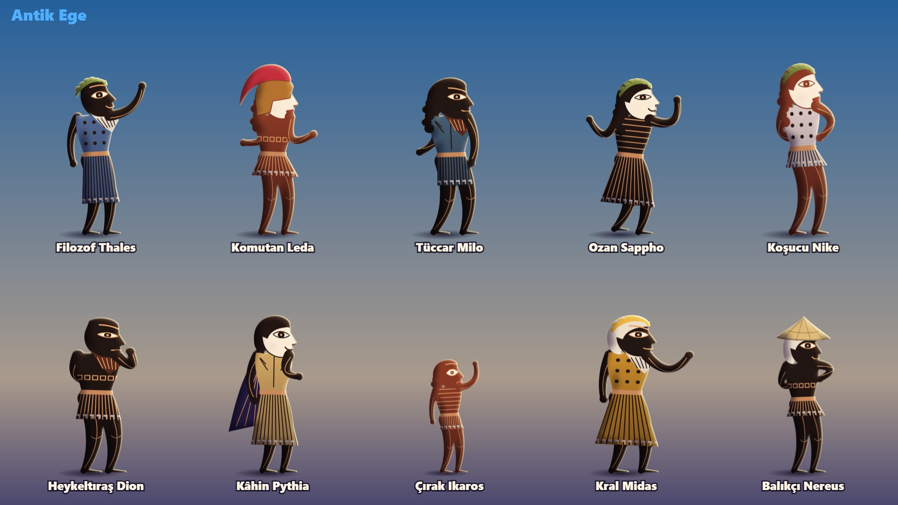

# Antik Ege: video fikirleri

> Koddan üretilir: `node sistem.mjs hikaye rehber`

**Uygun konular:** filozof anekdotları, geometri ve buluş, savaş hileleri, olimpiyat, mitoloji (kurgu)

## 1. Gündüz Feneri

> Filozof güpegündüz fenerle dolaşıyordu.

| | |
|---|---|
| Tür | **araştır**: gerçek konu, kaynak bul |
| Sırrın yönü | Diyojen anekdotu |
| Final | Aradığı insan karşısındadır |
| Kahraman / alaycı / uzman | Filozof Thales / Tüccar Milo / Ozan Sappho |
| Sahneler | Meydan şaşkınlığı → Alay → Kovalamaca → Fikir anı → Zafer |

`node sistem.mjs hikaye yeni filmim --tema=antik --ilham=1`

## 2. Taç Altın mı?

> Hamamdan çıplak koştu, çünkü kralı yakalamıştı.

| | |
|---|---|
| Tür | **araştır**: gerçek konu, kaynak bul |
| Sırrın yönü | Arşimet ve kaldırma kuvveti |
| Final | Kuyumcu kaçar |
| Kahraman / alaycı / uzman | Filozof Thales / Kral Midas / Heykeltıraş Dion |
| Sahneler | Fikir anı → Yarış → Gergin bekleyiş → Ters giden deney → Kovalamaca |

`node sistem.mjs hikaye yeni filmim --tema=antik --ilham=2`

## 3. Koşarak Gelen Haber

> Haberi verdi ve yere yığıldı.

| | |
|---|---|
| Tür | **araştır**: gerçek konu, kaynak bul |
| Sırrın yönü | Maraton anlatısı; kaynaklar farklı |
| Final | Mesaj tek kelimedir |
| Kahraman / alaycı / uzman | Koşucu Nike / Komutan Leda / Ozan Sappho |
| Sahneler | Düello → Yarış → Fırtına → Fikir anı → Yüksekten düşüş |

`node sistem.mjs hikaye yeni filmim --tema=antik --ilham=3`

## 4. Altına Dönen Yemek

> Dokunduğu her şey altındı, aç kaldı.

| | |
|---|---|
| Tür | **kurgu** |
| Sırrın yönü | Midas efsanesi |
| Final | Nehir altın akar |
| Kahraman / alaycı / uzman | Kral Midas / Tüccar Milo / Kâhin Pythia |
| Sahneler | Büyük keşif → Uçuşan eşyalar → Kovalamaca → Gizli anlaşma → Zafer |

`node sistem.mjs hikaye yeni filmim --tema=antik --ilham=4`

## 5. Çift Anlamlı Kehanet

> Kehanet tuttu, ama yanlış kral yıkıldı.

| | |
|---|---|
| Tür | **araştır**: gerçek konu, kaynak bul |
| Sırrın yönü | Karun ve kâhin anlatısı |
| Final | Cümle iki anlamlıdır |
| Kahraman / alaycı / uzman | Kâhin Pythia / Kral Midas / Ozan Sappho |
| Sahneler | Gergin bekleyiş → Gizli anlaşma → Düello → Fikir anı → Alay |

`node sistem.mjs hikaye yeni filmim --tema=antik --ilham=5`

## 6. Ayna Savaşı

> Gemiler kimse dokunmadan bir anda tutuştu.

| | |
|---|---|
| Tür | **araştır**: gerçek konu, kaynak bul |
| Sırrın yönü | Arşimet aynası; gerçekliği tartışmalı |
| Final | Deneylerde zor çıkar |
| Kahraman / alaycı / uzman | Filozof Thales / Komutan Leda / Çırak Ikaros |
| Sahneler | Gergin bekleyiş → Ters giden deney → Patlama → Meydan şaşkınlığı → Zafer |

`node sistem.mjs hikaye yeni filmim --tema=antik --ilham=6`

## 7. Heykelin Gülüşü

> Heykel her sabah biraz daha gülüyordu.

| | |
|---|---|
| Tür | **kurgu** |
| Sırrın yönü | Işık açısı |
| Final | Yontan çıraktır |
| Kahraman / alaycı / uzman | Heykeltıraş Dion / Kral Midas / Çırak Ikaros |
| Sahneler | Gizlice sızma → Meydan şaşkınlığı → Kovalamaca → Büyük keşif → Alay |

`node sistem.mjs hikaye yeni filmim --tema=antik --ilham=7`

## 8. Kaplumbağayı Geçemeyen

> En hızlı koşucu kaplumbağayı geçemedi.

| | |
|---|---|
| Tür | **araştır**: gerçek konu, kaynak bul |
| Sırrın yönü | Zenon paradoksu |
| Final | Kaplumbağa durmuştur |
| Kahraman / alaycı / uzman | Koşucu Nike / Filozof Thales / Çırak Ikaros |
| Sahneler | Alay → Yarış → Gergin bekleyiş → Ters giden deney → Zafer |

`node sistem.mjs hikaye yeni filmim --tema=antik --ilham=8`

[← Bütün temalar](../ILHAM.md)
