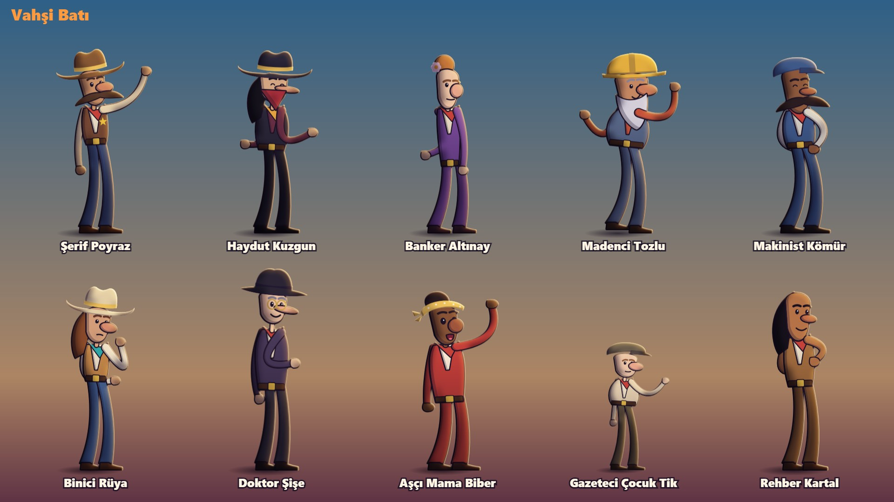

# Vahşi Batı: video fikirleri

> Koddan üretilir: `node sistem.mjs hikaye rehber`

**Uygun konular:** altına hücum, tren ve telgraf, soygun ve kaçış, dolandırıcılık, kasaba yasaları

## 1. Altın Sıkılan Maden

> Boş madenin duvarına altın tozu sıktı.

| | |
|---|---|
| Tür | **araştır**: gerçek konu, kaynak bul |
| Sırrın yönü | Maden tuzlama dolandırıcılığı |
| Final | Alıcı gerçek damar bulur |
| Kahraman / alaycı / uzman | Madenci Tozlu / Doktor Şişe / Banker Altınay |
| Sahneler | Gizlice sızma → Patlama → Gizli anlaşma → Büyük keşif → Alay |

`node sistem.mjs hikaye yeni filmim --tema=bati --ilham=1`

## 2. Durmayan Tren

> Soyguncular treni durdurdu, kasa yoktu.

| | |
|---|---|
| Tür | **kurgu** |
| Sırrın yönü | Sahte kasa |
| Final | Para yolcu çantasındadır |
| Kahraman / alaycı / uzman | Makinist Kömür / Haydut Kuzgun / Banker Altınay |
| Sahneler | Kovalamaca → Patlama → Tuzak → Fikir anı → Alay |

`node sistem.mjs hikaye yeni filmim --tema=bati --ilham=2`

## 3. Her Derde Deva Şişe

> Aynı şişe hem saçı hem çizmeyi parlatıyordu.

| | |
|---|---|
| Tür | **araştır**: gerçek konu, kaynak bul |
| Sırrın yönü | Sahte ilaç satıcıları |
| Final | İlk müşteri ortağıdır |
| Kahraman / alaycı / uzman | Doktor Şişe / Şerif Poyraz / Aşçı Mama Biber |
| Sahneler | Meydan şaşkınlığı → Ters giden deney → Kovalamaca → İhanet → Son anda kaçış |

`node sistem.mjs hikaye yeni filmim --tema=bati --ilham=3`

## 4. Düelloya Gelmeyen Adam

> Düelloya gelmedi ama kazandı.

| | |
|---|---|
| Tür | **kurgu** |
| Sırrın yönü | Saat ve güneş hilesi |
| Final | Rakip yanlış güne gelmiştir |
| Kahraman / alaycı / uzman | Şerif Poyraz / Haydut Kuzgun / Gazeteci Çocuk Tik |
| Sahneler | Gergin bekleyiş → Düello → Alay → Fikir anı → Zafer |

`node sistem.mjs hikaye yeni filmim --tema=bati --ilham=4`

## 5. İlk İkinci Çeken

> Neden ikinci davranan daha hızlıydı?

| | |
|---|---|
| Tür | **araştır**: gerçek konu, kaynak bul |
| Sırrın yönü | Tepki ve niyetli hareket araştırmaları |
| Final | Hız yetmez |
| Kahraman / alaycı / uzman | Binici Rüya / Haydut Kuzgun / Doktor Şişe |
| Sahneler | Düello → Yarış → Toz bulutu kavga → Ters giden deney → Zafer |

`node sistem.mjs hikaye yeni filmim --tema=bati --ilham=5`

## 6. Telgrafı Susturan Kuş

> Bütün kasabanın haberini bir kuş kesti.

| | |
|---|---|
| Tür | **kurgu** |
| Sırrın yönü | Tel ve kısa devre |
| Final | Kuş yuva yapmıştır |
| Kahraman / alaycı / uzman | Gazeteci Çocuk Tik / Makinist Kömür / Rehber Kartal |
| Sahneler | Kovalamaca → Fırtına → Yüksekten düşüş → Fikir anı → Zafer |

`node sistem.mjs hikaye yeni filmim --tema=bati --ilham=6`

## 7. Kasabayı Taşıyanlar

> Bir gecede bütün kasaba yer değiştirdi.

| | |
|---|---|
| Tür | **araştır**: gerçek konu, kaynak bul |
| Sırrın yönü | Raylar üstünde evler |
| Final | Yeni yerde tren durur |
| Kahraman / alaycı / uzman | Banker Altınay / Şerif Poyraz / Makinist Kömür |
| Sahneler | Gergin bekleyiş → Deprem → Kovalamaca → Meydan şaşkınlığı → Zafer |

`node sistem.mjs hikaye yeni filmim --tema=bati --ilham=7`

## 8. Haritasız İz Süren

> Ayak izine bakmadan kaçağı buldu.

| | |
|---|---|
| Tür | **kurgu** |
| Sırrın yönü | Kuşlar, toz ve rüzgâr |
| Final | Kaçak arkasındadır |
| Kahraman / alaycı / uzman | Rehber Kartal / Şerif Poyraz / Haydut Kuzgun |
| Sahneler | Gizlice sızma → Kovalamaca → Fikir anı → Tuzak → Alay |

`node sistem.mjs hikaye yeni filmim --tema=bati --ilham=8`

[← Bütün temalar](../ILHAM.md)
