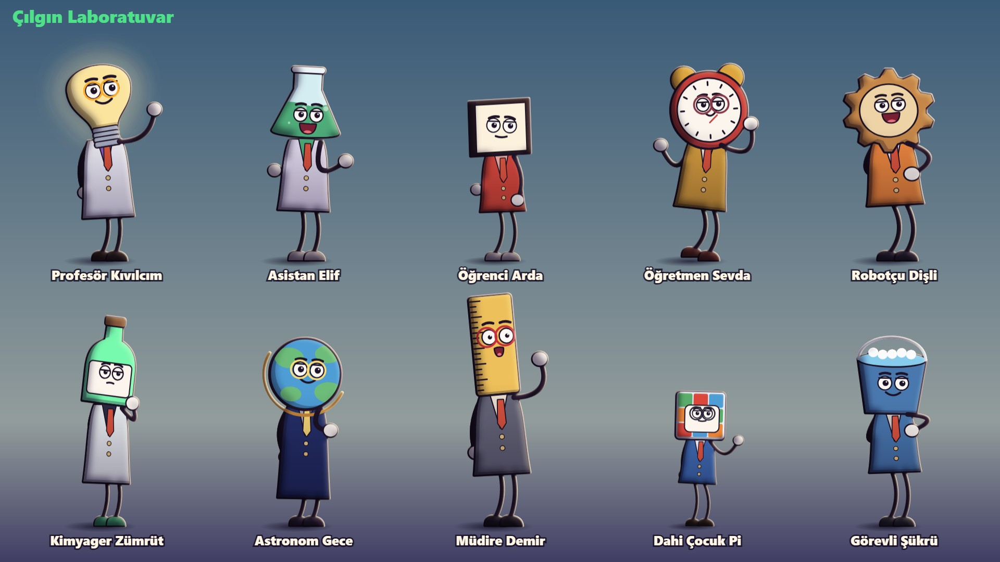

# Çılgın Laboratuvar: video fikirleri

> Koddan üretilir: `node sistem.mjs hikaye rehber`

**Uygun konular:** tesadüfen yapılan buluşlar, ünlü deneyler, kimya ve elektrik, matematik bilmeceleri, insan bedeni

## 1. Küflenen Deney

> Kirli tabağı atmadı, milyonlarca hayat kurtuldu.

| | |
|---|---|
| Tür | **araştır**: gerçek konu, kaynak bul |
| Sırrın yönü | Penisilin |
| Final | Tabak müzededir |
| Kahraman / alaycı / uzman | Görevli Şükrü / Müdire Demir / Kimyager Zümrüt |
| Sahneler | Gergin bekleyiş → Ters giden deney → Toz bulutu kavga → Büyük keşif → Zafer |

`node sistem.mjs hikaye yeni filmim --tema=bilim --ilham=1`

## 2. Cebinde Eriyen Çikolata

> Makineye yaklaştı, çikolatası eridi.

| | |
|---|---|
| Tür | **araştır**: gerçek konu, kaynak bul |
| Sırrın yönü | Mikrodalga |
| Final | İlk yiyecek patlar |
| Kahraman / alaycı / uzman | Robotçu Dişli / Müdire Demir / Profesör Kıvılcım |
| Sahneler | Fikir anı → Ters giden deney → Patlama → Büyük keşif → Zafer |

`node sistem.mjs hikaye yeni filmim --tema=bilim --ilham=2`

## 3. Yapışmayan Yapıştırıcı

> En kötü yapıştırıcı en çok satan oldu.

| | |
|---|---|
| Tür | **araştır**: gerçek konu, kaynak bul |
| Sırrın yönü | Yapışkan not kâğıdı |
| Final | Koro defterinde başlar |
| Kahraman / alaycı / uzman | Asistan Elif / Müdire Demir / Kimyager Zümrüt |
| Sahneler | Ters giden deney → Alay → Kap kaç → Fikir anı → Zafer |

`node sistem.mjs hikaye yeni filmim --tema=bilim --ilham=3`

## 4. Kendini Aşılayan Profesör

> Kimse inanmayınca deneyi kendi üstünde yaptı.

| | |
|---|---|
| Tür | **araştır**: gerçek konu, kaynak bul |
| Sırrın yönü | Bakteri ve ülser |
| Final | Ödül alır |
| Kahraman / alaycı / uzman | Profesör Kıvılcım / Müdire Demir / Asistan Elif |
| Sahneler | Alay → Ters giden deney → Yüksekten düşüş → Gergin bekleyiş → Zafer |

`node sistem.mjs hikaye yeni filmim --tema=bilim --ilham=4`

## 5. Yanlış Ölçen Cetvel

> Cetvel yanlıştı, bina doğru çıktı.

| | |
|---|---|
| Tür | **kurgu** |
| Sırrın yönü | İki hata birbirini götürür |
| Final | Cetvel saklanır |
| Kahraman / alaycı / uzman | Müdire Demir / Öğretmen Sevda / Dahi Çocuk Pi |
| Sahneler | Gergin bekleyiş → Deprem → Alay → Fikir anı → Zafer |

`node sistem.mjs hikaye yeni filmim --tema=bilim --ilham=5`

## 6. Düşmeyen Elma

> Elma düşmedi, profesör çıldırdı.

| | |
|---|---|
| Tür | **kurgu** |
| Sırrın yönü | Mıknatıs ya da ip hilesi |
| Final | Öğrenci bağlamıştır |
| Kahraman / alaycı / uzman | Öğrenci Arda / Profesör Kıvılcım / Öğretmen Sevda |
| Sahneler | Uçuşan eşyalar → Gizlice sızma → Kovalamaca → Ters giden deney → Alay |

`node sistem.mjs hikaye yeni filmim --tema=bilim --ilham=6`

## 7. Saati Durduran Çocuk

> Saat durdu, sınav bitmedi.

| | |
|---|---|
| Tür | **kurgu** |
| Sırrın yönü | Sarkaç |
| Final | Öğretmen de durdurmuştur |
| Kahraman / alaycı / uzman | Dahi Çocuk Pi / Öğretmen Sevda / Robotçu Dişli |
| Sahneler | Gizlice sızma → Kaybolma → Kovalamaca → Ters giden deney → Zafer |

`node sistem.mjs hikaye yeni filmim --tema=bilim --ilham=7`

## 8. Rengi Unutan Deney

> Karışım her karıştırmada renk değiştirdi.

| | |
|---|---|
| Tür | **araştır**: gerçek konu, kaynak bul |
| Sırrın yönü | Salınan tepkimeler |
| Final | Yarışmayı kazanır |
| Kahraman / alaycı / uzman | Kimyager Zümrüt / Öğretmen Sevda / Asistan Elif |
| Sahneler | Ters giden deney → Alay → Patlama → Uçuşan eşyalar → Zafer |

`node sistem.mjs hikaye yeni filmim --tema=bilim --ilham=8`

[← Bütün temalar](../ILHAM.md)
