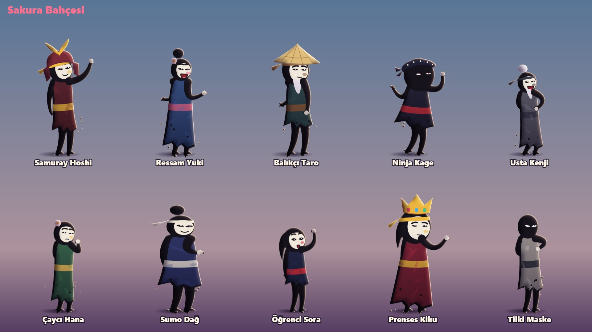

# Sakura Bahçesi: video fikirleri

> Koddan üretilir: `node sistem.mjs hikaye rehber`

**Uygun konular:** zanaat ve sanat, savaş taktikleri, gelenek ve görgü, çay, yemek, bahçe, gizli örgüt efsaneleri

## 1. Kırık Vazonun Değeri

> Usta en güzel vazosunu bilerek kırdı.

| | |
|---|---|
| Tür | **araştır**: gerçek konu, kaynak bul |
| Sırrın yönü | Altınla onarma sanatı |
| Final | Kırık olan daha pahalıdır |
| Kahraman / alaycı / uzman | Usta Kenji / Prenses Kiku / Öğrenci Sora |
| Sahneler | Yüksekten düşüş → Alay → Gergin bekleyiş → Büyük keşif → Zafer |

`node sistem.mjs hikaye yeni filmim --tema=japon --ilham=1`

## 2. Boş Kaledeki Çalgı

> Düşman kapıdayken kaleyi açıp çalgı çaldı.

| | |
|---|---|
| Tür | **araştır**: gerçek konu, kaynak bul |
| Sırrın yönü | Boş kale hilesi |
| Final | Ordu geri döner |
| Kahraman / alaycı / uzman | Ressam Yuki / Samuray Hoshi / Çaycı Hana |
| Sahneler | Gergin bekleyiş → Fırtına → Meydan şaşkınlığı → Son anda kaçış → Alay |

`node sistem.mjs hikaye yeni filmim --tema=japon --ilham=2`

## 3. Kılıcını Satan Samuray

> Savaştan önce kılıcını sattı.

| | |
|---|---|
| Tür | **kurgu** |
| Sırrın yönü | Ün, söylenti ve hile |
| Final | Rakip korkudan gelmez |
| Kahraman / alaycı / uzman | Samuray Hoshi / Sumo Dağ / Balıkçı Taro |
| Sahneler | Gizli anlaşma → Alay → Düello → Fikir anı → Zafer |

`node sistem.mjs hikaye yeni filmim --tema=japon --ilham=3`

## 4. Çayı Taşıran Usta

> Dolu bardağa çay doldurmayı bırakmadı.

| | |
|---|---|
| Tür | **kurgu** |
| Sırrın yönü | Öğrenmek için boşalmak |
| Final | Öğrenci susar |
| Kahraman / alaycı / uzman | Usta Kenji / Öğrenci Sora / Çaycı Hana |
| Sahneler | Gergin bekleyiş → Ters giden deney → Meydan şaşkınlığı → Fikir anı → Zafer |

`node sistem.mjs hikaye yeni filmim --tema=japon --ilham=4`

## 5. Gölgesini Satan Ninja

> Gece boyunca aynı yerde iki gölge vardı.

| | |
|---|---|
| Tür | **kurgu** |
| Sırrın yönü | Fener ve açı |
| Final | Üçüncü gölge kedidir |
| Kahraman / alaycı / uzman | Ninja Kage / Samuray Hoshi / Tilki Maske |
| Sahneler | Gizlice sızma → Kaybolma → Kovalamaca → Fikir anı → Son anda kaçış |

`node sistem.mjs hikaye yeni filmim --tema=japon --ilham=5`

## 6. Sumoyu Deviren Çocuk

> En küçük, en büyüğü tek parmakla devirdi.

| | |
|---|---|
| Tür | **kurgu** |
| Sırrın yönü | Denge merkezi |
| Final | Dev güler |
| Kahraman / alaycı / uzman | Öğrenci Sora / Sumo Dağ / Usta Kenji |
| Sahneler | Alay → Çarpışma → Yüksekten düşüş → Ters giden deney → Zafer |

`node sistem.mjs hikaye yeni filmim --tema=japon --ilham=6`

## 7. Mürekkebi Biten Ressam

> Mürekkebi bitti, resmi yine tamamladı.

| | |
|---|---|
| Tür | **kurgu** |
| Sırrın yönü | Boşluk ve gölge |
| Final | Resim pencereden görünür |
| Kahraman / alaycı / uzman | Ressam Yuki / Prenses Kiku / Usta Kenji |
| Sahneler | Fikir anı → Fırtına → Gizlice sızma → Büyük keşif → Zafer |

`node sistem.mjs hikaye yeni filmim --tema=japon --ilham=7`

## 8. Deprem Uyarısı Veren Kuyu

> Kuyunun suyu çekilince köyü boşalttı.

| | |
|---|---|
| Tür | **araştır**: gerçek konu, kaynak bul |
| Sırrın yönü | Yeraltı suyu değişimi; kesinliği araştır |
| Final | Geç kalan geri döner |
| Kahraman / alaycı / uzman | Balıkçı Taro / Prenses Kiku / Çaycı Hana |
| Sahneler | Gergin bekleyiş → Meydan şaşkınlığı → Deprem → Fikir anı → Son anda kaçış |

`node sistem.mjs hikaye yeni filmim --tema=japon --ilham=8`

[← Bütün temalar](../ILHAM.md)
