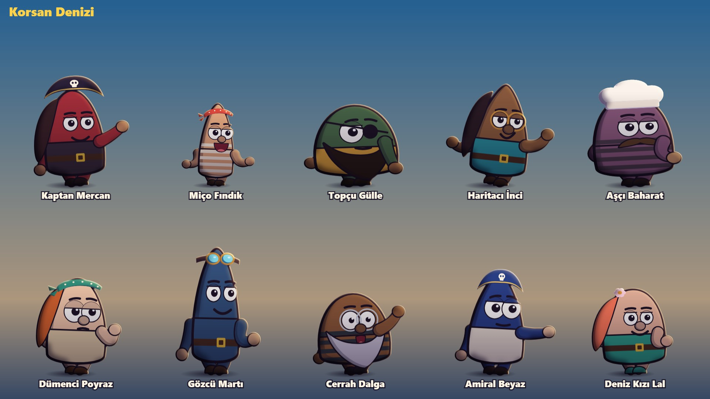

# Korsan Denizi: video fikirleri

> Koddan üretilir: `node sistem.mjs hikaye rehber`

**Uygun konular:** denizcilik buluşları, fırtınada hayatta kalma, hazine ve dolandırıcılık, harita ve yön bulma, gemi savaşları

## 1. Gemisini Delen Kaptan

> Fırtınada herkes kaçarken o, gemisinin altını deliyordu.

| | |
|---|---|
| Tür | **kurgu** |
| Sırrın yönü | Su, ağırlık ve denge |
| Final | Batması beklenen gemi ayakta kalan tek gemi olur |
| Kahraman / alaycı / uzman | Kaptan Mercan / Topçu Gülle / Haritacı İnci |
| Sahneler | Fırtına → Gizlice sızma → Deprem → Ters giden deney → Zafer |

`node sistem.mjs hikaye yeni filmim --tema=korsan --ilham=1`

## 2. Topun İçindeki Soğan

> Korsanlar topa gülle yerine soğan doldurdu.

| | |
|---|---|
| Tür | **kurgu** |
| Sırrın yönü | Koku, göz yaşartma ve panik |
| Final | Rakip gemi ağlayarak teslim olur |
| Kahraman / alaycı / uzman | Aşçı Baharat / Amiral Beyaz / Dümenci Poyraz |
| Sahneler | Gizlice sızma → Tuzak → Patlama → Kovalamaca → Meydan şaşkınlığı |

`node sistem.mjs hikaye yeni filmim --tema=korsan --ilham=2`

## 3. Denize Yağ Döken Denizciler

> Fırtınada denizciler neden denize yağ dökerdi?

| | |
|---|---|
| Tür | **araştır**: gerçek konu, kaynak bul |
| Sırrın yönü | Yağ tabakasının dalgaya etkisi |
| Final | Alay eden de yağ ister |
| Kahraman / alaycı / uzman | Dümenci Poyraz / Topçu Gülle / Cerrah Dalga |
| Sahneler | Fırtına → Son anda kaçış → Deprem → Ters giden deney → Zafer |

`node sistem.mjs hikaye yeni filmim --tema=korsan --ilham=3`

## 4. Göz Bandının Gerçek Nedeni

> İki gözü de sağlamdı ama birini hep kapalı tutuyordu.

| | |
|---|---|
| Tür | **araştır**: gerçek konu, kaynak bul |
| Sırrın yönü | Karanlığa alışan göz fikri; kesin kanıt var mı araştır |
| Final | Işık sönünce yalnız o görür |
| Kahraman / alaycı / uzman | Topçu Gülle / Kaptan Mercan / Cerrah Dalga |
| Sahneler | Fikir anı → Gizlice sızma → Toz bulutu kavga → Kaybolma → Zafer |

`node sistem.mjs hikaye yeni filmim --tema=korsan --ilham=4`

## 5. Boş Sandığın Korsanı

> Hazineyi buldu, içi boştu, yine de zengin oldu.

| | |
|---|---|
| Tür | **kurgu** |
| Sırrın yönü | Söylenti nasıl para eder |
| Final | Harita satışı |
| Kahraman / alaycı / uzman | Haritacı İnci / Kaptan Mercan / Miço Fındık |
| Sahneler | Büyük keşif → Gizli anlaşma → Kovalamaca → Meydan şaşkınlığı → Kap kaç |

`node sistem.mjs hikaye yeni filmim --tema=korsan --ilham=5`

## 6. İskorbüt Deneyi

> Doktor aynı hastalara neden farklı yiyecekler verdi?

| | |
|---|---|
| Tür | **araştır**: gerçek konu, kaynak bul |
| Sırrın yönü | Turunçgil ve vitamin |
| Final | En çok alay edilen öneri işe yarar |
| Kahraman / alaycı / uzman | Cerrah Dalga / Amiral Beyaz / Aşçı Baharat |
| Sahneler | Gergin bekleyiş → Ters giden deney → Yüksekten düşüş → Fikir anı → Zafer |

`node sistem.mjs hikaye yeni filmim --tema=korsan --ilham=6`

## 7. Aynı Anda İki Adada

> Korsan iki limanda aynı saatte görüldü.

| | |
|---|---|
| Tür | **kurgu** |
| Sırrın yönü | İkiz, kıyafet ya da saat hilesi |
| Final | Tanık yanlış saate bakmıştır |
| Kahraman / alaycı / uzman | Kaptan Mercan / Amiral Beyaz / Gözcü Martı |
| Sahneler | Kaybolma → Gizlice sızma → Kovalamaca → Fikir anı → İhanet |

`node sistem.mjs hikaye yeni filmim --tema=korsan --ilham=7`

## 8. Savaşsız Alınan Gemi

> Tek kurşun atmadan koca gemiyi teslim aldı.

| | |
|---|---|
| Tür | **araştır**: gerçek konu, kaynak bul |
| Sırrın yönü | Bayrak, duman ve korku psikolojisi |
| Final | Gemide yalnızca üç kişi vardır |
| Kahraman / alaycı / uzman | Dümenci Poyraz / Amiral Beyaz / Miço Fındık |
| Sahneler | Gergin bekleyiş → Gizli anlaşma → Patlama → Meydan şaşkınlığı → Alay |

`node sistem.mjs hikaye yeni filmim --tema=korsan --ilham=8`

[← Bütün temalar](../ILHAM.md)
