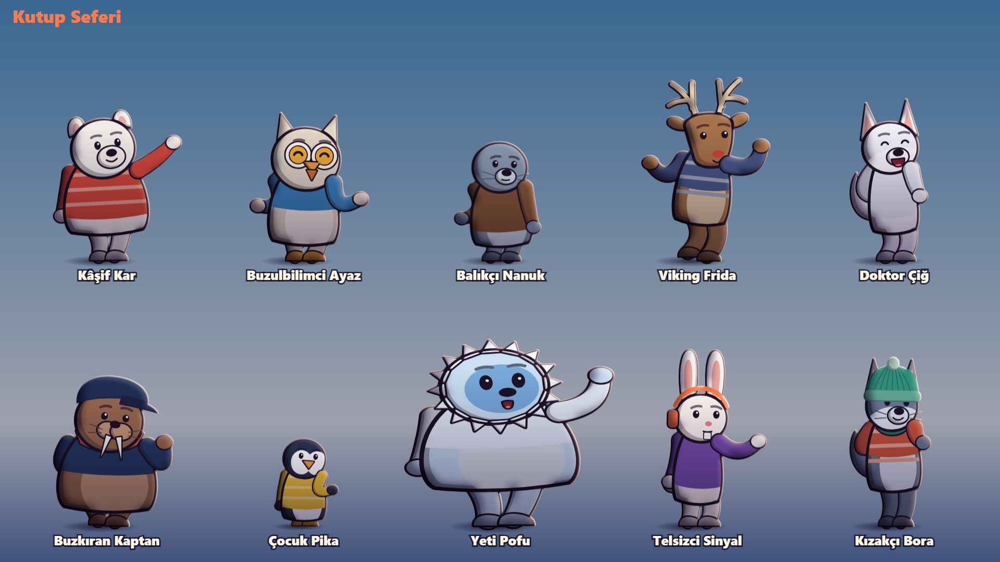

# Kutup Seferi: video fikirleri

> Koddan üretilir: `node sistem.mjs hikaye rehber`

**Uygun konular:** kutup yarışları, hayatta kalma, buz ve iklim, hayvan gözlemi, kuzey halkları ve denizciler

## 1. Çadırını Yakan Kâşif

> Donmamak için çadırını ateşe verdi.

| | |
|---|---|
| Tür | **kurgu** |
| Sırrın yönü | Kar mağarası ve yalıtım |
| Final | Karın altı daha sıcaktır |
| Kahraman / alaycı / uzman | Kâşif Kar / Kızakçı Bora / Balıkçı Nanuk |
| Sahneler | Fırtına → Patlama → Alay → Ters giden deney → Zafer |

`node sistem.mjs hikaye yeni filmim --tema=kutup --ilham=1`

## 2. Buz Evin Sıcaklığı

> Buzdan evin içinde neden terlediler?

| | |
|---|---|
| Tür | **araştır**: gerçek konu, kaynak bul |
| Sırrın yönü | Kar ve hava yalıtımı |
| Final | Alaycı kapıyı çalar |
| Kahraman / alaycı / uzman | Balıkçı Nanuk / Buzkıran Kaptan / Buzulbilimci Ayaz |
| Sahneler | Alay → Fırtına → Gergin bekleyiş → Ters giden deney → Zafer |

`node sistem.mjs hikaye yeni filmim --tema=kutup --ilham=2`

## 3. Penguenin Çakıl Taşı

> Penguen hediye diye taş çaldı.

| | |
|---|---|
| Tür | **araştır**: gerçek konu, kaynak bul |
| Sırrın yönü | Yuva taşı davranışı |
| Final | Taş üç kez el değiştirir |
| Kahraman / alaycı / uzman | Çocuk Pika / Yeti Pofu / Buzulbilimci Ayaz |
| Sahneler | Kap kaç → Kovalamaca → Gizli anlaşma → Fikir anı → Zafer |

`node sistem.mjs hikaye yeni filmim --tema=kutup --ilham=3`

## 4. Buza Sıkışan Gemi

> Kaptan gemiyi kurtarmak yerine futbol oynattı.

| | |
|---|---|
| Tür | **araştır**: gerçek konu, kaynak bul |
| Sırrın yönü | Moral ve hayatta kalma |
| Final | Herkes döner |
| Kahraman / alaycı / uzman | Buzkıran Kaptan / Kâşif Kar / Doktor Çiğ |
| Sahneler | Deprem → Yarış → Fırtına → Fikir anı → Zafer |

`node sistem.mjs hikaye yeni filmim --tema=kutup --ilham=4`

## 5. Yanlış Yöne Giden Pusula

> Pusula doğruydu, herkes yanlış gitti.

| | |
|---|---|
| Tür | **araştır**: gerçek konu, kaynak bul |
| Sırrın yönü | Manyetik kutup |
| Final | Yıldız konuşur |
| Kahraman / alaycı / uzman | Buzulbilimci Ayaz / Kızakçı Bora / Balıkçı Nanuk |
| Sahneler | Fırtına → Kovalamaca → Yüksekten düşüş → Fikir anı → Zafer |

`node sistem.mjs hikaye yeni filmim --tema=kutup --ilham=5`

## 6. Yeti'nin Ayak İzi

> İz her sabah biraz daha büyüyordu.

| | |
|---|---|
| Tür | **araştır**: gerçek konu, kaynak bul |
| Sırrın yönü | Eriyen kar |
| Final | İz tavşanındır |
| Kahraman / alaycı / uzman | Telsizci Sinyal / Yeti Pofu / Buzulbilimci Ayaz |
| Sahneler | Gizlice sızma → Son anda kaçış → Tuzak → Fikir anı → Alay |

`node sistem.mjs hikaye yeni filmim --tema=kutup --ilham=6`

## 7. Susan Telsiz

> Yardım çağırdı, kendi sesini duydu.

| | |
|---|---|
| Tür | **kurgu** |
| Sırrın yönü | Yankı |
| Final | Karşıdaki ikinci kamptır |
| Kahraman / alaycı / uzman | Telsizci Sinyal / Buzkıran Kaptan / Doktor Çiğ |
| Sahneler | Gergin bekleyiş → Fırtına → Gizlice sızma → Fikir anı → Zafer |

`node sistem.mjs hikaye yeni filmim --tema=kutup --ilham=7`

## 8. Kızağı Çeken Rüzgâr

> Köpeksiz kızak yarışı kazandı.

| | |
|---|---|
| Tür | **kurgu** |
| Sırrın yönü | Yelken |
| Final | Yelken battaniyedir |
| Kahraman / alaycı / uzman | Kızakçı Bora / Viking Frida / Balıkçı Nanuk |
| Sahneler | Alay → Yarış → Fırtına → Ters giden deney → Zafer |

`node sistem.mjs hikaye yeni filmim --tema=kutup --ilham=8`

[← Bütün temalar](../ILHAM.md)
