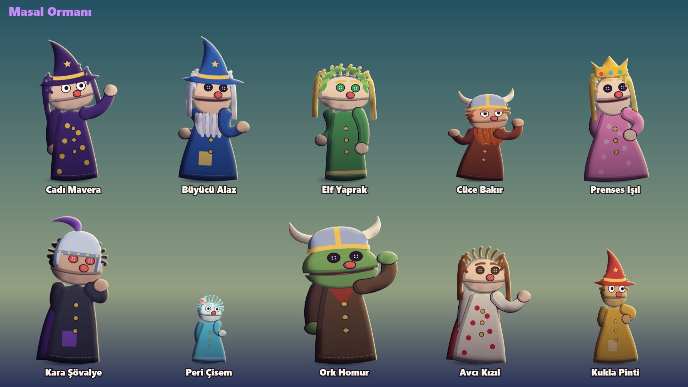

# Masal Ormanı: video fikirleri

> Koddan üretilir: `node sistem.mjs hikaye rehber`

**Uygun konular:** halk masalları, bilmeceler, efsaneler, çocuk hikâyeleri, ahlaki seçimler

## 1. Bedava Dilek

> Cadı dileği bedava verdi, köy onu kovaladı.

| | |
|---|---|
| Tür | **kurgu** |
| Sırrın yönü | Bedelsiz şey olmaz |
| Final | Bedeli önceden ödenmiştir |
| Kahraman / alaycı / uzman | Cadı Mavera / Avcı Kızıl / Büyücü Alaz |
| Sahneler | Gizli anlaşma → Kovalamaca → Uçuşan eşyalar → Fikir anı → İhanet |

`node sistem.mjs hikaye yeni filmim --tema=masal --ilham=1`

## 2. Kendini Kurtaran Prenses

> Şövalye geldiğinde prenses ejderhayla çay içiyordu.

| | |
|---|---|
| Tür | **kurgu** |
| Sırrın yönü | Konuşmak |
| Final | Şövalye kaybolmuştur |
| Kahraman / alaycı / uzman | Prenses Işıl / Kara Şövalye / Peri Çisem |
| Sahneler | Gergin bekleyiş → Düello → Tuzak → Gizli anlaşma → Alay |

`node sistem.mjs hikaye yeni filmim --tema=masal --ilham=2`

## 3. Yalan Söyleyen Kukla

> Her yalanında ev büyüyordu.

| | |
|---|---|
| Tür | **kurgu** |
| Sırrın yönü | Yalanın bedeli |
| Final | Kapı bulunmaz |
| Kahraman / alaycı / uzman | Kukla Pinti / Ork Homur / Peri Çisem |
| Sahneler | Alay → Deprem → Son anda kaçış → Fikir anı → Zafer |

`node sistem.mjs hikaye yeni filmim --tema=masal --ilham=3`

## 4. Korkan Ork

> Köyü basmaya geldi, kelebekten kaçtı.

| | |
|---|---|
| Tür | **kurgu** |
| Sırrın yönü | Korku görecelidir |
| Final | Köyün bekçisi olur |
| Kahraman / alaycı / uzman | Ork Homur / Avcı Kızıl / Peri Çisem |
| Sahneler | Kovalamaca → Meydan şaşkınlığı → Son anda kaçış → Fikir anı → Zafer |

`node sistem.mjs hikaye yeni filmim --tema=masal --ilham=4`

## 5. Küçülen Büyücü

> Her büyüde biraz küçülüyordu.

| | |
|---|---|
| Tür | **kurgu** |
| Sırrın yönü | Gücün bedeli |
| Final | Son büyüyü yapmaz |
| Kahraman / alaycı / uzman | Büyücü Alaz / Cadı Mavera / Elf Yaprak |
| Sahneler | Uçuşan eşyalar → Düello → Kaybolma → Fikir anı → Zafer |

`node sistem.mjs hikaye yeni filmim --tema=masal --ilham=5`

## 6. Gölgesiz Orman

> Ormanda kimsenin gölgesi yoktu.

| | |
|---|---|
| Tür | **kurgu** |
| Sırrın yönü | Işık kaynağı |
| Final | Gölgeler toplanmıştır |
| Kahraman / alaycı / uzman | Elf Yaprak / Cüce Bakır / Peri Çisem |
| Sahneler | Gizlice sızma → Kaybolma → Kovalamaca → Büyük keşif → Zafer |

`node sistem.mjs hikaye yeni filmim --tema=masal --ilham=6`

## 7. Cücenin Madeni

> Altını bulunca madeni kapattı.

| | |
|---|---|
| Tür | **kurgu** |
| Sırrın yönü | Kıtlık ve değer |
| Final | Altın hâlâ oradadır |
| Kahraman / alaycı / uzman | Cüce Bakır / Kara Şövalye / Elf Yaprak |
| Sahneler | Büyük keşif → Patlama → Kap kaç → Fikir anı → Alay |

`node sistem.mjs hikaye yeni filmim --tema=masal --ilham=7`

## 8. İki Kere İyi Kral

> Aynı iyiliği iki kez yaptı, lanetlendi.

| | |
|---|---|
| Tür | **kurgu** |
| Sırrın yönü | Niyet |
| Final | Lanet komiktir |
| Kahraman / alaycı / uzman | Avcı Kızıl / Kara Şövalye / Cadı Mavera |
| Sahneler | Gizli anlaşma → İhanet → Kovalamaca → Uçuşan eşyalar → Zafer |

`node sistem.mjs hikaye yeni filmim --tema=masal --ilham=8`

[← Bütün temalar](../ILHAM.md)
