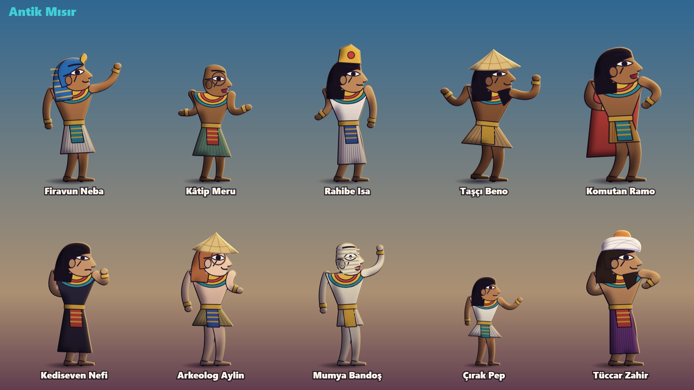

# Antik Mısır: video fikirleri

> Koddan üretilir: `node sistem.mjs hikaye rehber`

**Uygun konular:** yapı ve mühendislik, mezar soygunculuğu ve tuzaklar, yazı ve sayı, tıp ve mumyalama, arkeoloji keşifleri

## 1. Kumu Islatan İşçi

> Taşı çekmek yerine kuma su döküyordu.

| | |
|---|---|
| Tür | **araştır**: gerçek konu, kaynak bul |
| Sırrın yönü | Islak kumda sürtünme |
| Final | Alay eden ekip geride kalır |
| Kahraman / alaycı / uzman | Taşçı Beno / Firavun Neba / Kâtip Meru |
| Sahneler | Alay → Yarış → Deprem → Ters giden deney → Zafer |

`node sistem.mjs hikaye yeni filmim --tema=misir --ilham=1`

## 2. Kendi Mezarını Saklayan

> Firavun mezarını yapan ustalara haritayı vermedi.

| | |
|---|---|
| Tür | **kurgu** |
| Sırrın yönü | Gizli geçit ve tuzak |
| Final | Giriş herkesin gözü önündedir |
| Kahraman / alaycı / uzman | Taşçı Beno / Firavun Neba / Arkeolog Aylin |
| Sahneler | Gizlice sızma → Tuzak → Son anda kaçış → Büyük keşif → Kaybolma |

`node sistem.mjs hikaye yeni filmim --tema=misir --ilham=2`

## 3. Kedi Yüzünden Biten Savaş

> Ordu, bir kedi yüzünden ok atamadı.

| | |
|---|---|
| Tür | **araştır**: gerçek konu, kaynak bul |
| Sırrın yönü | Kutsal kedi anlatısı; kaynağı tartışmalı |
| Final | Kedi hâlâ uyuyordur |
| Kahraman / alaycı / uzman | Kediseven Nefi / Komutan Ramo / Kâtip Meru |
| Sahneler | Gergin bekleyiş → Kovalamaca → Meydan şaşkınlığı → Fikir anı → Zafer |

`node sistem.mjs hikaye yeni filmim --tema=misir --ilham=3`

## 4. Yazıyı Çözen Taş

> Üç kez aynı şeyi yazan taş neden hazineydi?

| | |
|---|---|
| Tür | **araştır**: gerçek konu, kaynak bul |
| Sırrın yönü | Rosetta Taşı |
| Final | En küçük kelime kapıyı açar |
| Kahraman / alaycı / uzman | Arkeolog Aylin / Tüccar Zahir / Kâtip Meru |
| Sahneler | Büyük keşif → Gizli anlaşma → Deprem → Fikir anı → Zafer |

`node sistem.mjs hikaye yeni filmim --tema=misir --ilham=4`

## 5. Günü Çalan Takvim

> Bir rahip yıla beş gün ekledi.

| | |
|---|---|
| Tür | **araştır**: gerçek konu, kaynak bul |
| Sırrın yönü | Güneş yılı |
| Final | Borçlular kurtulur |
| Kahraman / alaycı / uzman | Rahibe Isa / Firavun Neba / Kâtip Meru |
| Sahneler | Fikir anı → Alay → Meydan şaşkınlığı → Kaybolma → Zafer |

`node sistem.mjs hikaye yeni filmim --tema=misir --ilham=5`

## 6. Tuzağa Düşen Tuzakçı

> Mezara tuzak kurdu, ilk o düştü.

| | |
|---|---|
| Tür | **kurgu** |
| Sırrın yönü | Kum ve kapak mekanizması |
| Final | Onu kurtaran hırsızdır |
| Kahraman / alaycı / uzman | Çırak Pep / Taşçı Beno / Mumya Bandoş |
| Sahneler | Gizlice sızma → Tuzak → Yüksekten düşüş → Ters giden deney → Gizli anlaşma |

`node sistem.mjs hikaye yeni filmim --tema=misir --ilham=6`

## 7. Altın Olmayan Altın

> Tüccar altını eritti, ağırlığı arttı.

| | |
|---|---|
| Tür | **kurgu** |
| Sırrın yönü | Yoğunluk ve sahtecilik |
| Final | Terazi konuşur |
| Kahraman / alaycı / uzman | Kâtip Meru / Tüccar Zahir / Rahibe Isa |
| Sahneler | Gizli anlaşma → Kap kaç → Kovalamaca → Ters giden deney → Alay |

`node sistem.mjs hikaye yeni filmim --tema=misir --ilham=7`

## 8. Nil Neden Taştı?

> Herkes kaçarken o tarlasını suya açtı.

| | |
|---|---|
| Tür | **araştır**: gerçek konu, kaynak bul |
| Sırrın yönü | Alüvyon |
| Final | En çok ürün onundur |
| Kahraman / alaycı / uzman | Taşçı Beno / Tüccar Zahir / Rahibe Isa |
| Sahneler | Fırtına → Alay → Son anda kaçış → Fikir anı → Zafer |

`node sistem.mjs hikaye yeni filmim --tema=misir --ilham=8`

[← Bütün temalar](../ILHAM.md)
