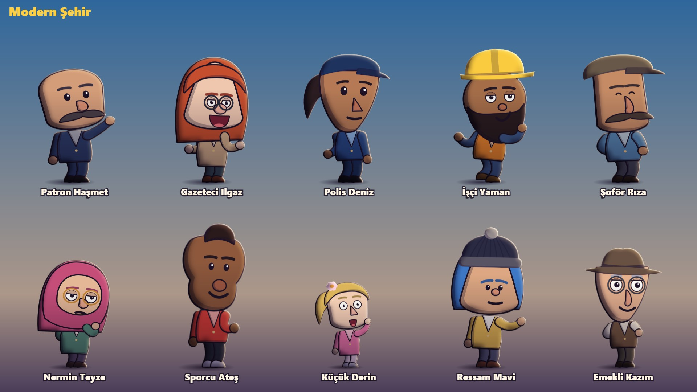

# Modern Şehir: video fikirleri

> Koddan üretilir: `node sistem.mjs hikaye rehber`

**Uygun konular:** psikoloji deneyleri, iş hayatı tuhaflıkları, trafik ve şehir tasarımı, dolandırıcılık, ilginç yasalar

## 1. Çizgisi Silinen Yol

> Kazalar azalsın diye yol çizgilerini sildiler.

| | |
|---|---|
| Tür | **araştır**: gerçek konu, kaynak bul |
| Sırrın yönü | Paylaşılan alan deneyleri |
| Final | Herkes yavaşlar |
| Kahraman / alaycı / uzman | İşçi Yaman / Patron Haşmet / Emekli Kazım |
| Sahneler | Çarpışma → Alay → Yarış → Fikir anı → Zafer |

`node sistem.mjs hikaye yeni filmim --tema=modern --ilham=1`

## 2. Asansördeki Ayna

> Asansör hızlanmadı ama şikâyet bitti.

| | |
|---|---|
| Tür | **araştır**: gerçek konu, kaynak bul |
| Sırrın yönü | Bekleme algısı |
| Final | Çözüm bir aynadır |
| Kahraman / alaycı / uzman | İşçi Yaman / Patron Haşmet / Ressam Mavi |
| Sahneler | Gergin bekleyiş → Alay → Toz bulutu kavga → Büyük keşif → Zafer |

`node sistem.mjs hikaye yeni filmim --tema=modern --ilham=2`

## 3. Piyano Merdiveni

> Yürüyen merdiven dururken herkes merdivene koştu.

| | |
|---|---|
| Tür | **araştır**: gerçek konu, kaynak bul |
| Sırrın yönü | Oyunlaştırma deneyi |
| Final | Müdür dans eder |
| Kahraman / alaycı / uzman | Ressam Mavi / Polis Deniz / Emekli Kazım |
| Sahneler | Meydan şaşkınlığı → Yarış → Alay → Ters giden deney → Zafer |

`node sistem.mjs hikaye yeni filmim --tema=modern --ilham=3`

## 4. Teyzenin Dolandırıcıyı Dolandırması

> Dolandırıcı aradı, teyze ona para gönderttirdi.

| | |
|---|---|
| Tür | **kurgu** |
| Sırrın yönü | Ters sosyal mühendislik |
| Final | Çay ısmarlar |
| Kahraman / alaycı / uzman | Nermin Teyze / Şoför Rıza / Polis Deniz |
| Sahneler | Gizli anlaşma → Gergin bekleyiş → Kovalamaca → Tuzak → Alay |

`node sistem.mjs hikaye yeni filmim --tema=modern --ilham=4`

## 5. Boş Dükkânın Kuyruğu

> Satacak bir şeyi yoktu, kuyruk sokağı aştı.

| | |
|---|---|
| Tür | **kurgu** |
| Sırrın yönü | Sosyal kanıt |
| Final | İlk sıradaki tabela bekler |
| Kahraman / alaycı / uzman | Şoför Rıza / Gazeteci Ilgaz / Emekli Kazım |
| Sahneler | Meydan şaşkınlığı → Alay → Toz bulutu kavga → Fikir anı → Zafer |

`node sistem.mjs hikaye yeni filmim --tema=modern --ilham=5`

## 6. Hata Yapan Haritacı

> Haritaya var olmayan bir kasaba koydu.

| | |
|---|---|
| Tür | **araştır**: gerçek konu, kaynak bul |
| Sırrın yönü | Telif tuzağı kasabaları |
| Final | Biri oraya dükkân açar |
| Kahraman / alaycı / uzman | Ressam Mavi / Patron Haşmet / Gazeteci Ilgaz |
| Sahneler | Gizlice sızma → Büyük keşif → Kovalamaca → Fikir anı → Alay |

`node sistem.mjs hikaye yeni filmim --tema=modern --ilham=6`

## 7. Trafiği Duran Araba Açtı

> Yavaşlayınca herkes daha hızlı vardı.

| | |
|---|---|
| Tür | **araştır**: gerçek konu, kaynak bul |
| Sırrın yönü | Hayalet trafik dalgası |
| Final | Sabırsız geride kalır |
| Kahraman / alaycı / uzman | Şoför Rıza / Sporcu Ateş / Polis Deniz |
| Sahneler | Yarış → Çarpışma → Alay → Ters giden deney → Zafer |

`node sistem.mjs hikaye yeni filmim --tema=modern --ilham=7`

## 8. Kimsenin Görmediği Goril

> Ortadan goril geçti, kimse görmedi.

| | |
|---|---|
| Tür | **araştır**: gerçek konu, kaynak bul |
| Sırrın yönü | Dikkat körlüğü deneyi |
| Final | İzleyici de görmemiştir |
| Kahraman / alaycı / uzman | Küçük Derin / Patron Haşmet / Gazeteci Ilgaz |
| Sahneler | Meydan şaşkınlığı → Kaybolma → Alay → Ters giden deney → Zafer |

`node sistem.mjs hikaye yeni filmim --tema=modern --ilham=8`

[← Bütün temalar](../ILHAM.md)
