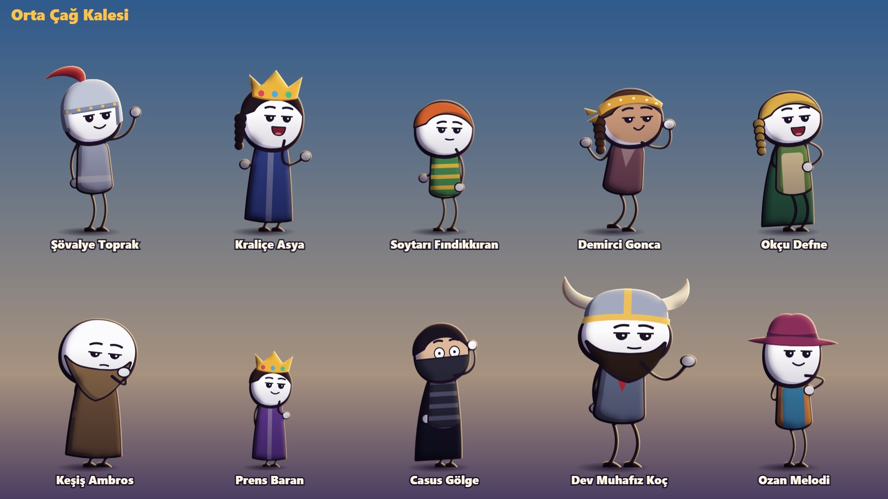

# Orta Çağ Kalesi: video fikirleri

> Koddan üretilir: `node sistem.mjs hikaye rehber`

**Uygun konular:** kuşatma taktikleri, saray oyunları, zırh ve silah buluşları, hukuk ve ceza tuhaflıkları, salgın ve gündelik yaşam

## 1. Domuzlu Kuşatma

> Aç kalan kale, düşmana surdan yemek fırlattı.

| | |
|---|---|
| Tür | **araştır**: gerçek konu, kaynak bul |
| Sırrın yönü | Bolluk yalanı; efsane mi araştır |
| Final | Düşman vazgeçer |
| Kahraman / alaycı / uzman | Kraliçe Asya / Dev Muhafız Koç / Ozan Melodi |
| Sahneler | Gergin bekleyiş → Gizlice sızma → Patlama → Meydan şaşkınlığı → Zafer |

`node sistem.mjs hikaye yeni filmim --tema=ortacag --ilham=1`

## 2. Zırhını Boyayan Şövalye

> Savaştan önce zırhını neden zifte buladı?

| | |
|---|---|
| Tür | **araştır**: gerçek konu, kaynak bul |
| Sırrın yönü | Pas ve parlama |
| Final | Alay eden paslanır |
| Kahraman / alaycı / uzman | Şövalye Toprak / Soytarı Fındıkkıran / Demirci Gonca |
| Sahneler | Alay → Düello → Fırtına → Ters giden deney → Zafer |

`node sistem.mjs hikaye yeni filmim --tema=ortacag --ilham=2`

## 3. Kapıyı Açık Bırakan Muhafız

> Kaleyi koruyan adam kapıyı bilerek açık bıraktı.

| | |
|---|---|
| Tür | **kurgu** |
| Sırrın yönü | Boş şehir hilesi |
| Final | Düşman tuzak sanıp döner |
| Kahraman / alaycı / uzman | Dev Muhafız Koç / Casus Gölge / Kraliçe Asya |
| Sahneler | Gizlice sızma → Gergin bekleyiş → Tuzak → Son anda kaçış → Alay |

`node sistem.mjs hikaye yeni filmim --tema=ortacag --ilham=3`

## 4. Yargılanan Horoz

> Bir horoz mahkemeye çıkarıldı.

| | |
|---|---|
| Tür | **araştır**: gerçek konu, kaynak bul |
| Sırrın yönü | Orta Çağ hayvan davaları |
| Final | Karar beklenmedik |
| Kahraman / alaycı / uzman | Ozan Melodi / Keşiş Ambros / Soytarı Fındıkkıran |
| Sahneler | Meydan şaşkınlığı → Kovalamaca → Gergin bekleyiş → Fikir anı → Zafer |

`node sistem.mjs hikaye yeni filmim --tema=ortacag --ilham=4`

## 5. Kilidi Yapan ve Açan

> Kırılmaz kilidi yapan usta, onu ilk açan oldu.

| | |
|---|---|
| Tür | **kurgu** |
| Sırrın yönü | Kilit mekanizması |
| Final | Anahtar hep üstündedir |
| Kahraman / alaycı / uzman | Demirci Gonca / Dev Muhafız Koç / Keşiş Ambros |
| Sahneler | Ters giden deney → Gergin bekleyiş → Tuzak → Fikir anı → Büyük keşif |

`node sistem.mjs hikaye yeni filmim --tema=ortacag --ilham=5`

## 6. Sessiz Çan

> Çan çalmadı ama bütün köy duydu.

| | |
|---|---|
| Tür | **kurgu** |
| Sırrın yönü | Titreşim ve metal |
| Final | Çanı çalan çocuktur |
| Kahraman / alaycı / uzman | Prens Baran / Keşiş Ambros / Ozan Melodi |
| Sahneler | Deprem → Meydan şaşkınlığı → Kovalamaca → Ters giden deney → Zafer |

`node sistem.mjs hikaye yeni filmim --tema=ortacag --ilham=6`

## 7. Kaledeki Son Ekmek

> Komutan son ekmeği düşman elçisine verdi.

| | |
|---|---|
| Tür | **kurgu** |
| Sırrın yönü | Psikolojik savaş |
| Final | Elçi raporu yanlış götürür |
| Kahraman / alaycı / uzman | Kraliçe Asya / Casus Gölge / Ozan Melodi |
| Sahneler | Gergin bekleyiş → Gizli anlaşma → Kovalamaca → Meydan şaşkınlığı → Zafer |

`node sistem.mjs hikaye yeni filmim --tema=ortacag --ilham=7`

## 8. Sahte Ordu

> Üç kişiyle bin kişilik ordu oldular.

| | |
|---|---|
| Tür | **kurgu** |
| Sırrın yönü | Ateş, ses ve gölge |
| Final | Sabah yalnız üç iz vardır |
| Kahraman / alaycı / uzman | Okçu Defne / Dev Muhafız Koç / Casus Gölge |
| Sahneler | Gizlice sızma → Patlama → Son anda kaçış → Fikir anı → Alay |

`node sistem.mjs hikaye yeni filmim --tema=ortacag --ilham=8`

[← Bütün temalar](../ILHAM.md)
