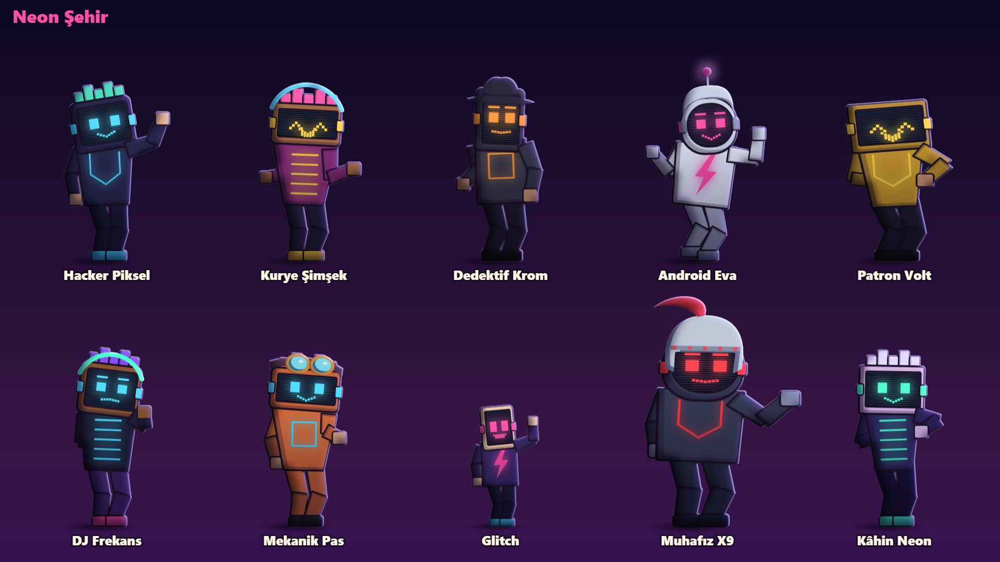

# Neon Şehir: video fikirleri

> Koddan üretilir: `node sistem.mjs hikaye rehber`

**Uygun konular:** bilgisayar güvenliği tarihi, dolandırıcılık ve tuzaklar, yapay zekâ varsayımları, gizlilik, gelecek kurgusu

## 1. Balonla Açılan Kapı

> En güvenli kapıyı bir balon açtı.

| | |
|---|---|
| Tür | **kurgu** |
| Sırrın yönü | Hareket algılayıcı |
| Final | Balon doğum günündendir |
| Kahraman / alaycı / uzman | Hacker Piksel / Muhafız X9 / Mekanik Pas |
| Sahneler | Gizlice sızma → Uçuşan eşyalar → Kovalamaca → Ters giden deney → Zafer |

`node sistem.mjs hikaye yeni filmim --tema=siber --ilham=1`

## 2. Şifreyi Duvara Yazan Patron

> Şifreyi herkes görüyordu, kimse giremedi.

| | |
|---|---|
| Tür | **kurgu** |
| Sırrın yönü | Yanlış düzen |
| Final | Ters okunur |
| Kahraman / alaycı / uzman | Glitch / Patron Volt / Dedektif Krom |
| Sahneler | Gergin bekleyiş → Alay → Gizlice sızma → Fikir anı → Zafer |

`node sistem.mjs hikaye yeni filmim --tema=siber --ilham=2`

## 3. İlk Bilgisayar Böceği

> Makineyi bozan gerçek bir böcekti.

| | |
|---|---|
| Tür | **araştır**: gerçek konu, kaynak bul |
| Sırrın yönü | 1947 günlüğündeki güve |
| Final | Böcek deftere yapıştırılır |
| Kahraman / alaycı / uzman | Mekanik Pas / Patron Volt / Android Eva |
| Sahneler | Gergin bekleyiş → Patlama → Büyük keşif → Fikir anı → Zafer |

`node sistem.mjs hikaye yeni filmim --tema=siber --ilham=3`

## 4. Kendini Arayan Robot

> Robot kayıp ilanındaki yüzü tanıdı.

| | |
|---|---|
| Tür | **kurgu** |
| Sırrın yönü | Kopya ve kimlik |
| Final | İlanı kendisi asmıştır |
| Kahraman / alaycı / uzman | Android Eva / Dedektif Krom / Kâhin Neon |
| Sahneler | Meydan şaşkınlığı → Kovalamaca → Kaybolma → Fikir anı → İhanet |

`node sistem.mjs hikaye yeni filmim --tema=siber --ilham=4`

## 5. Duvardaki Kulak

> Odadaki en sessiz cihaz her şeyi duydu.

| | |
|---|---|
| Tür | **kurgu** |
| Sırrın yönü | Titreşim |
| Final | Cihaz bitkidir |
| Kahraman / alaycı / uzman | Dedektif Krom / Patron Volt / Mekanik Pas |
| Sahneler | Gizlice sızma → Gizli anlaşma → Tuzak → Ters giden deney → Alay |

`node sistem.mjs hikaye yeni filmim --tema=siber --ilham=5`

## 6. Bir Kuruşluk Soygun

> Kimse fark etmeden milyon topladı.

| | |
|---|---|
| Tür | **araştır**: gerçek konu, kaynak bul |
| Sırrın yönü | Küsurat dolandırıcılığı anlatısı |
| Final | Kendi maaşı eksik çıkar |
| Kahraman / alaycı / uzman | Hacker Piksel / Patron Volt / Dedektif Krom |
| Sahneler | Gizlice sızma → Kap kaç → Kovalamaca → Fikir anı → İhanet |

`node sistem.mjs hikaye yeni filmim --tema=siber --ilham=6`

## 7. Işığı Çalan DJ

> Şehrin elektriği müzikle kesildi.

| | |
|---|---|
| Tür | **kurgu** |
| Sırrın yönü | Rezonans |
| Final | Yanlış düğme |
| Kahraman / alaycı / uzman | DJ Frekans / Muhafız X9 / Mekanik Pas |
| Sahneler | Meydan şaşkınlığı → Deprem → Patlama → Ters giden deney → Son anda kaçış |

`node sistem.mjs hikaye yeni filmim --tema=siber --ilham=7`

## 8. Geleceği Doğru Söyleyen

> Her tahmini tuttu, çünkü hep susuyordu.

| | |
|---|---|
| Tür | **kurgu** |
| Sırrın yönü | Seçici hatırlama |
| Final | Müşteri kendisi söyler |
| Kahraman / alaycı / uzman | Kâhin Neon / Patron Volt / Dedektif Krom |
| Sahneler | Meydan şaşkınlığı → Alay → Gergin bekleyiş → Fikir anı → Zafer |

`node sistem.mjs hikaye yeni filmim --tema=siber --ilham=8`

[← Bütün temalar](../ILHAM.md)
