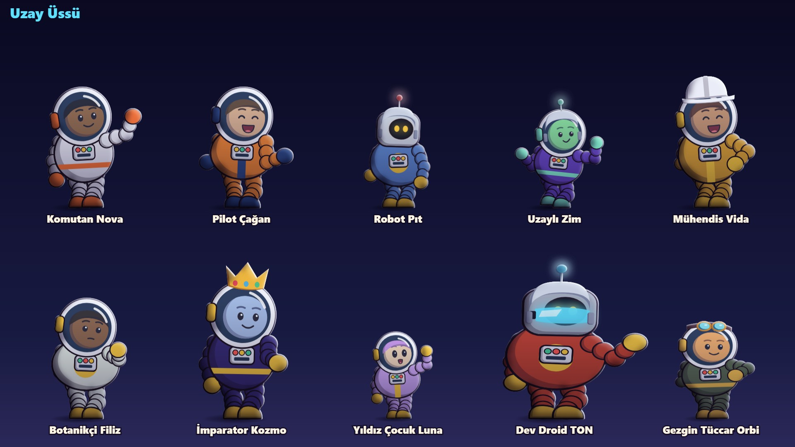

# Uzay Üssü: video fikirleri

> Koddan üretilir: `node sistem.mjs hikaye rehber`

**Uygun konular:** uzay kazaları ve çözümleri, gezegenler, robot ve yapay zekâ, uzaylı varsayımları, fizik kuralları

## 1. Oksijeni Boşaltan Astronot

> Son oksijeni bilerek dışarı bıraktı.

| | |
|---|---|
| Tür | **kurgu** |
| Sırrın yönü | Etki ve tepki |
| Final | Gemi rotaya girer |
| Kahraman / alaycı / uzman | Komutan Nova / Pilot Çağan / Mühendis Vida |
| Sahneler | Patlama → Gergin bekleyiş → Son anda kaçış → Ters giden deney → Zafer |

`node sistem.mjs hikaye yeni filmim --tema=uzay --ilham=1`

## 2. Uzayda Uçan Damla

> Su damlası geminin kaderini belirledi.

| | |
|---|---|
| Tür | **kurgu** |
| Sırrın yönü | Yüzey gerilimi ve sızıntı |
| Final | Sızıntıyı damla bulur |
| Kahraman / alaycı / uzman | Botanikçi Filiz / Pilot Çağan / Mühendis Vida |
| Sahneler | Uçuşan eşyalar → Gizlice sızma → Patlama → Ters giden deney → Zafer |

`node sistem.mjs hikaye yeni filmim --tema=uzay --ilham=2`

## 3. Emre Fazla Uyan Robot

> Robota "kimse çıkmasın" dediler, çıkan yalnız o oldu.

| | |
|---|---|
| Tür | **kurgu** |
| Sırrın yönü | Kelimesi kelimesine mantık |
| Final | Suç cümlededir |
| Kahraman / alaycı / uzman | Robot Pıt / Pilot Çağan / Komutan Nova |
| Sahneler | Gergin bekleyiş → Kovalamaca → Alay → Fikir anı → Zafer |

`node sistem.mjs hikaye yeni filmim --tema=uzay --ilham=3`

## 4. Ay Tozunun Kokusu

> Ay'dan dönen kaskı açınca burnunu kapattı.

| | |
|---|---|
| Tür | **araştır**: gerçek konu, kaynak bul |
| Sırrın yönü | Astronotların anlattığı barut kokusu |
| Final | Koku Dünya'da kaybolur |
| Kahraman / alaycı / uzman | Komutan Nova / Botanikçi Filiz / Mühendis Vida |
| Sahneler | Büyük keşif → Meydan şaşkınlığı → Ters giden deney → Fikir anı → Kaybolma |

`node sistem.mjs hikaye yeni filmim --tema=uzay --ilham=4`

## 5. Geri Sayan Gezegen

> Gezegende her gün bir saat kısalıyordu.

| | |
|---|---|
| Tür | **kurgu** |
| Sırrın yönü | Dönüş hızı |
| Final | Saat değil, gezegen bozuktur |
| Kahraman / alaycı / uzman | Mühendis Vida / İmparator Kozmo / Robot Pıt |
| Sahneler | Gergin bekleyiş → Deprem → Kovalamaca → Fikir anı → Son anda kaçış |

`node sistem.mjs hikaye yeni filmim --tema=uzay --ilham=5`

## 6. İlk Temas Hatası

> Uzaylı el salladı, gemi alarm verdi.

| | |
|---|---|
| Tür | **kurgu** |
| Sırrın yönü | Yanlış anlama |
| Final | Alarm çay içindir |
| Kahraman / alaycı / uzman | Uzaylı Zim / Dev Droid TON / Yıldız Çocuk Luna |
| Sahneler | Meydan şaşkınlığı → Kovalamaca → Tuzak → Gizli anlaşma → Zafer |

`node sistem.mjs hikaye yeni filmim --tema=uzay --ilham=6`

## 7. Çivi Yüzünden Dönüş

> Bir çivi eksikti, görev iptal oldu.

| | |
|---|---|
| Tür | **kurgu** |
| Sırrın yönü | Küçük parça, büyük hata |
| Final | Çivi cebindedir |
| Kahraman / alaycı / uzman | Mühendis Vida / Pilot Çağan / Komutan Nova |
| Sahneler | Fikir anı → Gergin bekleyiş → Patlama → Ters giden deney → Alay |

`node sistem.mjs hikaye yeni filmim --tema=uzay --ilham=7`

## 8. Uzayda Bitki Savaşı

> Uzaydaki bitkiler aşağının neresi olduğunu bulamadı.

| | |
|---|---|
| Tür | **araştır**: gerçek konu, kaynak bul |
| Sırrın yönü | Yerçekimi ve kök yönü |
| Final | Işık kazanır |
| Kahraman / alaycı / uzman | Botanikçi Filiz / Gezgin Tüccar Orbi / Yıldız Çocuk Luna |
| Sahneler | Uçuşan eşyalar → Alay → Toz bulutu kavga → Ters giden deney → Zafer |

`node sistem.mjs hikaye yeni filmim --tema=uzay --ilham=8`

[← Bütün temalar](../ILHAM.md)
