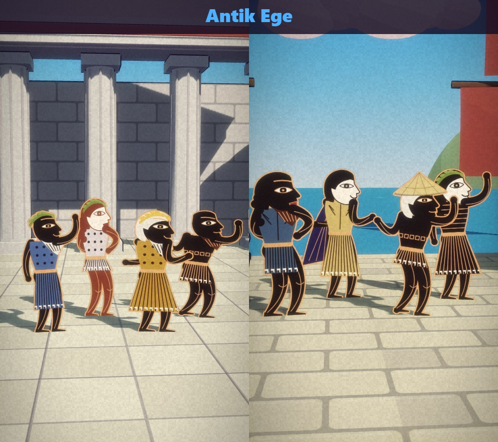
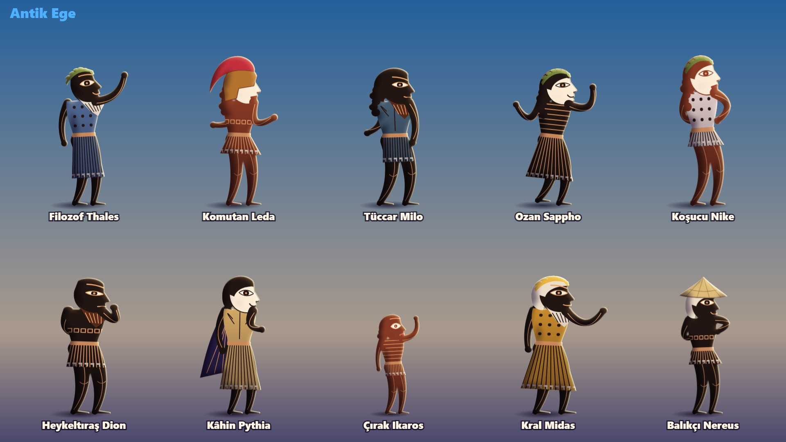

# Antik Ege

> Koddan üretilir: `node sistem.mjs hikaye rehber`

Felsefe, matematik, savaş ve efsane hikâyeleri.

- **Kod:** `antik`
- **Karakter biçimi:** Vazo figürü
- **Video fikirleri:** [8 hazır fikir](../ilham/antik.md)
- **Vurgu rengi:** `#4fb0ff`
- **Müzik ruhu:** acilis
- **Uygun konular:** filozof anekdotları, geometri ve buluş, savaş hileleri, olimpiyat, mitoloji (kurgu)
- **Örnek kanca fikri:** Filozof, güpegündüz neden fenerle dolaştı? *(yalnızca biçim örneği; gerçek diye kullanılmadan önce kaynağı bulunmalı)*

## Mekânlar

| Mekân | Kod | Ne zaman kullanılır? |
|---|---|---|
| agora | `{"tema":"antik","mekan":"agora"}` | Tartışma, meydan, alay, ders |
| liman | `{"tema":"antik","mekan":"liman"}` | Ticaret, sefer, varış |

## Karakterler

| Karakter | Kod | Görünüş | Hikâyedeki görevi | Nerede kullanılır? |
|---|---|---|---|---|
| **Filozof Thales** | `antik-filozof` | ak sakal, mavi pelerin; tunik (yaşlı) | Kahraman | Garip davranan, açıklamayan bilge |
| **Komutan Leda** | `antik-komutan` | tunç zırh, kızıl sorguç; zırh | Kahraman, Engel / rakip | Savaş hilesi, strateji |
| **Tüccar Milo** | `antik-tuccar` | turuncu tunik, kolye; tunik | Alaycı, Engel / rakip | Pazarlık, açgözlülük |
| **Ozan Sappho** | `antik-ozan` | lila elbise, defne tacı; elbise | Tanık, Uzman | Hikâyeyi aktaran, duygu |
| **Koşucu Nike** | `antik-sporcu` | kısa tunik, defne tacı; tunik (uzun, ince) | Kahraman | Koşu, olimpiyat, haber taşıma |
| **Heykeltıraş Dion** | `antik-heykeltiras` | önlük, kel, iri gövde; önlük (iri) | Uzman, Kahraman | Heykel, oran, ustalık |
| **Kâhin Pythia** | `antik-kahin` | mor örtü, pelerin; cüppe (pelerinli) | Engel / rakip | Kehanet, çift anlamlı söz |
| **Çırak Ikaros** | `antik-cocuk` | küçük boy, sarı kıvırcık; tunik (çocuk) | Kahraman, Şaka | Meraklı çırak; sınırı zorlayan |
| **Kral Midas** | `antik-kral` | altın taç, altın kaftan; kaftan (yaşlı) | Engel / rakip, Alaycı | Kibirli kral; ders alan |
| **Balıkçı Nereus** | `antik-balikci` | hasır şapka, çıplak kol; tunik (yaşlı) | Tanık | Sıradan halkın gözü |

## Hazır üçlü

| Kahraman | Alaycı | Sırrı gösteren / yardımcı |
|---|---|---|
| Filozof Thales `antik-filozof` | Tüccar Milo `antik-tuccar` | Heykeltıraş Dion `antik-heykeltiras` |

[← Bütün rehber](../KARAKTER_REHBERI.md)
