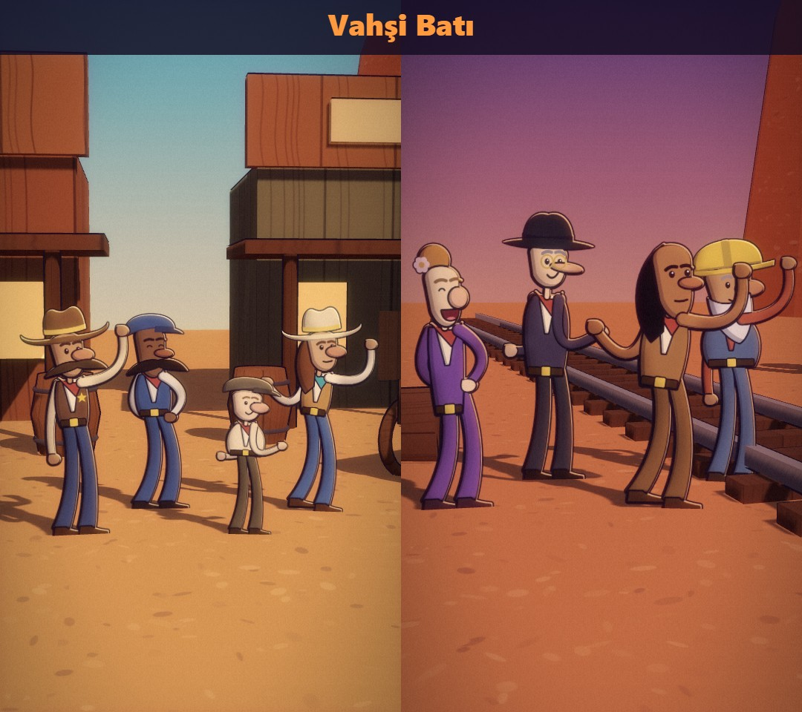
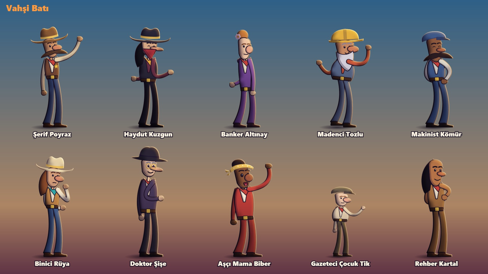

# Vahşi Batı

> Koddan üretilir: `node sistem.mjs hikaye rehber`

Altın, tren, dolandırıcılık ve sınır kasabası hikâyeleri.

- **Kod:** `bati`
- **Karakter biçimi:** Sırık
- **Video fikirleri:** [8 hazır fikir](../ilham/bati.md)
- **Vurgu rengi:** `#ff9a3f`
- **Müzik ruhu:** oyun
- **Uygun konular:** altına hücum, tren ve telgraf, soygun ve kaçış, dolandırıcılık, kasaba yasaları
- **Örnek kanca fikri:** Soyguncular treni durdurdu, ama kasanın içinden neden kahkaha geldi? *(yalnızca biçim örneği; gerçek diye kullanılmadan önce kaynağı bulunmalı)*

## Mekânlar

| Mekân | Kod | Ne zaman kullanılır? |
|---|---|---|
| kasaba | `{"tema":"bati","mekan":"kasaba"}` | Saloon, sokak, yüzleşme, pazarlık |
| demiryolu | `{"tema":"bati","mekan":"demiryolu"}` | Tren, çöl, soygun, kamp |

## Karakterler

| Karakter | Kod | Görünüş | Hikâyedeki görevi | Nerede kullanılır? |
|---|---|---|---|---|
| **Şerif Poyraz** | `bati-serif` | yıldız rozet, geniş şapka; kovboy yeleği | Kahraman, Engel / rakip | Yasa, soruşturma; sakin kahraman |
| **Haydut Kuzgun** | `bati-haydut` | siyah şapka, maske; kovboy yeleği | Engel / rakip, Kahraman | Soygun, kaçış, maske; rakip ya da ters köşe kahraman |
| **Banker Altınay** | `bati-banker` | mor elbise, çiçek; elbise | Kahraman, Alaycı | Para, kasa, sözleşme; herkesten zeki çıkan |
| **Madenci Tozlu** | `bati-madenci` | sarı baret, ak sakal; tulum (yaşlı) | Kahraman, Tanık | Altın, maden, dinamit; şanssız ama sabırlı |
| **Makinist Kömür** | `bati-demiryolcu` | çizgili tulum, kasket; tulum | Uzman | Buhar, ray, hız; teknik sır |
| **Binici Rüya** | `bati-kovboykiz` | turkuaz fular, uzun örgü; kovboy yeleği | Kahraman | At, sürü, takip; cesur kahraman |
| **Doktor Şişe** | `bati-doktor` | uzun redingot, silindir gövde; palto (yaşlı, uzun, ince) | Alaycı, Engel / rakip | Sahte ilaç satıcısı, dolandırıcı |
| **Aşçı Mama Biber** | `bati-kazan` | kırmızı elbise, önlük; önlük (iri) | Yardımcı, Şaka | Mutfak, kalabalık, dedikodu |
| **Gazeteci Çocuk Tik** | `bati-cocuk` | kasket, askılı; kareli gömlek (çocuk) | Tanık | Haber dağıtan çocuk; haberi yayma anı |
| **Rehber Kartal** | `bati-kartal` | deri tunik, uzun siyah saç; tunik | Uzman, Yardımcı | İz sürme, doğa bilgisi, yol gösterme |

## Hazır üçlü

| Kahraman | Alaycı | Sırrı gösteren / yardımcı |
|---|---|---|
| Şerif Poyraz `bati-serif` | Doktor Şişe `bati-doktor` | Makinist Kömür `bati-demiryolcu` |

[← Bütün rehber](../KARAKTER_REHBERI.md)
