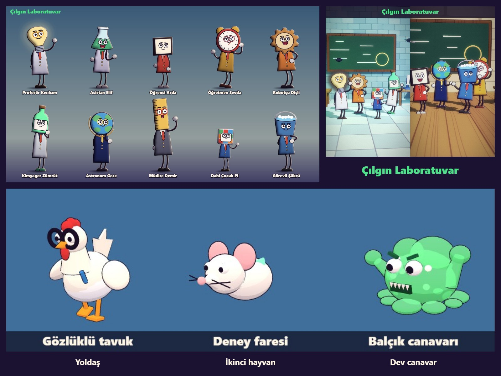
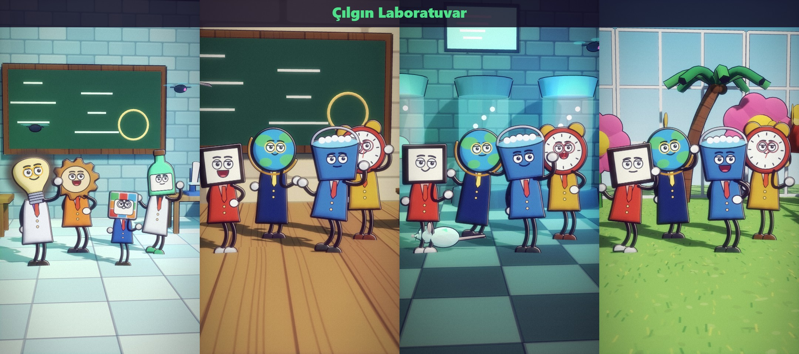
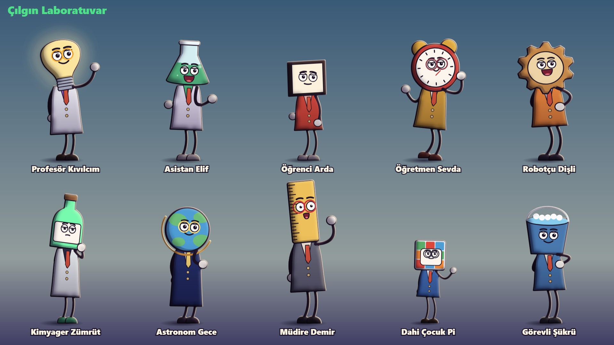

# Çılgın Laboratuvar

> Koddan üretilir: `node sistem.mjs hikaye rehber`

Deney, buluş ve okul hikâyeleri.

- **Kod:** `bilim`
- **Karakter biçimi:** Nesne kafa
- **Video fikirleri:** [8 hazır fikir](../ilham/bilim.md)
- **Vurgu rengi:** `#4fe08a`
- **Müzik ruhu:** gerilim
- **Uygun konular:** tesadüfen yapılan buluşlar, ünlü deneyler, kimya ve elektrik, matematik bilmeceleri, insan bedeni
- **Örnek kanca fikri:** Profesör neden yanlış deneyi yüz kez tekrarladı? *(yalnızca biçim örneği; gerçek diye kullanılmadan önce kaynağı bulunmalı)*

## Temada hazır gelen her şey

| | |
|---|---|
| Yoldaş hayvan | Gözlüklü tavuk |
| İkinci hayvan | Deney faresi |
| Dev canavar | Balçık canavarı |
| Müzik çalgısı | çan |
| lab ortamı | kabarcık ve cihaz; taş zeminde adım sesi; arka planda canlılar |
| sinif ortamı | ofis uğultusu; ahşap zeminde adım sesi; arka planda canlılar |
| bodrum ortamı | makine uğultusu; taş zeminde adım sesi; arka planda canlılar |
| sera ortamı | orman kuşları; çimen zeminde adım sesi; arka planda canlılar |

Bunlar kendiliğinden gelir. Değiştirmek için [ayarlar](../AYARLAR.md).

## Mekânlar

| Mekân | Kod | Ne zaman kullanılır? |
|---|---|---|
| lab | `{"tema":"bilim","mekan":"lab"}` | Deney, patlama, buluş |
| sinif | `{"tema":"bilim","mekan":"sinif"}` | Ders, bilmece, yarışma, alay |
| bodrum | `{"tema":"bilim","mekan":"bodrum"}` | Gizli makine, yasak deney, kaçan yaratık |
| sera | `{"tema":"bilim","mekan":"sera"}` | Dev bitkiler, büyüyen deney, doğa |

## Karakterler

| Karakter | Kod | Görünüş | Hikâyedeki görevi | Nerede kullanılır? |
|---|---|---|---|---|
| **Profesör Kıvılcım** | `bilim-profesor` | dağınık ak saç, gözlük; beyaz önlük (yaşlı) | Kahraman | Garip deneyi yapan; açıklamayan dâhi |
| **Asistan Elif** | `bilim-asistan` | yeşil önlük, at kuyruğu; önlük | Yardımcı, Tanık | Şaşıran ve soran; izleyicinin yerine geçen |
| **Öğrenci Arda** | `bilim-ogrenci` | kırmızı kapüşonlu; kapüşonlu | Kahraman, Şaka | Meraklı; kazara bulan |
| **Öğretmen Sevda** | `bilim-ogretmen` | hardal hırka; hırka | Uzman, Alaycı | Dersi veren ya da inanmayan |
| **Robotçu Dişli** | `bilim-robotcu` | turuncu tulum, anten; tulum | Uzman, Kahraman | Makine, robot, mekanik |
| **Kimyager Zümrüt** | `bilim-kimyager` | yeşil saç, önlük; beyaz önlük (ince) | Uzman | Karışım, renk, tepkime |
| **Astronom Gece** | `bilim-astronom` | lacivert cüppe, yıldızlar; cüppe | Uzman | Yıldız, zaman, hesap |
| **Müdire Demir** | `bilim-mudur` | gri takım, sıkı topuz; takım elbise (yaşlı) | Engel / rakip, Alaycı | Deneyi durduran, alay eden yetkili |
| **Dahi Çocuk Pi** | `bilim-dahi` | dev gözlük, papyonlu yelek; yelek (çocuk) | Kahraman | Büyükleri yenen çocuk |
| **Görevli Şükrü** | `bilim-temizlikci` | mavi tulum, kasket; tulum (yaşlı) | Kahraman, Tanık | Sırrı fark eden, kimsenin görmediği kişi |

## Hazır üçlü

| Kahraman | Alaycı | Sırrı gösteren / yardımcı |
|---|---|---|
| Profesör Kıvılcım `bilim-profesor` | Öğretmen Sevda `bilim-ogretmen` | Robotçu Dişli `bilim-robotcu` |

[← Bütün rehber](../KARAKTER_REHBERI.md)
