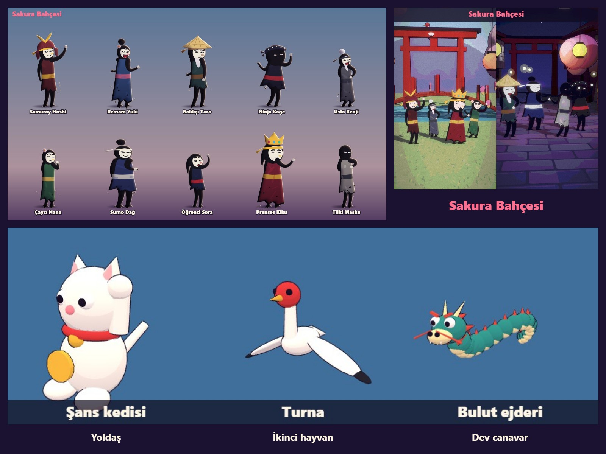
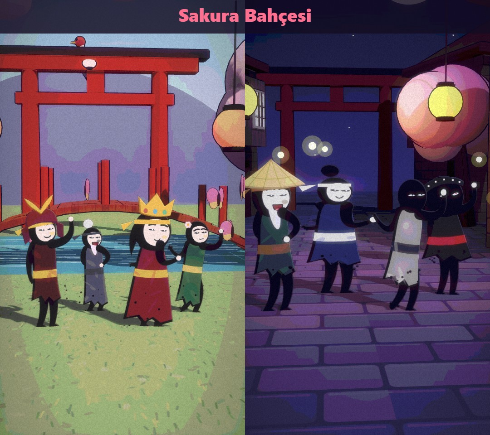
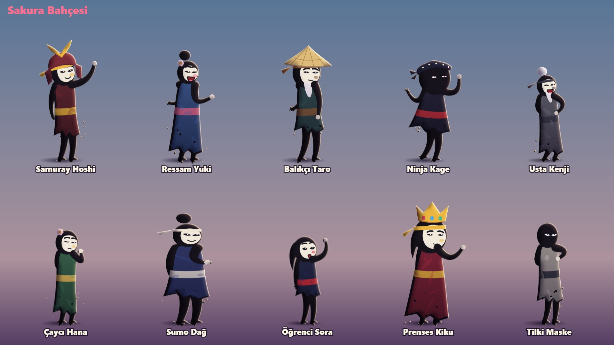

# Sakura Bahçesi

> Koddan üretilir: `node sistem.mjs hikaye rehber`

Zanaat, onur, sabır ve gece hikâyeleri.

- **Kod:** `japon`
- **Karakter biçimi:** Mürekkep
- **Video fikirleri:** [8 hazır fikir](../ilham/japon.md)
- **Vurgu rengi:** `#ff6f8f`
- **Müzik ruhu:** sicak
- **Uygun konular:** zanaat ve sanat, savaş taktikleri, gelenek ve görgü, çay, yemek, bahçe, gizli örgüt efsaneleri
- **Örnek kanca fikri:** Usta neden en güzel vazosunu bilerek kırdı? *(yalnızca biçim örneği; gerçek diye kullanılmadan önce kaynağı bulunmalı)*

## Temada hazır gelen her şey

| | |
|---|---|
| Yoldaş hayvan | Şans kedisi |
| İkinci hayvan | Turna |
| Dev canavar | Bulut ejderi |
| Müzik çalgısı | koto |
| bahce ortamı | su ve rüzgâr çanı; çimen zeminde adım sesi; arka planda canlılar |
| sokak ortamı | gece böcekleri; taş zeminde adım sesi; arka planda canlılar |

Bunlar kendiliğinden gelir. Değiştirmek için [ayarlar](../AYARLAR.md).

## Mekânlar

| Mekân | Kod | Ne zaman kullanılır? |
|---|---|---|
| bahce | `{"tema":"japon","mekan":"bahce"}` | Huzur, ders, düello öncesi, köprü |
| sokak | `{"tema":"japon","mekan":"sokak"}` | Gece, takip, fener ışığı, gizem |

## Karakterler

| Karakter | Kod | Görünüş | Hikâyedeki görevi | Nerede kullanılır? |
|---|---|---|---|---|
| **Samuray Hoshi** | `japon-samuray` | altın boynuzlu miğfer; zırh | Kahraman, Engel / rakip | Düello, savaş, onur |
| **Ressam Yuki** | `japon-ressam` | mavi kimono, çiçek; kimono | Kahraman | Resim, sabır, ince ayrıntı |
| **Balıkçı Taro** | `japon-balikci` | hasır şapka; kimono (yaşlı) | Uzman, Tanık | Deniz bilgisi, sade bilgelik |
| **Ninja Kage** | `japon-ninja` | koyu maske; kimono | Kahraman, Engel / rakip | Sızma, gece, hızlı hareket |
| **Usta Kenji** | `japon-usta` | ak sakal, gri kimono; kimono (yaşlı) | Uzman, Kahraman | Öğretmen; açıklamayan sakin kahraman |
| **Çaycı Hana** | `japon-cayci` | yeşil kimono, önlük; kimono | Tanık, Yardımcı | Çay evi, dinleyen, haber taşıyan |
| **Sumo Dağ** | `japon-sumo` | dev beden, topuz; kimono (iri) | Alaycı, Engel / rakip | Küçümseyen güçlü; fiziksel şaka |
| **Öğrenci Sora** | `japon-ogrenci` | lacivert ceket, kırmızı fular; takım elbise | Kahraman, Tanık | Modern ya da okul hikâyeleri; öğrenen göz |
| **Prenses Kiku** | `japon-prenses` | altın taç, kırmızı kimono; kimono | Kahraman, Engel / rakip | Saray, karar, kaçış |
| **Tilki Maske** | `japon-maskeli` | turuncu saç, beyaz maske; kimono (ince) | Engel / rakip, Şaka | Gizemli kişi, sürpriz kimlik |

## Hazır üçlü

| Kahraman | Alaycı | Sırrı gösteren / yardımcı |
|---|---|---|
| Samuray Hoshi `japon-samuray` | Sumo Dağ `japon-sumo` | Balıkçı Taro `japon-balikci` |

[← Bütün rehber](../KARAKTER_REHBERI.md)
