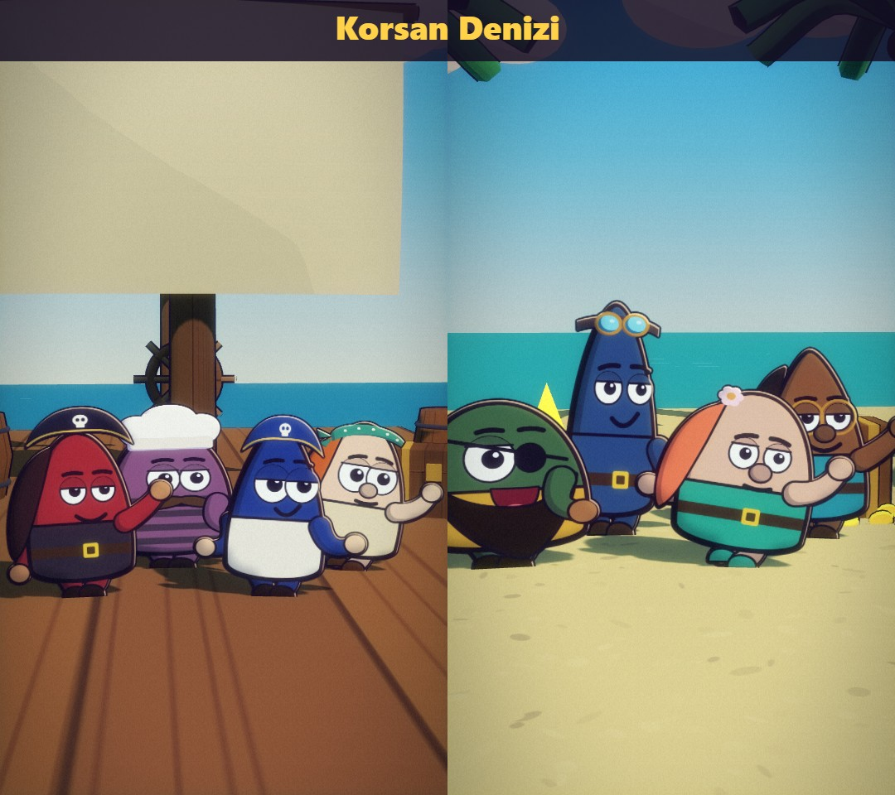
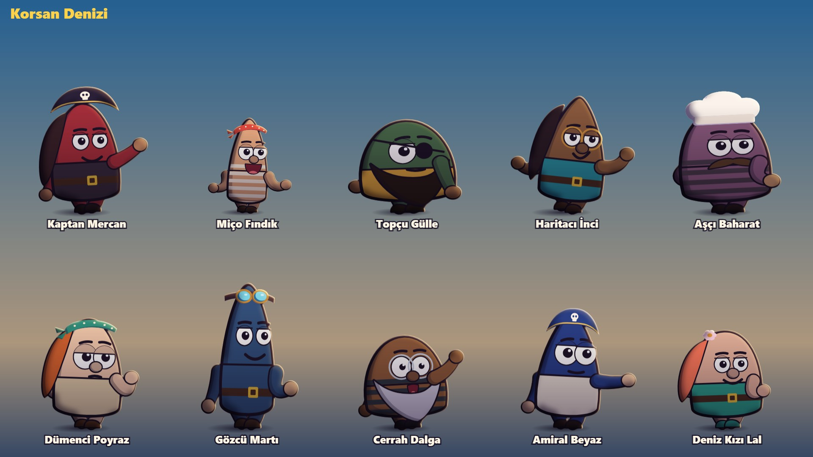

# Korsan Denizi

> Koddan üretilir: `node sistem.mjs hikaye rehber`

Deniz, keşif, hile ve hayatta kalma hikâyeleri.

- **Kod:** `korsan`
- **Karakter biçimi:** Damla
- **Video fikirleri:** [8 hazır fikir](../ilham/korsan.md)
- **Vurgu rengi:** `#ffd24a`
- **Müzik ruhu:** oyun
- **Uygun konular:** denizcilik buluşları, fırtınada hayatta kalma, hazine ve dolandırıcılık, harita ve yön bulma, gemi savaşları
- **Örnek kanca fikri:** Bir denizci neden gemisinin altını bilerek deldi? *(yalnızca biçim örneği; gerçek diye kullanılmadan önce kaynağı bulunmalı)*

## Mekânlar

| Mekân | Kod | Ne zaman kullanılır? |
|---|---|---|
| guverte | `{"tema":"korsan","mekan":"guverte"}` | Gemide geçen her olay: fırtına, isyan, kovalamaca, top atışı |
| ada | `{"tema":"korsan","mekan":"ada"}` | Karaya çıkış, hazine bulma, mahsur kalma |

## Karakterler

| Karakter | Kod | Görünüş | Hikâyedeki görevi | Nerede kullanılır? |
|---|---|---|---|---|
| **Kaptan Mercan** | `korsan-kaptan` | kızıl ceket, tüylü şapka; korsan ceketi | Kahraman, Engel / rakip | Kararı veren lider; açıklama yapmadan garip emir veren sakin kahraman |
| **Miço Fındık** | `korsan-mico` | çizgili tişört; kazak (çocuk) | Tanık, Şaka | Her şeyi ilk gören çocuk; soru soran, şaşıran göz |
| **Topçu Gülle** | `korsan-topcu` | göz bandı, dev gövde; korsan ceketi | Alaycı, Engel / rakip | Kahramanla alay eden iri yarı tayfa; top ve patlama sahneleri |
| **Haritacı İnci** | `korsan-harita` | turkuaz ceket, gözlük; korsan ceketi | Uzman, Yardımcı | Harita, rota, yıldız; işin sırrını gösteren kişi |
| **Aşçı Baharat** | `korsan-ahci` | aşçı şapkası, geniş gövde; önlük (iri) | Şaka, Kahraman | Mutfak ve yiyecek hileleri; kimsenin ciddiye almadığı kahraman |
| **Dümenci Poyraz** | `korsan-dumenci` | kızıl örgüler, yeşil bandana; tunik | Yardımcı, Tanık | Fırtına, dönüş, kaçış; dümen başındaki gergin anlar |
| **Gözcü Martı** | `korsan-gozcu` | uzun boy, pilot gözlüğü; korsan ceketi (uzun, ince) | Tanık | Tehlikeyi uzaktan haber veren; "kara göründü" anları |
| **Cerrah Dalga** | `korsan-cerrah` | uzun siyah ceket, yuvarlak gözlük; palto (yaşlı) | Uzman | Hastalık, iskorbüt, gemide tıp hikâyeleri |
| **Amiral Beyaz** | `korsan-amiral` | apoletli lacivert, fötr; takım elbise (yaşlı, pelerinli) | Engel / rakip, Alaycı | Korsanların peşindeki resmî güç; kendinden emin rakip |
| **Deniz Kızı Lal** | `korsan-deniz` | mercan saç, yosun elbise; elbise | Kahraman | Deniz efsaneleri ve masalsı bölümler (kurgu etiketiyle) |

## Hazır üçlü

| Kahraman | Alaycı | Sırrı gösteren / yardımcı |
|---|---|---|
| Kaptan Mercan `korsan-kaptan` | Topçu Gülle `korsan-topcu` | Haritacı İnci `korsan-harita` |

[← Bütün rehber](../KARAKTER_REHBERI.md)
