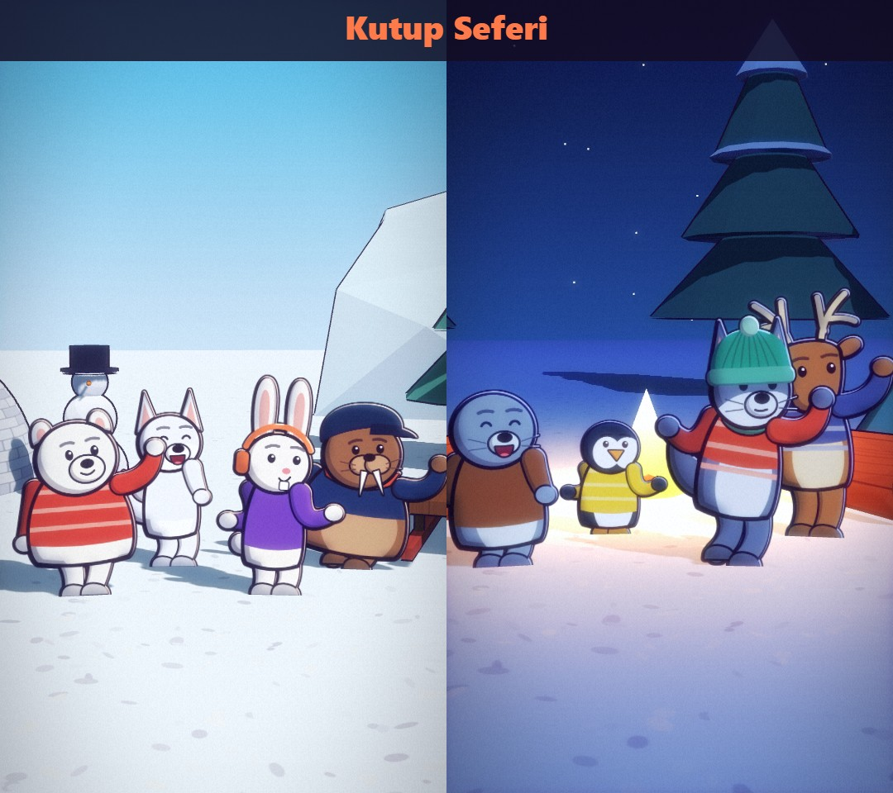
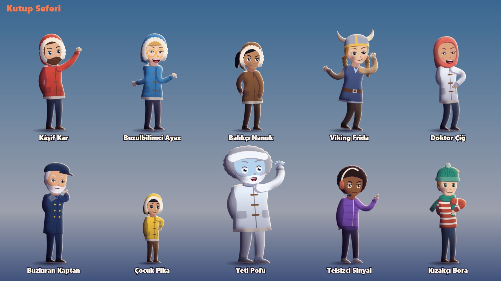

# Kutup Seferi

> Koddan üretilir: `node sistem.mjs hikaye rehber`

Keşif, soğuk, dayanıklılık ve kurtarma hikâyeleri.

- **Kod:** `kutup`
- **Vurgu rengi:** `#ff7a4a`
- **Müzik ruhu:** huzun
- **Uygun konular:** kutup yarışları, hayatta kalma, buz ve iklim, hayvan gözlemi, kuzey halkları ve denizciler
- **Örnek kanca fikri:** Kaşif, donmamak için neden çadırını sökmeye başladı? *(yalnızca biçim örneği; gerçek diye kullanılmadan önce kaynağı bulunmalı)*

## Mekânlar

| Mekân | Kod | Ne zaman kullanılır? |
|---|---|---|
| buz | `{"tema":"kutup","mekan":"buz"}` | Yürüyüş, iglo, kızak, tehlike |
| kamp | `{"tema":"kutup","mekan":"kamp"}` | Gece, ateş başı, telsiz, bekleyiş |

## Karakterler

| Karakter | Kod | Görünüş | Hikâyedeki görevi | Nerede kullanılır? |
|---|---|---|---|---|
| **Kâşif Kar** | `kutup-kasif` | kızıl parka, kürk; parka | Kahraman | Sefer lideri; kararlı |
| **Buzulbilimci Ayaz** | `kutup-bilimci` | mavi parka, gözlük; parka | Uzman | Buz örneği, ölçüm, açıklama |
| **Balıkçı Nanuk** | `kutup-avci` | kahve parka; parka | Uzman, Kahraman | Yerel bilgi; hazırlıksızları kurtaran |
| **Viking Frida** | `kutup-viking` | boynuzlu miğfer, örgüler; tunik | Kahraman, Engel / rakip | Kuzey denizciliği, keşif |
| **Doktor Çiğ** | `kutup-doktor` | beyaz parka, mercan örtü; parka | Uzman, Yardımcı | Donma, beslenme, ilk yardım |
| **Buzkıran Kaptan** | `kutup-kaptan` | lacivert palto, kasket; palto (yaşlı) | Engel / rakip, Kahraman | Buza sıkışan gemi, zor karar |
| **Çocuk Pika** | `kutup-cocuk` | sarı mini parka; parka (çocuk) | Tanık | Köy yaşamı, öğrenme |
| **Yeti Pofu** | `kutup-yeti` | dev beyaz kürk; parka (uzun, iri) | Şaka | Efsane ve komik kurgu |
| **Telsizci Sinyal** | `kutup-radyocu` | mor mont, kulaklık; mont | Tanık, Yardımcı | Telsiz, yardım çağrısı, gerilim |
| **Kızakçı Bora** | `kutup-kizakci` | yeşil atkı, bere; kazak | Kahraman | Kızak, hız, yarış |

## Hazır üçlü

| Kahraman | Alaycı | Sırrı gösteren / yardımcı |
|---|---|---|
| Kâşif Kar `kutup-kasif` | Buzulbilimci Ayaz `kutup-bilimci` | Balıkçı Nanuk `kutup-avci` |

[← Bütün rehber](../KARAKTER_REHBERI.md)
