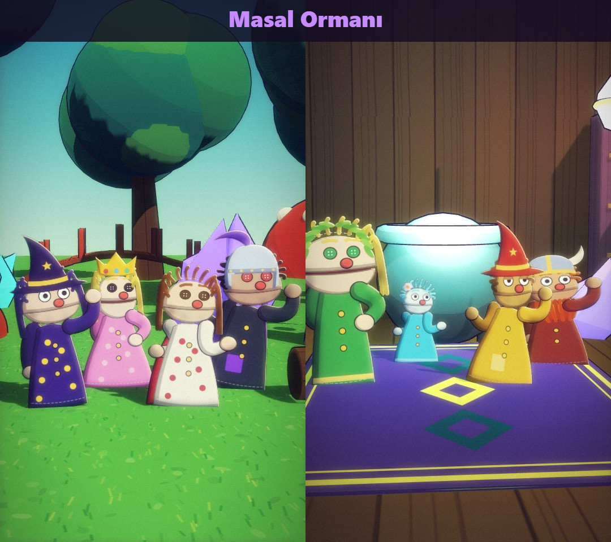
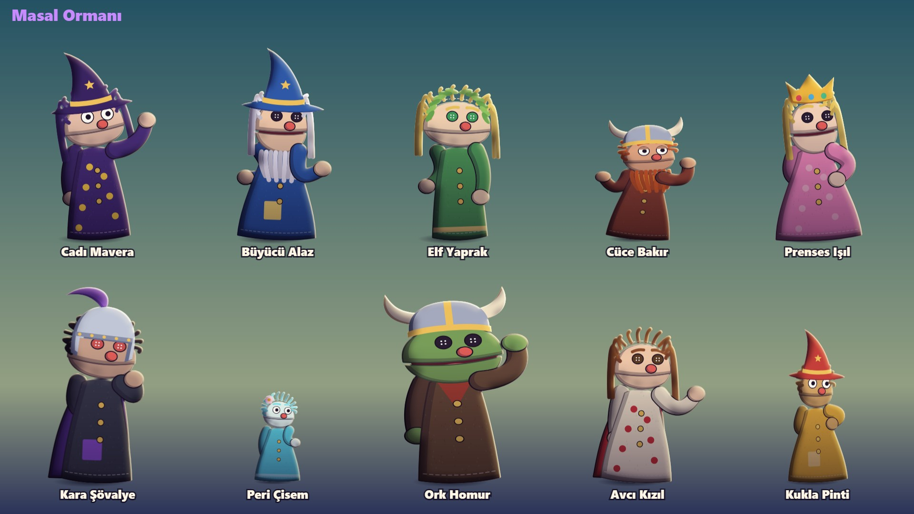

# Masal Ormanı

> Koddan üretilir: `node sistem.mjs hikaye rehber`

Masal, efsane ve ders veren kurgu hikâyeler.

- **Kod:** `masal`
- **Karakter biçimi:** Keçe kukla
- **Video fikirleri:** [8 hazır fikir](../ilham/masal.md)
- **Vurgu rengi:** `#c88aff`
- **Müzik ruhu:** sicak
- **Uygun konular:** halk masalları, bilmeceler, efsaneler, çocuk hikâyeleri, ahlaki seçimler
- **Örnek kanca fikri:** Cadı neden dileği bedava verdi? *(yalnızca biçim örneği; gerçek diye kullanılmadan önce kaynağı bulunmalı)*

## Mekânlar

| Mekân | Kod | Ne zaman kullanılır? |
|---|---|---|
| orman | `{"tema":"masal","mekan":"orman"}` | Yolculuk, karşılaşma, sınav |
| kulube | `{"tema":"masal","mekan":"kulube"}` | Anlaşma, iksir, sır |

## Karakterler

| Karakter | Kod | Görünüş | Hikâyedeki görevi | Nerede kullanılır? |
|---|---|---|---|---|
| **Cadı Mavera** | `masal-cadi` | sivri şapka, mor cüppe; cüppe | Engel / rakip, Kahraman | Anlaşma, bedel; göründüğünden iyi çıkan |
| **Büyücü Alaz** | `masal-buyucu` | mavi cüppe, ak sakal; cüppe (yaşlı) | Uzman | Kuralı koyan bilge |
| **Elf Yaprak** | `masal-elf` | defne tacı, yeşil tunik; tunik | Kahraman | Orman, iyilik, hız |
| **Cüce Bakır** | `masal-cuce` | kızıl sakal, boynuzlu miğfer; tunik (iri) | Alaycı, Kahraman | Maden, inat, zanaat |
| **Prenses Işıl** | `masal-prenses` | taç, pembe elbise; elbise | Kahraman | Kurtarılan değil, çözen kahraman |
| **Kara Şövalye** | `masal-sovalye` | siyah zırh, mor pelerin; zırh (uzun, pelerinli) | Engel / rakip | Güçlü rakip, dönüşen düşman |
| **Peri Çisem** | `masal-peri` | minik, camgöbeği elbise; elbise (minik) | Yardımcı | Minik yardımcı, ipucu veren |
| **Ork Homur** | `masal-ork` | yeşil ten, dev beden; tunik (uzun, iri) | Engel / rakip, Şaka | Korkutucu ama komik |
| **Avcı Kızıl** | `masal-avci` | kırmızı pelerin, örgü; tunik (pelerinli) | Kahraman | Takip, orman, cesaret |
| **Kukla Pinti** | `masal-soytari` | tahta ten, sarı yelek; yelek (ince) | Şaka, Tanık | Yalan, şaka, ders |

## Hazır üçlü

| Kahraman | Alaycı | Sırrı gösteren / yardımcı |
|---|---|---|
| Elf Yaprak `masal-elf` | Cüce Bakır `masal-cuce` | Büyücü Alaz `masal-buyucu` |

[← Bütün rehber](../KARAKTER_REHBERI.md)
