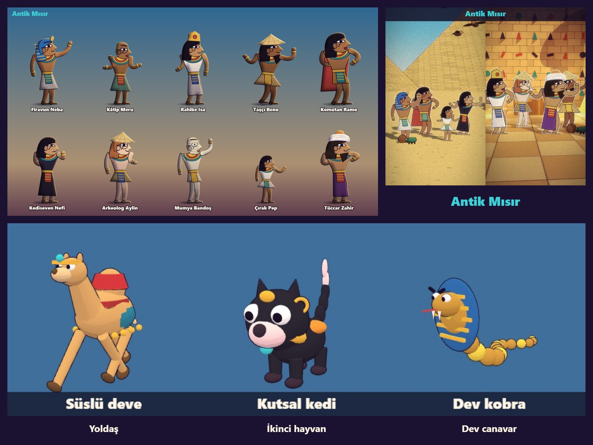
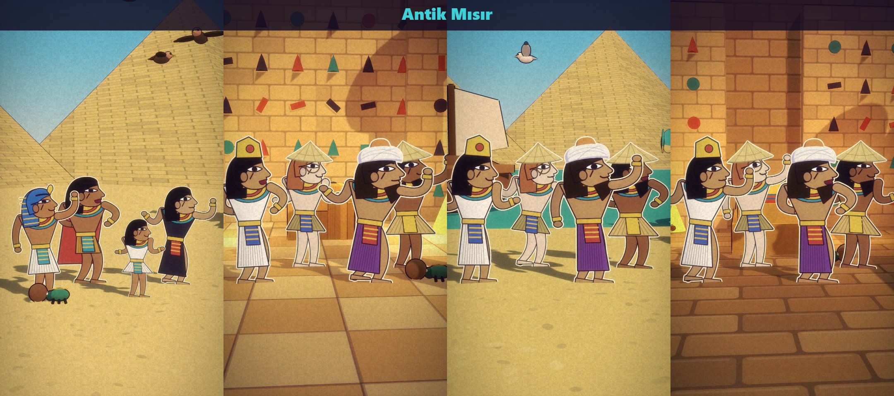
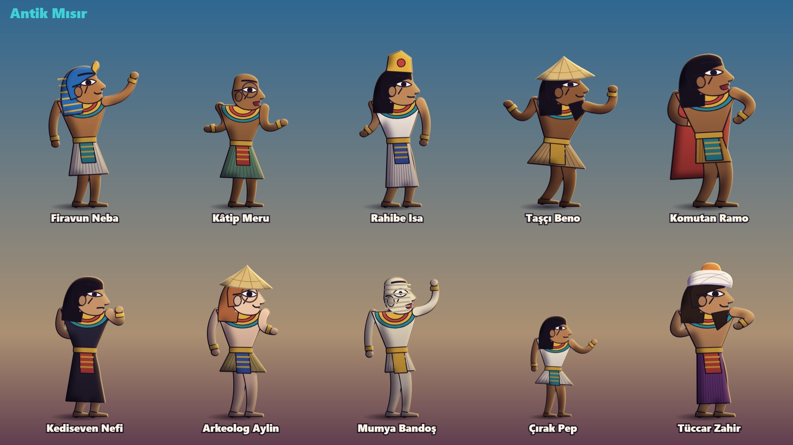

# Antik Mısır

> Koddan üretilir: `node sistem.mjs hikaye rehber`

Piramit, mezar, buluş ve inanç hikâyeleri.

- **Kod:** `misir`
- **Karakter biçimi:** Duvar resmi
- **Video fikirleri:** [8 hazır fikir](../ilham/misir.md)
- **Vurgu rengi:** `#3fd0d8`
- **Müzik ruhu:** merak
- **Uygun konular:** yapı ve mühendislik, mezar soygunculuğu ve tuzaklar, yazı ve sayı, tıp ve mumyalama, arkeoloji keşifleri
- **Örnek kanca fikri:** Tonlarca taşı kaydırmanın sırrı bir testi suda mıydı? *(yalnızca biçim örneği; gerçek diye kullanılmadan önce kaynağı bulunmalı)*

## Temada hazır gelen her şey

| | |
|---|---|
| Yoldaş hayvan | Süslü deve |
| İkinci hayvan | Kutsal kedi |
| Dev canavar | Dev kobra |
| Müzik çalgısı | flüt |
| col ortamı | çöl rüzgârı; kum zeminde adım sesi; arka planda canlılar |
| tapinak ortamı | mağara damlaları; taş zeminde adım sesi; arka planda canlılar |
| nil ortamı | su ve rüzgâr çanı; kum zeminde adım sesi; arka planda canlılar |
| mezar ortamı | mağara damlaları; taş zeminde adım sesi; arka planda canlılar |

Bunlar kendiliğinden gelir. Değiştirmek için [ayarlar](../AYARLAR.md).

## Mekânlar

| Mekân | Kod | Ne zaman kullanılır? |
|---|---|---|
| col | `{"tema":"misir","mekan":"col"}` | Piramit önü, taş taşıma, yolculuk, kazı |
| tapinak | `{"tema":"misir","mekan":"tapinak"}` | Gizli oda, tören, tuzak, karar |
| nil | `{"tema":"misir","mekan":"nil"}` | Nehir yolculuğu, timsah, hasat, ticaret |
| mezar | `{"tema":"misir","mekan":"mezar"}` | Gizli oda, lanet, hazine, mumya |

## Karakterler

| Karakter | Kod | Görünüş | Hikâyedeki görevi | Nerede kullanılır? |
|---|---|---|---|---|
| **Firavun Neba** | `misir-firavun` | mavi çizgili başlık; keten tunik | Engel / rakip, Alaycı | Emir veren hükümdar; sonunda yanılan güç |
| **Kâtip Meru** | `misir-katip` | kel kafa, yeşil keten; tunik | Uzman, Tanık | Yazı, hesap, kayıt; sayıyı söyleyen kişi |
| **Rahibe Isa** | `misir-rahibe` | altın taç, turkuaz kolye; keten tunik | Uzman, Kahraman | Tören, yıldız, inanç; sakin ve bilgili |
| **Taşçı Beno** | `misir-tasci` | hasır şapka; tunik | Kahraman | Taş, kaldıraç, kızak; emeğiyle çözen kahraman |
| **Komutan Ramo** | `misir-komutan` | tunç zırh; zırh (uzun, pelerinli) | Engel / rakip | Ordu, sefer, muhafız |
| **Kediseven Nefi** | `misir-kediseven` | siyah elbise, altın kuşak; elbise | Kahraman, Şaka | Kediler, ev yaşamı, gündelik tuhaflıklar |
| **Arkeolog Aylin** | `misir-kasifm` | haki yelek, hasır şapka; yelek | Kahraman, Uzman | Günümüz arkeoloğu; hikâyeyi bugüne bağlayan final |
| **Mumya Bandoş** | `misir-mumya` | sargılı, solgun; kazak (ince) | Şaka | Komik ya da masalsı bölüm, sır canlandırması |
| **Çırak Pep** | `misir-cocuk` | yan örgü, küçük boy; keten tunik (çocuk) | Tanık | Çırak gözü; büyüklerin kaçırdığını gören |
| **Tüccar Zahir** | `misir-tuccar` | mor kaftan, kavuk; kaftan | Alaycı, Engel / rakip | Pazarlık, takas, sahtecilik |

## Hazır üçlü

| Kahraman | Alaycı | Sırrı gösteren / yardımcı |
|---|---|---|
| Taşçı Beno `misir-tasci` | Tüccar Zahir `misir-tuccar` | Kâtip Meru `misir-katip` |

[← Bütün rehber](../KARAKTER_REHBERI.md)
