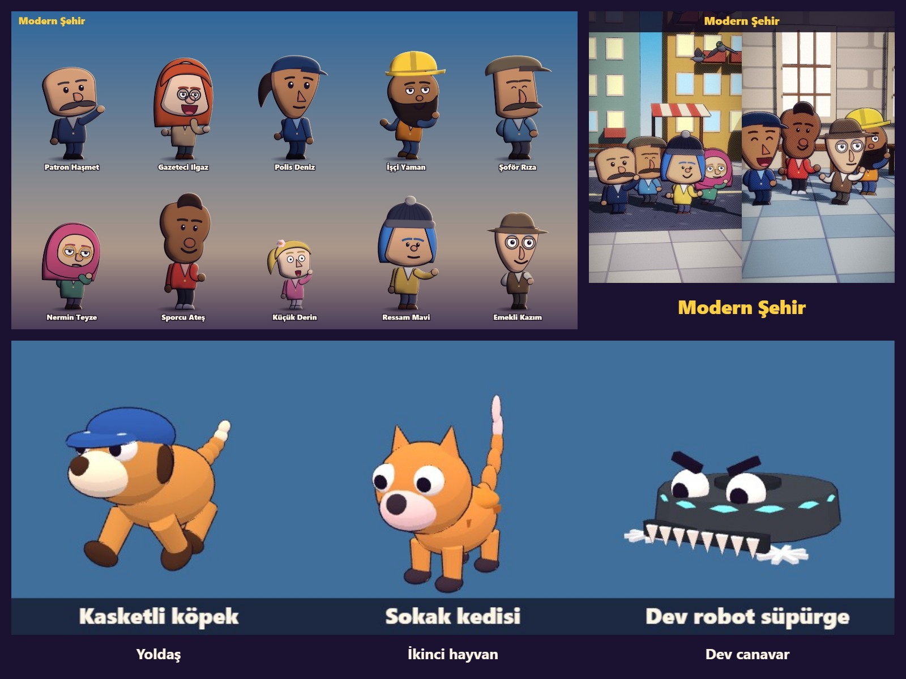
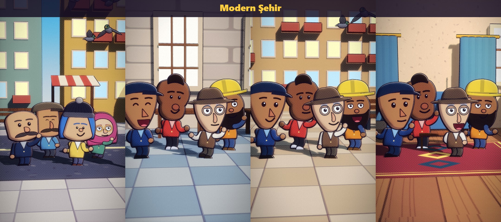
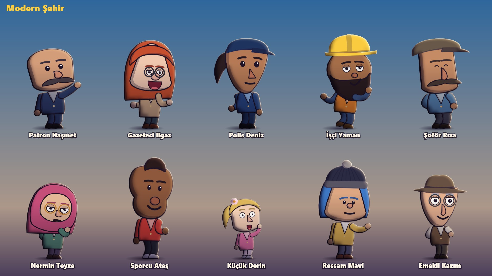

# Modern Şehir

> Koddan üretilir: `node sistem.mjs hikaye rehber`

Gündelik hayat, iş, şehir ve psikoloji hikâyeleri.

- **Kod:** `modern`
- **Karakter biçimi:** Dev kafa
- **Video fikirleri:** [8 hazır fikir](../ilham/modern.md)
- **Vurgu rengi:** `#ffcf3f`
- **Müzik ruhu:** oyun
- **Uygun konular:** psikoloji deneyleri, iş hayatı tuhaflıkları, trafik ve şehir tasarımı, dolandırıcılık, ilginç yasalar
- **Örnek kanca fikri:** Bir şehir kazaları azaltmak için neden yol çizgilerini sildi? *(yalnızca biçim örneği; gerçek diye kullanılmadan önce kaynağı bulunmalı)*

## Temada hazır gelen her şey

| | |
|---|---|
| Yoldaş hayvan | Kasketli köpek |
| İkinci hayvan | Sokak kedisi |
| Dev canavar | Dev robot süpürge |
| Müzik çalgısı | piyano |
| cadde ortamı | trafik ve güvercin; taş zeminde adım sesi; arka planda canlılar |
| ofis ortamı | ofis uğultusu; taş zeminde adım sesi; arka planda canlılar |
| okul ortamı | trafik ve güvercin; taş zeminde adım sesi; arka planda canlılar |
| ev ortamı | ofis uğultusu; ahşap zeminde adım sesi; arka planda canlılar |

Bunlar kendiliğinden gelir. Değiştirmek için [ayarlar](../AYARLAR.md).

## Mekânlar

| Mekân | Kod | Ne zaman kullanılır? |
|---|---|---|
| cadde | `{"tema":"modern","mekan":"cadde"}` | Trafik, kaza, sokak deneyi, takip |
| ofis | `{"tema":"modern","mekan":"ofis"}` | Toplantı, terfi, ceza, sır |
| okul | `{"tema":"modern","mekan":"okul"}` | Sınav, arkadaşlık, muziplik, yarışma |
| ev | `{"tema":"modern","mekan":"ev"}` | Aile, sır, gece korkusu, misafir |

## Karakterler

| Karakter | Kod | Görünüş | Hikâyedeki görevi | Nerede kullanılır? |
|---|---|---|---|---|
| **Patron Haşmet** | `modern-patron` | lacivert takım, bıyık; takım elbise | Alaycı, Engel / rakip | Kibirli yönetici |
| **Gazeteci Ilgaz** | `modern-gazeteci` | bej trençkot, kızıl saç; palto | Kahraman, Tanık | Araştıran, soran, ortaya çıkaran |
| **Polis Deniz** | `modern-polis` | lacivert üniforma; takım elbise | Kahraman, Engel / rakip | Soruşturma, trafik, yakalama |
| **İşçi Yaman** | `modern-isci` | sarı baret, turuncu yelek; mont | Kahraman | Sahada çözen, küçümsenen kahraman |
| **Şoför Rıza** | `modern-sofor` | kareli gömlek, bıyık; kareli gömlek (iri) | Şaka, Tanık | Yol, trafik, sohbet |
| **Nermin Teyze** | `modern-teyze` | çiçekli örtü, hırka; hırka (yaşlı) | Kahraman, Şaka | Kimsenin beklemediği zeki kahraman |
| **Sporcu Ateş** | `modern-sporcu` | kırmızı mont, dikik saç; mont (uzun) | Kahraman, Engel / rakip | Yarış, rekor, hile |
| **Küçük Derin** | `modern-kiz` | pembe elbise, sırma kuyruk; elbise (çocuk) | Tanık | Masum soru; doğruyu gören |
| **Ressam Mavi** | `modern-sanatci` | bere, boyalı önlük; önlük | Kahraman | Tasarım, sahtecilik, sanat |
| **Emekli Kazım** | `modern-bilge` | kahve yelek, baston duruşu; yelek (yaşlı) | Uzman | Geçmişi bilen, açıklayan |

## Hazır üçlü

| Kahraman | Alaycı | Sırrı gösteren / yardımcı |
|---|---|---|
| Gazeteci Ilgaz `modern-gazeteci` | Patron Haşmet `modern-patron` | Emekli Kazım `modern-bilge` |

[← Bütün rehber](../KARAKTER_REHBERI.md)
