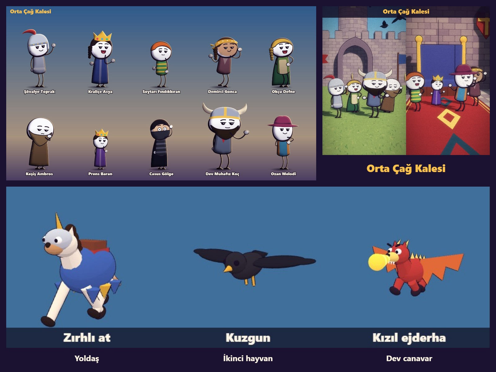
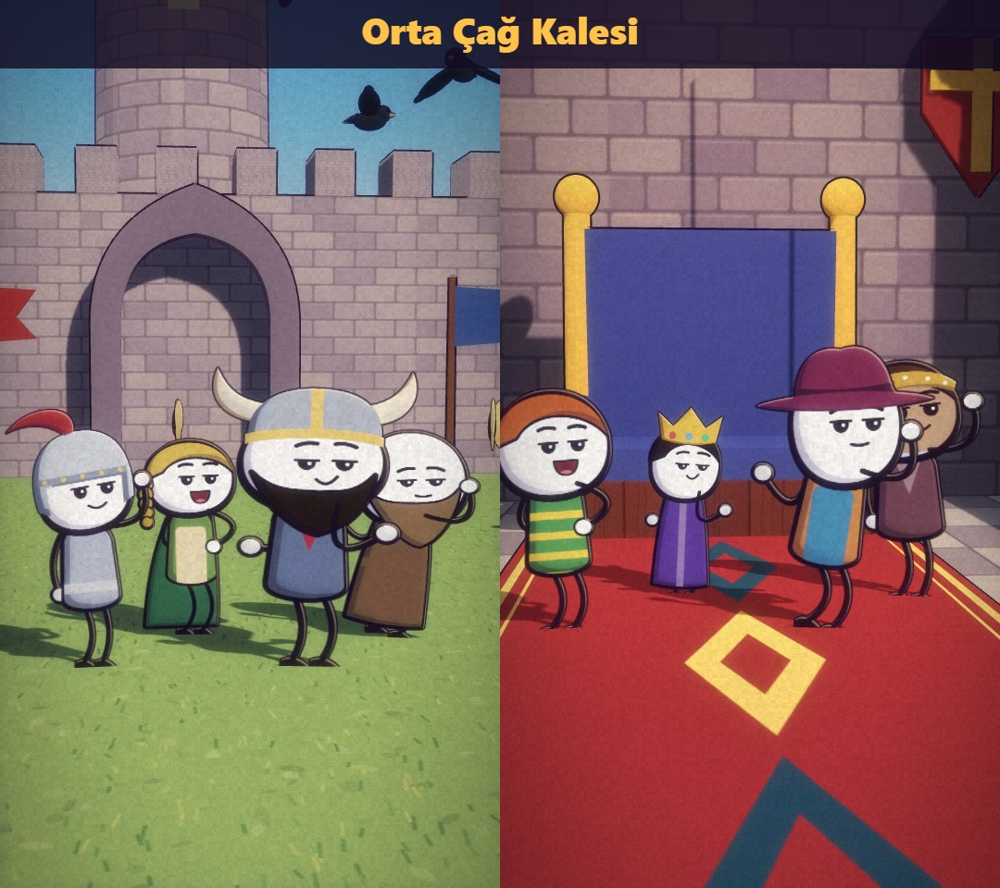
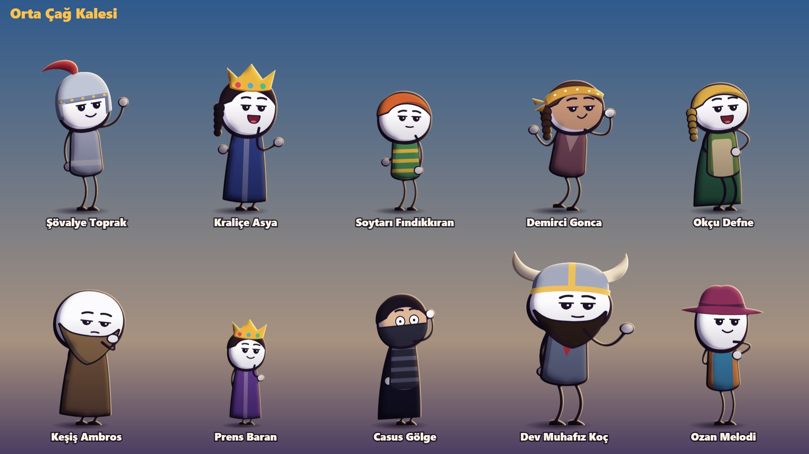

# Orta Çağ Kalesi

> Koddan üretilir: `node sistem.mjs hikaye rehber`

Kale, kuşatma, kral ve hile hikâyeleri.

- **Kod:** `ortacag`
- **Karakter biçimi:** Yumurta kafa
- **Video fikirleri:** [8 hazır fikir](../ilham/ortacag.md)
- **Vurgu rengi:** `#ffc24a`
- **Müzik ruhu:** acilis
- **Uygun konular:** kuşatma taktikleri, saray oyunları, zırh ve silah buluşları, hukuk ve ceza tuhaflıkları, salgın ve gündelik yaşam
- **Örnek kanca fikri:** Küçük bir kale koca orduyu tek bir koyunla nasıl geri gönderdi? *(yalnızca biçim örneği; gerçek diye kullanılmadan önce kaynağı bulunmalı)*

## Temada hazır gelen her şey

| | |
|---|---|
| Yoldaş hayvan | Zırhlı at |
| İkinci hayvan | Kuzgun |
| Dev canavar | Kızıl ejderha |
| Müzik çalgısı | telli çalgı |
| kale ortamı | rüzgâr ve karga; çimen zeminde adım sesi; arka planda canlılar |
| salon ortamı | taş salon yankısı; taş zeminde adım sesi; arka planda canlılar |

Bunlar kendiliğinden gelir. Değiştirmek için [ayarlar](../AYARLAR.md).

## Mekânlar

| Mekân | Kod | Ne zaman kullanılır? |
|---|---|---|
| kale | `{"tema":"ortacag","mekan":"kale"}` | Kuşatma, ordu, kale önü, pazarlık |
| salon | `{"tema":"ortacag","mekan":"salon"}` | Taht, yargılama, ziyafet, gizli plan |

## Karakterler

| Karakter | Kod | Görünüş | Hikâyedeki görevi | Nerede kullanılır? |
|---|---|---|---|---|
| **Şövalye Toprak** | `ortacag-sovalye` | gümüş zırh, kızıl sorguç; zırh | Kahraman, Engel / rakip | Düello, görev, onur; ya kahraman ya yenilen rakip |
| **Kraliçe Asya** | `ortacag-kralice` | altın taç, lacivert elbise; elbise | Kahraman, Engel / rakip | Kararı veren hükümdar; sabırlı ve zeki lider |
| **Soytarı Fındıkkıran** | `ortacag-soytari` | yeşil tunik, muzip yüz; tunik | Alaycı, Şaka, Kahraman | Alay eden; bazen gerçeği tek gören kişi |
| **Demirci Gonca** | `ortacag-demirci` | deri önlük, bandana; önlük | Uzman, Kahraman | Zırh, kilit, silah, mekanizma açıklamaları |
| **Okçu Defne** | `ortacag-okcu` | yeşil pelerin, sarı örgü; tunik (pelerinli) | Kahraman | Uzak atış, orman, gizli pusu |
| **Keşiş Ambros** | `ortacag-kesis` | kahve cüppe, kel; cüppe (yaşlı, iri) | Uzman, Tanık | El yazması, bilgi, manastır; sırrı bilen kişi |
| **Prens Baran** | `ortacag-prens` | küçük taç, mor kaftan; kaftan (çocuk) | Tanık, Şaka | Çocuk gözünden saray; masum soru |
| **Casus Gölge** | `ortacag-casus` | siyah pelerin, maske; tunik (ince, pelerinli) | Kahraman, Engel / rakip | Sızma, gece, gizli mektup |
| **Dev Muhafız Koç** | `ortacag-dev` | dev beden, miğfer; zırh (uzun, iri) | Engel / rakip, Alaycı | Aşılması gereken muhafız; küçümseyen güçlü |
| **Ozan Melodi** | `ortacag-ozan` | tüylü şapka, turuncu tunik; tunik | Tanık, Yardımcı | Haberi yayan; kalabalık ve şenlik sahneleri |

## Hazır üçlü

| Kahraman | Alaycı | Sırrı gösteren / yardımcı |
|---|---|---|
| Şövalye Toprak `ortacag-sovalye` | Soytarı Fındıkkıran `ortacag-soytari` | Demirci Gonca `ortacag-demirci` |

[← Bütün rehber](../KARAKTER_REHBERI.md)
