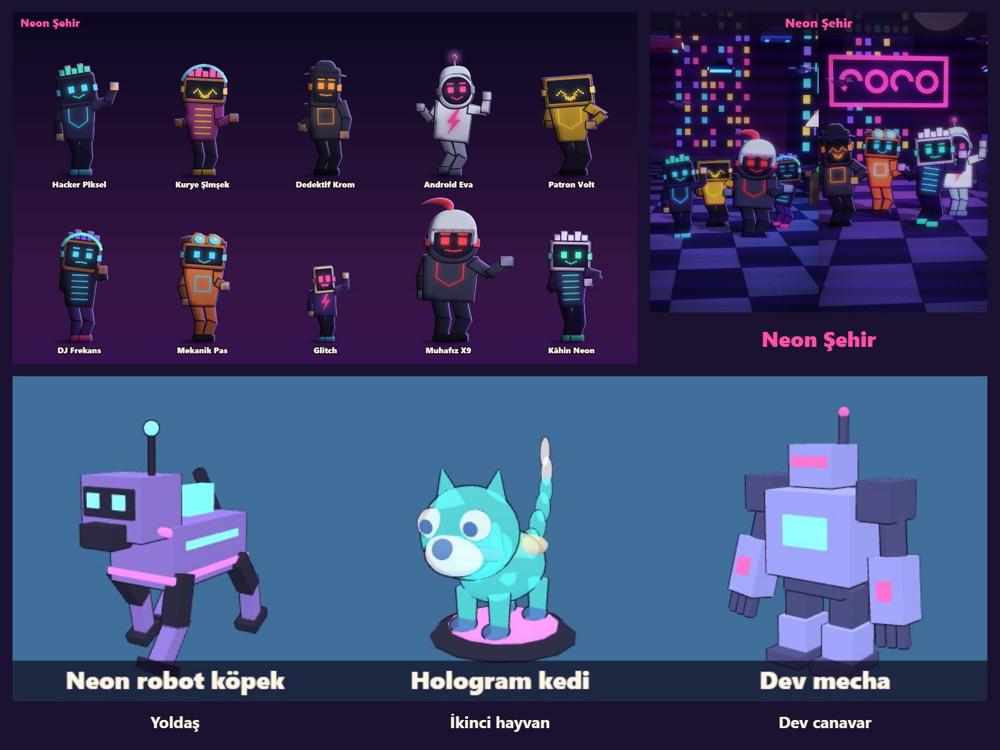
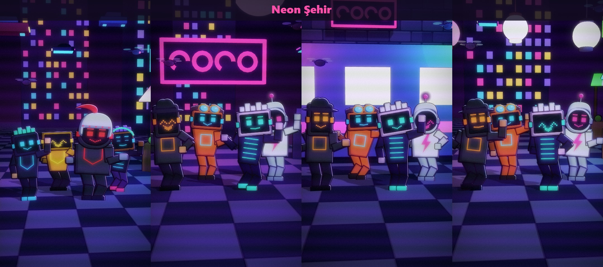
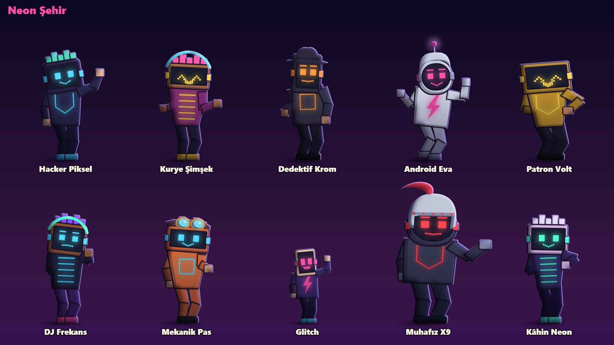

# Neon Şehir

> Koddan üretilir: `node sistem.mjs hikaye rehber`

Teknoloji, güvenlik ve yakın gelecek hikâyeleri.

- **Kod:** `siber`
- **Karakter biçimi:** Küp robot
- **Video fikirleri:** [8 hazır fikir](../ilham/siber.md)
- **Vurgu rengi:** `#ff4fa8`
- **Müzik ruhu:** gerilim
- **Uygun konular:** bilgisayar güvenliği tarihi, dolandırıcılık ve tuzaklar, yapay zekâ varsayımları, gizlilik, gelecek kurgusu
- **Örnek kanca fikri:** Dünyanın en güvenli kapısını bir balon nasıl açtı? *(yalnızca biçim örneği; gerçek diye kullanılmadan önce kaynağı bulunmalı)*

## Temada hazır gelen her şey

| | |
|---|---|
| Yoldaş hayvan | Neon robot köpek |
| İkinci hayvan | Hologram kedi |
| Dev canavar | Dev mecha |
| Müzik çalgısı | sentezleyici |
| cadde ortamı | neon uğultusu ve yağmur; metal zeminde adım sesi; arka planda canlılar |
| cati ortamı | neon uğultusu ve yağmur; metal zeminde adım sesi; arka planda canlılar |
| metro ortamı | makine uğultusu; metal zeminde adım sesi; arka planda canlılar |
| gecepazari ortamı | neon uğultusu ve yağmur; metal zeminde adım sesi; arka planda canlılar |

Bunlar kendiliğinden gelir. Değiştirmek için [ayarlar](../AYARLAR.md).

## Mekânlar

| Mekân | Kod | Ne zaman kullanılır? |
|---|---|---|
| cadde | `{"tema":"siber","mekan":"cadde"}` | Takip, teslimat, kalabalık, neon gece |
| cati | `{"tema":"siber","mekan":"cati"}` | Gizli buluşma, plan, final |
| metro | `{"tema":"siber","mekan":"metro"}` | Takip, buluşma, kaçış, gizli teslimat |
| gecepazari | `{"tema":"siber","mekan":"gecepazari"}` | Kalabalık, kaçak satış, pazarlık |

## Karakterler

| Karakter | Kod | Görünüş | Hikâyedeki görevi | Nerede kullanılır? |
|---|---|---|---|---|
| **Hacker Piksel** | `siber-hacker` | neon vizör; neon ceket | Kahraman | Açığı bulan; zekâsıyla çözen |
| **Kurye Şimşek** | `siber-kurye` | pembe ceket, mikrofon; neon ceket | Kahraman, Tanık | Takip, zaman yarışı |
| **Dedektif Krom** | `siber-dedektif` | fötr şapka, parlak çizgiler; neon ceket | Kahraman | İz, kanıt, sorgu |
| **Android Eva** | `siber-android` | gümüş ten, anten; neon ceket | Engel / rakip, Uzman | Yapay zekâ, "insan mı?" soruları |
| **Patron Volt** | `siber-patron` | altın takım, kel; takım elbise (iri) | Alaycı, Engel / rakip | Kibirli şirket sahibi; sonunda kaybeden |
| **DJ Frekans** | `siber-dj` | mor afro, dev kulaklık; kapüşonlu | Yardımcı, Şaka | Kalabalık, ses, dikkat dağıtma |
| **Mekanik Pas** | `siber-mekanik` | turuncu tulum, pilot gözlüğü; tulum | Uzman | Cihazın içi; sırrı gösteren |
| **Glitch** | `siber-cocuk` | küçük boy, camgöbeği saç; neon ceket (çocuk) | Kahraman, Şaka | Herkesten hızlı çocuk; ters köşe |
| **Muhafız X9** | `siber-muhafiz` | dev zırh, kırmızı vizör; zırh (uzun, iri) | Engel / rakip | Geçilmez güvenlik |
| **Kâhin Neon** | `siber-kahin` | parlayan cüppe; cüppe (yaşlı, pelerinli) | Tanık | Gelecek tahmini, gizemli açılış |

## Hazır üçlü

| Kahraman | Alaycı | Sırrı gösteren / yardımcı |
|---|---|---|
| Hacker Piksel `siber-hacker` | Patron Volt `siber-patron` | Mekanik Pas `siber-mekanik` |

[← Bütün rehber](../KARAKTER_REHBERI.md)
