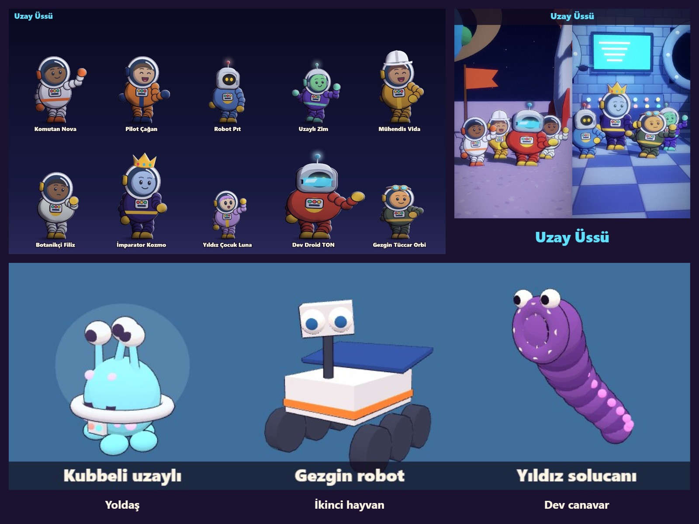
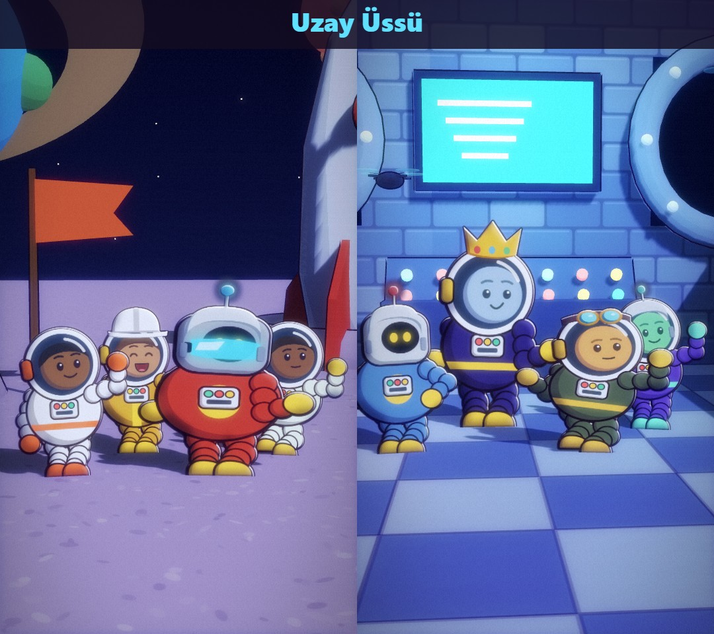
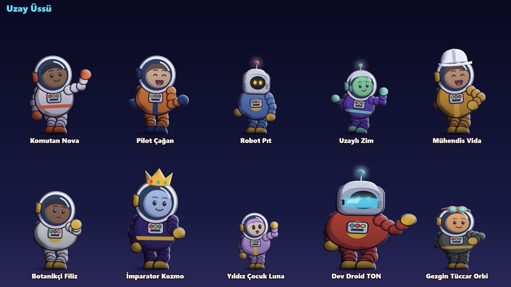

# Uzay Üssü

> Koddan üretilir: `node sistem.mjs hikaye rehber`

Uzay yolculuğu, bilim ve hayatta kalma hikâyeleri.

- **Kod:** `uzay`
- **Karakter biçimi:** Balon
- **Video fikirleri:** [8 hazır fikir](../ilham/uzay.md)
- **Vurgu rengi:** `#5fe0ff`
- **Müzik ruhu:** merak
- **Uygun konular:** uzay kazaları ve çözümleri, gezegenler, robot ve yapay zekâ, uzaylı varsayımları, fizik kuralları
- **Örnek kanca fikri:** Astronotlar neden son oksijeni bilerek boşa harcadı? *(yalnızca biçim örneği; gerçek diye kullanılmadan önce kaynağı bulunmalı)*

## Temada hazır gelen her şey

| | |
|---|---|
| Yoldaş hayvan | Kubbeli uzaylı |
| İkinci hayvan | Gezgin robot |
| Dev canavar | Yıldız solucanı |
| Müzik çalgısı | sentezleyici |
| gezegen ortamı | uzay uğultusu; kum zeminde adım sesi; arka planda canlılar |
| gemi ortamı | makine uğultusu; metal zeminde adım sesi; arka planda canlılar |

Bunlar kendiliğinden gelir. Değiştirmek için [ayarlar](../AYARLAR.md).

## Mekânlar

| Mekân | Kod | Ne zaman kullanılır? |
|---|---|---|
| gezegen | `{"tema":"uzay","mekan":"gezegen"}` | İniş, keşif, kaza, bekleyiş |
| gemi | `{"tema":"uzay","mekan":"gemi"}` | Kokpit, alarm, karar, tartışma |

## Karakterler

| Karakter | Kod | Görünüş | Hikâyedeki görevi | Nerede kullanılır? |
|---|---|---|---|---|
| **Komutan Nova** | `uzay-komutan` | beyaz uzay giysisi; uzay giysisi | Kahraman | Görev lideri; sakin karar veren |
| **Pilot Çağan** | `uzay-pilot` | turuncu giysi; uzay giysisi | Kahraman, Şaka | Aceleci, hata yapan; sonuçlarını yaşayan |
| **Robot Pıt** | `uzay-robot` | antenli kafa, mavi gövde; uzay giysisi | Şaka, Yardımcı | Kuralı harfiyen uygulayan komik yardımcı |
| **Uzaylı Zim** | `uzay-uzayli` | yeşil ten, mor cüppe; cüppe | Engel / rakip, Şaka | Dışarıdan bakan göz; varsayım ve kurgu bölümleri |
| **Mühendis Vida** | `uzay-muhendis` | sarı tulum, baret; tulum | Uzman, Kahraman | Tamir, parça, çözüm; sırrı gösteren |
| **Botanikçi Filiz** | `uzay-bitkici` | yeşil önlük, kıvırcık; beyaz önlük | Uzman | Bitki, oksijen, yiyecek, biyoloji |
| **İmparator Kozmo** | `uzay-imparator` | altın taç, mor pelerin; kaftan (uzun, pelerinli) | Engel / rakip, Alaycı | Kurgu bölümlerde kibirli rakip |
| **Yıldız Çocuk Luna** | `uzay-cocuk` | mini uzay giysisi; uzay giysisi (çocuk) | Tanık | Çocuklara yönelik anlatım; masum soru |
| **Dev Droid TON** | `uzay-droid` | dev kırmızı robot; zırh (uzun, iri) | Engel / rakip | Kapıyı tutan, engelleyen makine |
| **Gezgin Tüccar Orbi** | `uzay-tuccar` | turuncu ten, kapüşon; cüppe (iri, pelerinli) | Alaycı, Engel / rakip | Takas, hile, şüpheli teklif |

## Hazır üçlü

| Kahraman | Alaycı | Sırrı gösteren / yardımcı |
|---|---|---|
| Komutan Nova `uzay-komutan` | Gezgin Tüccar Orbi `uzay-tuccar` | Mühendis Vida `uzay-muhendis` |

[← Bütün rehber](../KARAKTER_REHBERI.md)
